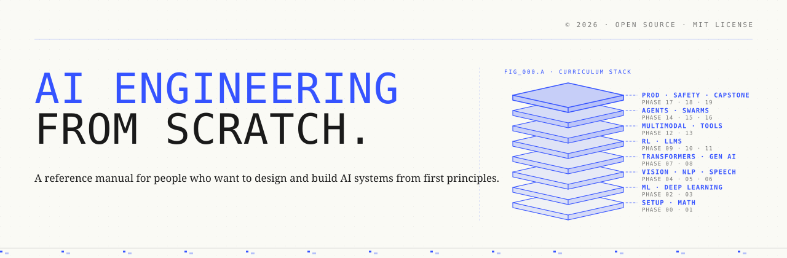
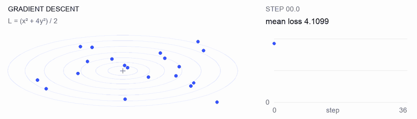
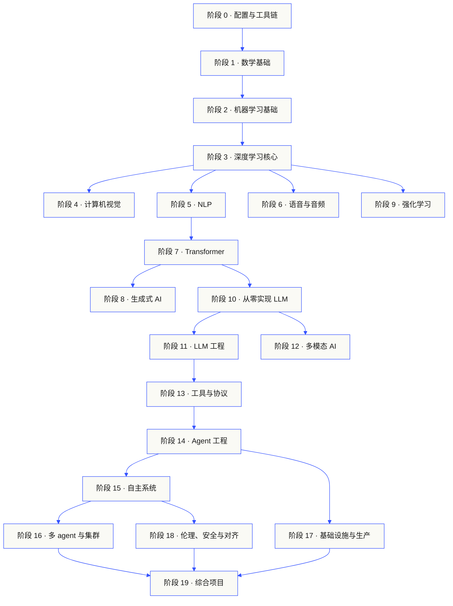
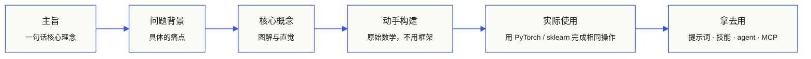

<p align="center">
  <picture>
    <source media="(prefers-color-scheme: dark)" srcset="assets/readme/header-dark.svg">
    
  </picture>
</p>

<p align="center">
 <a href="https://www.star-history.com/fancyboi999/ai-engineering-from-scratch-zh">
  <picture><source media="(prefers-color-scheme: dark)" srcset="https://api.star-history.com/badge?repo=fancyboi999/ai-engineering-from-scratch-zh&type=rank&theme=dark" /><source media="(prefers-color-scheme: light)" srcset="https://api.star-history.com/badge?repo=fancyboi999/ai-engineering-from-scratch-zh&type=rank" /></picture> <picture><source media="(prefers-color-scheme: dark)" srcset="https://api.star-history.com/badge?repo=fancyboi999/ai-engineering-from-scratch-zh&type=trending&theme=dark" /><source media="(prefers-color-scheme: light)" srcset="https://api.star-history.com/badge?repo=fancyboi999/ai-engineering-from-scratch-zh&type=trending" /></picture>
 </a>
</p>

实现模型内部机制、检索流水线和 agent 运行时。测试它们，分析失败，并保留代码与评估结果。

**[开始学习](https://aieng-zh.cn/lessons/00-setup-and-tooling/01-dev-environment/)** · **[选择路径](#learning-routes)** · **[试试实验](#interactive-lab)** · **[动手做项目](#project-challenges)** · **[浏览课程目录](#contents)**

免费、开源，采用 MIT 许可。你可以在网站上学习，使用 coding agent，或在本地运行代码。

> 542 节课，20 个阶段。Python、TypeScript、Rust、Julia。

<p align="center">
  <a href="LICENSE"></a>
  <a href="ROADMAP.md"></a>
  <a href="#contents"></a>
  <a href="https://github.com/fancyboi999/ai-engineering-from-scratch-zh/stargazers"></a>
  <a href="https://aieng-zh.cn"></a>
</p>

> 本项目是 [Rohit Ghumare](https://github.com/rohitg00) 及社区创建的 [AI Engineering from Scratch](https://github.com/rohitg00/ai-engineering-from-scratch) 的**简体中文衍生版**，由 [fancy](https://github.com/fancyboi999) 维护。课程内容与结构跟随上游，中文翻译遵循 [TRANSLATION.md](TRANSLATION.md)。

### 中文动画讲解视频

中文版额外提供 **333 节中文配音动画**，覆盖阶段 0–14 的部分课程。可在对应课程页内播放，提供视频直链与 B 站播放源，配合正文、推导和代码实践学习。

### 特别鸣谢

<p align="center">
  <a href="https://www.ipwo.net/?ref=githubgoofishcli">
    
  </a>
</p>

<p align="center">
  <a href="https://www.ipwo.net/?ref=githubgoofishcli"><ins>IPWO</ins></a> 拥有 9000 万+ 活跃住宅 IP 资源，覆盖 195+ 个国家和地区。<br>
  提供动态住宅代理、静态住宅代理及不限量住宅代理。<br>
  适用于网页抓取、数据采集、浏览器自动化、跨境业务等场景。<br>
  我们订阅使用 Claude / Claude Code 时采用住宅 IP，长期使用稳定。<br>
  支持<a href="https://www.ipwo.net/?ref=githubgoofishcli"><ins>免费测试</ins></a>，<strong>9 折优惠码：</strong><code>0203</code>
</p>

<a id="see-what-you-will-build-and-keep"></a>
<a id="learning-routes"></a>

## 学习路径

| 路径 | 起始课程 |
|---|---|
| 模型基础 | [配置与工具链](https://aieng-zh.cn/lessons/00-setup-and-tooling/01-dev-environment/) |
| LLM 系统 | [提示词工程](https://aieng-zh.cn/lessons/11-llm-engineering/01-prompt-engineering/) |
| Agent 与交付 | [Agent 循环](https://aieng-zh.cn/lessons/14-agent-engineering/01-the-agent-loop/) |

[比较职业路径](https://aieng-zh.cn/learning-paths.html) · [前置要求与学习时间](#study-guide)

<a id="interactive-lab"></a>

### 梯度下降

二十个起点沿着二次损失函数的梯度下降。图中展示每次更新后各点的位置及平均损失。

<p align="center">
  <a href="https://aieng-zh.cn/lessons/01-math-foundations/08-optimization/">
    <picture>
      <source media="(max-width: 600px) and (prefers-color-scheme: dark) and (prefers-reduced-motion: reduce)" srcset="assets/readme/101-gradient-mobile-dark.png">
      <source media="(max-width: 600px) and (prefers-reduced-motion: reduce)" srcset="assets/readme/101-gradient-mobile-light.png">
      <source media="(prefers-color-scheme: dark) and (prefers-reduced-motion: reduce)" srcset="assets/readme/101-gradient-dark.png">
      <source media="(prefers-reduced-motion: reduce)" srcset="assets/readme/101-gradient-light.png">
      <source media="(max-width: 600px) and (prefers-color-scheme: dark)" srcset="assets/readme/101-gradient-mobile-dark.gif">
      <source media="(max-width: 600px)" srcset="assets/readme/101-gradient-mobile-light.gif">
      <source media="(prefers-color-scheme: dark)" srcset="assets/readme/101-gradient-dark.gif">
      
    </picture>
  </a>
</p>

[在课程中调整学习率](https://aieng-zh.cn/lessons/01-math-foundations/08-optimization/) · [用代码比较 GD、momentum 和 Adam](phases/01-math-foundations/08-optimization/code/optimizers.py)

<a id="project-challenges"></a>

### 项目

三个项目均提供分阶段 starter、参考实现和本地评分器。[完成环境配置](#local-setup)后，在仓库根目录运行命令。实现对应阶段前，starter 会测试失败。

<details>
<summary><strong>01 · 检索评估实验室</strong> · Python · 排序指标与回归检查</summary>

候选版提高了平均 NDCG，但某个查询最相关证据的排名反而降低。构建逐查询比较，报告回归，并让它能够阻止发布检查通过。

使用 Python 3.10+。先复习 [RAG](phases/11-llm-engineering/06-rag/docs/zh.md)与[模型评估](phases/02-ml-fundamentals/09-model-evaluation/docs/zh.md)。依次实现排序验证、precision 与 recall、排名敏感指标和系统比较。

```bash
python3 scripts/project_test.py retrieval-evaluation-lab \
  --init learning-artifacts/retrieval-evaluation-lab
python3 scripts/project_test.py retrieval-evaluation-lab \
  --stage 1 --path learning-artifacts/retrieval-evaluation-lab --strict
python3 scripts/project_test.py retrieval-evaluation-lab \
  --all --path learning-artifacts/retrieval-evaluation-lab --strict
```

**保留产物：** 可复现的比较，包含逐查询差值与用于评分的相关性判断。指标描述的是这些判断，并不能证明回答正确。

[开始项目](https://aieng-zh.cn/project/retrieval-evaluation-lab/) · [查看参考实现](projects/retrieval-evaluation-lab/solution/) · [使用自己的输入](projects/retrieval-evaluation-lab/README.md#使用自己的输入运行)

</details>

<details>
<summary><strong>02 · Agent 轨迹调试器</strong> · TypeScript · 轨迹解析与计时</summary>

所给轨迹的总耗时仍为 100 ms，但 token 总用量增加了 200，且有一个 span 开始失败。分离重叠子任务与父任务执行时间，再生成可检查的报告，揭示变化。

评分器需要 Node.js 22.18+ 和 Python 3。依次实现 JSONL 解析、父级验证、区间运算和可检查的时间线。

```bash
python3 scripts/project_test.py agent-trace-debugger \
  --init learning-artifacts/agent-trace-debugger
python3 scripts/project_test.py agent-trace-debugger \
  --stage 1 --path learning-artifacts/agent-trace-debugger --strict
python3 scripts/project_test.py agent-trace-debugger \
  --all --path learning-artifacts/agent-trace-debugger --strict
```

**保留产物：** 输入轨迹、HTML 时间线与 JSON 回归报告。保留每个 span 独占的 token 数，避免把父级与子级用量重复计数。

[开始项目](https://aieng-zh.cn/project/agent-trace-debugger/) · [查看参考实现](projects/agent-trace-debugger/solution/) · [交互式探索计时](https://aieng-zh.cn/project/agent-trace-debugger/03-timing/)

</details>

<details>
<summary><strong>03 · 工具调用防火墙</strong> · Rust · 角色检查与批准回执</summary>

写入内容在审查后改变，或批准被重放。验证调用信封，检查调用方角色与路径，再消耗一次与精确请求和内容绑定的批准。

使用 Rust 与 Python 3.10+。先复习[工具 schema 设计](phases/13-tools-and-protocols/05-tool-schema-design/docs/zh.md)和[安全边界](phases/17-infrastructure-and-production/25-security-secrets-audit/docs/zh.md)。调用应用提供身份，模型只是提出操作。

```bash
python3 scripts/project_test.py tool-call-firewall \
  --init learning-artifacts/tool-call-firewall
python3 scripts/project_test.py tool-call-firewall \
  --stage 1 --path learning-artifacts/tool-call-firewall --strict
python3 scripts/project_test.py tool-call-firewall \
  --all --path learning-artifacts/tool-call-firewall --strict
```

**保留产物：** 展示请求操作和策略决策的审计回执。批准只在一次调用中单次使用；本项目不提供持久授权，也不是操作系统沙箱。

[开始项目](https://aieng-zh.cn/project/tool-call-firewall/) · [查看参考实现](projects/tool-call-firewall/solution/) · [探索批准边界](https://aieng-zh.cn/project/tool-call-firewall/03-consume-a-request-bound-approval-once/)

</details>

[浏览全部项目](https://aieng-zh.cn/projects.html) · [职业实践指南](learning-paths/CAREER-PRACTICE.md)

## 选择学习方式

### 在网站上学习

在 [aieng-zh.cn](https://aieng-zh.cn) 打开任意已完成的课程，或在下方[课程目录](#contents)中展开一个阶段。无需配置环境，也无需克隆仓库。

### 使用 AI 导师

如果已经安装 Node.js、`npx` 和支持 skill 的 coding agent，你的 coding agent 就可以成为导师。安装和阅读导师技能不需要克隆仓库。专项路径中可运行的实验需要 `python3`；Agent Skills 的宿主实验还需要选定宿主，以及可写入的用户或项目技能目录。

```bash
npx skills add fancyboi999/ai-engineering-from-scratch-zh
```

安装器询问时，选择宿主和安装范围。在 Codex 中使用 `start-learning`，在 Claude Code 中使用 `/start-learning`，或让其他宿主按名称使用该技能。

<details>
<summary>导师配置与宿主命令</summary>

先检查本地要求：

```bash
node --version
npx --version
python3 --version
```

`skills` 会写入安装时选定的宿主和范围，例如 `.claude/skills/`、`.cursor/skills/`、`.codex/skills/` 或其他受支持的技能目录。检查所选宿主能否发现这个确切位置。

调用语法由宿主决定，不属于可移植的 `SKILL.md` 格式：

| 宿主 | 开始全课程 | 开始模型上下文协议（MCP） | 开始 Agent Skills | 运行阶段测验 |
|---|---|---|---|---|
| Codex | `start-learning`，或从 `/skills` 选择 | `learn-mcp`，或从 `/skills` 选择 | `learn-agent-skills`，或从 `/skills` 选择 | `check-understanding 13`，或从 `/skills` 选择 |
| Claude Code | `/start-learning` | `/learn-mcp` | `/learn-agent-skills` | `/check-understanding 13` |
| 其他兼容宿主 | `使用 start-learning 开始课程。` | `使用 learn-mcp 开始模型上下文协议（MCP）路径。` | `使用 learn-agent-skills 开始 Agent Skills 工程路径。` | `使用 check-understanding 测验阶段 13。` |

十道题的定级测验会将你已有的知识映射到起始阶段，并把个性化学习计划保存到 `LEARNING.md`。随后，`learn` 技能每次会话教一节课：概念、数学、代码、测验。它直接从本仓库读取课程；`course-guide` 技能可以将你卡住的问题定位到具体课程。在 Codex 中使用 `learn` 和 `course-guide`，在 Claude Code 中使用 `/learn` 和 `/course-guide`，在其他兼容宿主中按名称调用即可。

只想学模型上下文协议（MCP）？使用宿主对应的 MCP 调用方式。它会生成 `MCP-LEARNING.md`，沿 17 节课的路线学习无状态请求、传输、双向交互、安全、可靠性、注册表治理和一致性证据。确切顺序和检查点见 [MCP 路径清单](learning-paths/model-context-protocol.json)。

只想学 Agent Skills？使用宿主对应的调用方式。它会生成 `AGENT-SKILLS-LEARNING.md`，按五节课学习契约、发现、调用、沙箱边界、发布评估与真实宿主的可移植性。网站入口见 [Agent Skills 路径](https://aieng-zh.cn/lessons/13-tools-and-protocols/22-skills-and-agent-sdks/?learningPath=agent-skills)。

安装器会列出可配置的宿主并询问安装位置。如果暂时没有 Node.js、`npx`、`python3`、受支持的宿主或可写入范围，可以先使用网站，或直接阅读 `docs/zh.md`。这样可以学习概念；真实宿主的发现、调用、脚本和卸载验证，需要等环境预检通过后再完成。课程可在 [aieng-zh.cn](https://aieng-zh.cn) 阅读。

### 学习技能

| 技能 | 作用 |
|---|---|
| [`start-learning`](skills/start-learning/SKILL.md) | 首次引导：明确学习目标、完成定级测验，并将个性化计划保存到 `LEARNING.md`。 |
| [`learn`](skills/learn/SKILL.md) | 导师循环：先回忆复习，再交互讲授下一课并完成测验；记录进度和复习队列。 |
| [`course-guide`](skills/course-guide/SKILL.md) | 主题路由：把“去哪里学 attention？”或“我的 loss 是 NaN”等问题定位到具体课程，并给出链接。 |
| [`learn-mcp`](skills/learn-mcp/SKILL.md) | MCP 专项导师。创建 `MCP-LEARNING.md`，遵循 17 课清单，记录协议线路、安全、可靠性与一致性证据。 |
| [`learn-agent-skills`](skills/learn-agent-skills/SKILL.md) | Agent Skills 专项导师。创建 `AGENT-SKILLS-LEARNING.md`，讲授第 22、24、25、26、27 课，并记录真实宿主证据。 |
| [`learn-reverse-engineering`](skills/learn-reverse-engineering/SKILL.md) | 逆向工程专项导师。创建 `REVERSE-ENGINEERING-LEARNING.md`，使用自己构建的程序学习阶段 13 第 32–45 课，并记录实验证据。 |
| [`claude-certification`](skills/claude-certification/SKILL.md) | Claude 认证导师。选择 CCAO-F、CCDV-F、CCAR-F 或 CCAR-P，逐课教学、运行实验、评审产物、组织诊断与模拟测验，并保存进度。 |
| [`mcpa-certification`](skills/mcpa-certification/SKILL.md) | MCPA 导师。按 2026-07-28 版协议学习 `mcpa-f` 的 34 课路线，运行实验与 wire checker，组织诊断和三套模拟测验，并保存进度。 |
| [`find-your-level`](skills/find-your-level/SKILL.md) | 十道题的定级测验。将已有知识映射到起始阶段，并生成带课时估算的个性化路径。 |
| [`check-understanding <phase>`](skills/check-understanding/SKILL.md) | 按阶段测验，八道题，附反馈和需要复习的具体课程。调用方式见上方宿主命令表。 |

</details>

<a id="local-setup"></a>

### 在本地运行代码

```bash
git clone https://github.com/fancyboi999/ai-engineering-from-scratch-zh.git
cd ai-engineering-from-scratch-zh
python3 phases/00-setup-and-tooling/01-dev-environment/code/verify.py --route beginner
python3 phases/01-math-foundations/01-linear-algebra-intuition/code/vectors.py
```

环境预检会区分当前必需项与后续才需要的工具。每项必需检查失败时，都会给出检测到的原因和修正命令。`vectors.py` 不需要第三方依赖，最后会展示矩阵与向量相乘如何成为神经网络层内部的运算。把这段终端输出保存为你的第一份证据。

<details>
<summary>用同样的方法学习每一课</summary>

### 每节课的学习方法

1. **阅读** `docs/zh.md`，用自己的话解释核心概念。
2. **输入并构建**关键代码，亲手实现它。
3. **运行**课程命令。工作目录是包含 `README.md` 和 `phases/` 的仓库根目录。
4. **保留证据**：命令、工作目录、退出码、有意义的输出，以及你修改或生成的产物。
5. **继续下一步**之前，先解释清楚输出，并能在不靠猜测的情况下作出一个小修改。

除非课程明确要求切换目录，否则页面中的命令路径均相对于仓库根目录。课程提供多种语言时，运行你正在学习的语言实现。

</details>

<a id="study-guide"></a>

## 选择学习路径

开始前不需要先扫完 542 节课。选一个目标即可。每个链接都对应 GitHub 或网站上的同一套课程，两处使用相同的课程代码。

| 你的目标 | 在 GitHub 上学习 | 在网站上学习 |
|---|---|---|
| 我是新手，想要完整地打牢基础 | [阶段 0 · 配置与工具链](phases/00-setup-and-tooling/) | [开发环境](https://aieng-zh.cn/lessons/00-setup-and-tooling/01-dev-environment/) |
| 我懂 Python，想学数学与机器学习基础 | [阶段 1 · 数学基础](phases/01-math-foundations/) | [线性代数直觉](https://aieng-zh.cn/lessons/01-math-foundations/01-linear-algebra-intuition/) |
| 我想构建生产级 LLM 应用 | [阶段 11 · LLM 工程](phases/11-llm-engineering/) | [提示词工程](https://aieng-zh.cn/lessons/11-llm-engineering/01-prompt-engineering/) |
| 我想构建自主 agent | [阶段 14 · Agent 工程](phases/14-agent-engineering/) | [Agent 循环](https://aieng-zh.cn/lessons/14-agent-engineering/01-the-agent-loop/) |
| 我想在真实代码仓库中使用 coding agent | [Agent 辅助工程路径](learning-paths/using-coding-agents.json) | [Agent 辅助工程](https://aieng-zh.cn/lessons/14-agent-engineering/31-agent-workbench-why-models-fail/?learningPath=using-coding-agents) |
| 我想在编码实施前把产品方案想透定准 | [产品判断与交付路径](learning-paths/shaping-the-build.json) | [产品判断与交付](https://aieng-zh.cn/lessons/14-agent-engineering/47-outcomes-before-output/?learningPath=shaping-the-build) |

拿不准自己适合从哪开始？使用 [`start-learning` 定位导师](skills/start-learning/SKILL.md)，或查看[网站前置要求指南](https://aieng-zh.cn/prereqs.html)。

在 [AI 工程学习路径](https://aieng-zh.cn/learning-paths.html)中比较四大核心领域与六大职业发展路线。

<details>
<summary>MCP、Agent Skills 与逆向工程专项路径</summary>

| 你的目标 | 在 GitHub 上学习 | 在网站上学习 |
|---|---|---|
| 我想基于模型上下文协议（MCP）构建系统 | [MCP 路线](phases/13-tools-and-protocols/README.md#model-context-protocol-mcp-path) | [MCP 路径](https://aieng-zh.cn/lessons/13-tools-and-protocols/06-mcp-fundamentals/?learningPath=model-context-protocol) |
| 我想编写并交付 Agent Skills | [Agent Skills 快速路线](phases/13-tools-and-protocols/README.md#agent-skills-fast-path) | [Agent Skills 路径](https://aieng-zh.cn/lessons/13-tools-and-protocols/22-skills-and-agent-sdks/?learningPath=agent-skills) |
| 我想读懂编译后的程序 | [逆向工程路线](learning-paths/reverse-engineering.json) | [逆向工程路径](https://aieng-zh.cn/lessons/13-tools-and-protocols/32-program-anatomy-elf-from-scratch/?learningPath=reverse-engineering) |

</details>

<details>
<summary>前置要求与学习时间</summary>

### 前置要求

- 能编写代码，语言不限，会 Python 更方便。
- 希望理解 AI 的实际工作机制。

## 从哪里开始

| 你的背景 | 从哪开始 | 上游路线估算 |
|---|---|---|
| 编程和 AI 都是新手 | 阶段 0 — 配置与工具链 | 约 306 小时 |
| 会 Python，刚接触 ML | 阶段 1 — 数学基础 | 约 270 小时 |
| 懂 ML，刚接触深度学习 | 阶段 3 — 深度学习核心 | 约 200 小时 |
| 懂深度学习，想学 LLM 和 agent | 阶段 10 — 从零实现 LLM | 约 100 小时 |
| 资深工程师，只想学 agent 工程 | 阶段 14 — Agent 工程 | 约 60 小时 |
| 只想构建生产级 MCP 系统 | [MCP 路径](learning-paths/model-context-protocol.json) | 约 23 小时 15 分 |
| 只想构建生产级 Agent Skills | [Agent Skills 工程路径](learning-paths/agent-skills.json) | 约 9.5 小时 |
| 只想学逆向工程 | [逆向工程路径](learning-paths/reverse-engineering.json) | 约 32.5 小时 |

路线估算沿用上游，不代表各课正文预计时长的总和。逐课时长见 [ROADMAP.md](ROADMAP.md)，专项路径的必修范围和时长以 `learning-paths/*.json` 为准。

</details>

## 课程的结构

二十个阶段层层叠起来。数学是地基，agent 和生产部署是屋顶。下层的东西你已经会了，就尽管
往前跳；但别跳过去之后，又回头纳闷上层为什么塌了。



<a id="contents"></a>

## 课程目录

二十个阶段。点开任意阶段即可展开它的课程列表。

<a id="phase-0"></a>
### Phase 0: 配置与工具链 `13 lessons`
> 把环境准备好，迎接后面所有的内容。

| # | Lesson | Type | Lang |
|:---:|--------|:----:|------|
| 01 | [开发环境](phases/00-setup-and-tooling/01-dev-environment/) | Build | Python |
| 02 | [Git 与协作](phases/00-setup-and-tooling/02-git-and-collaboration/) | Learn | — |
| 03 | [GPU 配置与云端](phases/00-setup-and-tooling/03-gpu-setup-and-cloud/) | Build | Python |
| 04 | [API 与密钥](phases/00-setup-and-tooling/04-apis-and-keys/) | Build | Python |
| 05 | [Jupyter Notebook](phases/00-setup-and-tooling/05-jupyter-notebooks/) | Build | Python |
| 06 | [Python 环境管理](phases/00-setup-and-tooling/06-python-environments/) | Build | Shell |
| 07 | [面向 AI 的 Docker](phases/00-setup-and-tooling/07-docker-for-ai/) | Build | Docker |
| 08 | [编辑器配置](phases/00-setup-and-tooling/08-editor-setup/) | Build | — |
| 09 | [数据管理](phases/00-setup-and-tooling/09-data-management/) | Build | Python |
| 10 | [终端与 Shell](phases/00-setup-and-tooling/10-terminal-and-shell/) | Learn | — |
| 11 | [面向 AI 的 Linux](phases/00-setup-and-tooling/11-linux-for-ai/) | Learn | — |
| 12 | [调试与性能分析](phases/00-setup-and-tooling/12-debugging-and-profiling/) | Build | Python |
| 13 | [AI 工程的 Python 基础](phases/00-setup-and-tooling/13-python-for-ai-engineering/) | Build | Python |

<details id="phase-1">
<summary><b>Phase 1 — 数学基础</b> &nbsp;<code>22 lessons</code>&nbsp; <em>每个 AI 算法背后的直觉，用代码讲清楚。</em></summary>
<br/>

| # | Lesson | Type | Lang |
|:---:|--------|:----:|------|
| 01 | [线性代数直觉](phases/01-math-foundations/01-linear-algebra-intuition/) | Learn | Python, Julia |
| 02 | [向量、矩阵与运算](phases/01-math-foundations/02-vectors-matrices-operations/) | Build | Python, Julia |
| 03 | [矩阵变换与特征值](phases/01-math-foundations/03-matrix-transformations/) | Build | Python, Julia |
| 04 | [机器学习里的微积分：导数与梯度](phases/01-math-foundations/04-calculus-for-ml/) | Learn | Python |
| 05 | [链式法则与自动微分](phases/01-math-foundations/05-chain-rule-and-autodiff/) | Build | Python |
| 06 | [概率与分布](phases/01-math-foundations/06-probability-and-distributions/) | Learn | Python |
| 07 | [贝叶斯定理与统计思维](phases/01-math-foundations/07-bayes-theorem/) | Build | Python |
| 08 | [优化：梯度下降家族](phases/01-math-foundations/08-optimization/) | Build | Python |
| 09 | [信息论：熵与 KL 散度](phases/01-math-foundations/09-information-theory/) | Learn | Python |
| 10 | [降维：PCA、t-SNE、UMAP](phases/01-math-foundations/10-dimensionality-reduction/) | Build | Python |
| 11 | [奇异值分解](phases/01-math-foundations/11-singular-value-decomposition/) | Build | Python, Julia |
| 12 | [张量运算](phases/01-math-foundations/12-tensor-operations/) | Build | Python |
| 13 | [数值稳定性](phases/01-math-foundations/13-numerical-stability/) | Build | Python |
| 14 | [范数与距离](phases/01-math-foundations/14-norms-and-distances/) | Build | Python |
| 15 | [机器学习里的统计学](phases/01-math-foundations/15-statistics-for-ml/) | Build | Python |
| 16 | [采样方法](phases/01-math-foundations/16-sampling-methods/) | Build | Python |
| 17 | [线性方程组](phases/01-math-foundations/17-linear-systems/) | Build | Python |
| 18 | [凸优化](phases/01-math-foundations/18-convex-optimization/) | Build | Python |
| 19 | [面向 AI 的复数](phases/01-math-foundations/19-complex-numbers/) | Learn | Python |
| 20 | [傅里叶变换](phases/01-math-foundations/20-fourier-transform/) | Build | Python |
| 21 | [机器学习里的图论](phases/01-math-foundations/21-graph-theory/) | Build | Python |
| 22 | [随机过程](phases/01-math-foundations/22-stochastic-processes/) | Learn | Python |

</details>

<details id="phase-2">
<summary><b>Phase 2 — 机器学习基础</b> &nbsp;<code>21 lessons</code>&nbsp; <em>经典机器学习——至今仍是大多数生产 AI 的骨架。</em></summary>
<br/>

| # | Lesson | Type | Lang |
|:---:|--------|:----:|------|
| 01 | [什么是机器学习](phases/02-ml-fundamentals/01-what-is-machine-learning/) | Learn | Python |
| 02 | [从零实现线性回归](phases/02-ml-fundamentals/02-linear-regression/) | Build | Python |
| 03 | [逻辑回归与分类](phases/02-ml-fundamentals/03-logistic-regression/) | Build | Python |
| 04 | [决策树与随机森林](phases/02-ml-fundamentals/04-decision-trees/) | Build | Python |
| 05 | [支持向量机](phases/02-ml-fundamentals/05-support-vector-machines/) | Build | Python |
| 06 | [KNN 与距离度量](phases/02-ml-fundamentals/06-knn-and-distances/) | Build | Python |
| 07 | [无监督学习：K-Means、DBSCAN](phases/02-ml-fundamentals/07-unsupervised-learning/) | Build | Python |
| 08 | [特征工程与特征选择](phases/02-ml-fundamentals/08-feature-engineering/) | Build | Python |
| 09 | [模型评估：指标与交叉验证](phases/02-ml-fundamentals/09-model-evaluation/) | Build | Python |
| 10 | [偏差、方差与学习曲线](phases/02-ml-fundamentals/10-bias-variance/) | Learn | Python |
| 11 | [集成方法：Boosting、Bagging、Stacking](phases/02-ml-fundamentals/11-ensemble-methods/) | Build | Python |
| 12 | [超参数调优](phases/02-ml-fundamentals/12-hyperparameter-tuning/) | Build | Python |
| 13 | [机器学习流水线与实验追踪](phases/02-ml-fundamentals/13-ml-pipelines/) | Build | Python |
| 14 | [朴素贝叶斯](phases/02-ml-fundamentals/14-naive-bayes/) | Build | Python |
| 15 | [时间序列基础](phases/02-ml-fundamentals/15-time-series/) | Build | Python |
| 16 | [异常检测](phases/02-ml-fundamentals/16-anomaly-detection/) | Build | Python |
| 17 | [处理不平衡数据](phases/02-ml-fundamentals/17-imbalanced-data/) | Build | Python |
| 18 | [特征选择](phases/02-ml-fundamentals/18-feature-selection/) | Build | Python |
| 19 | [ML 系统设计 —— 从业务问题到落地模型](phases/02-ml-fundamentals/19-ml-system-design/) | Build | Python |
| 20 | [生产环境中的模型监控 —— 数据漂移与概念漂移](phases/02-ml-fundamentals/20-model-monitoring-and-drift/) | Build | Python |
| 21 | [特征平台与训练-推理偏斜](phases/02-ml-fundamentals/21-feature-stores-and-training-serving-skew/) | Build | Python |

</details>

<details id="phase-3">
<summary><b>Phase 3 — 深度学习核心</b> &nbsp;<code>13 lessons</code>&nbsp; <em>从第一性原理出发的神经网络。先自己造一个，再碰框架。</em></summary>
<br/>

| # | Lesson | Type | Lang |
|:---:|--------|:----:|------|
| 01 | [感知机：一切的起点](phases/03-deep-learning-core/01-the-perceptron/) | Build | Python |
| 02 | [多层网络与前向传播](phases/03-deep-learning-core/02-multi-layer-networks/) | Build | Python |
| 03 | [从零实现反向传播](phases/03-deep-learning-core/03-backpropagation/) | Build | Python |
| 04 | [激活函数：ReLU、Sigmoid、GELU 及其原因](phases/03-deep-learning-core/04-activation-functions/) | Build | Python |
| 05 | [损失函数：MSE、交叉熵、对比损失](phases/03-deep-learning-core/05-loss-functions/) | Build | Python |
| 06 | [优化器：SGD、Momentum、Adam、AdamW](phases/03-deep-learning-core/06-optimizers/) | Build | Python |
| 07 | [正则化：Dropout、权重衰减、BatchNorm](phases/03-deep-learning-core/07-regularization/) | Build | Python |
| 08 | [权重初始化与训练稳定性](phases/03-deep-learning-core/08-weight-initialization/) | Build | Python |
| 09 | [学习率调度与 Warmup](phases/03-deep-learning-core/09-learning-rate-schedules/) | Build | Python |
| 10 | [造一个你自己的迷你框架](phases/03-deep-learning-core/10-mini-framework/) | Build | Python |
| 11 | [PyTorch 入门](phases/03-deep-learning-core/11-intro-to-pytorch/) | Build | Python |
| 12 | [JAX 入门](phases/03-deep-learning-core/12-intro-to-jax/) | Build | Python |
| 13 | [调试神经网络](phases/03-deep-learning-core/13-debugging-neural-networks/) | Build | Python |

</details>

<details id="phase-4">
<summary><b>Phase 4 — 计算机视觉</b> &nbsp;<code>28 lessons</code>&nbsp; <em>从像素到理解——图像、视频、3D、VLM 和世界模型。</em></summary>
<br/>

| # | Lesson | Type | Lang |
|:---:|--------|:----:|------|
| 01 | [图像基础：像素、通道、色彩空间](phases/04-computer-vision/01-image-fundamentals/) | Learn | Python |
| 02 | [从零实现卷积](phases/04-computer-vision/02-convolutions-from-scratch/) | Build | Python |
| 03 | [CNN：从 LeNet 到 ResNet](phases/04-computer-vision/03-cnns-lenet-to-resnet/) | Build | Python |
| 04 | [图像分类](phases/04-computer-vision/04-image-classification/) | Build | Python |
| 05 | [迁移学习与微调](phases/04-computer-vision/05-transfer-learning/) | Build | Python |
| 06 | [目标检测——从零实现 YOLO](phases/04-computer-vision/06-object-detection-yolo/) | Build | Python |
| 07 | [语义分割——U-Net](phases/04-computer-vision/07-semantic-segmentation-unet/) | Build | Python |
| 08 | [实例分割——Mask R-CNN](phases/04-computer-vision/08-instance-segmentation-mask-rcnn/) | Build | Python |
| 09 | [图像生成——GAN](phases/04-computer-vision/09-image-generation-gans/) | Build | Python |
| 10 | [图像生成——扩散模型](phases/04-computer-vision/10-image-generation-diffusion/) | Build | Python |
| 11 | [Stable Diffusion——架构与微调](phases/04-computer-vision/11-stable-diffusion/) | Build | Python |
| 12 | [视频理解——时序建模](phases/04-computer-vision/12-video-understanding/) | Build | Python |
| 13 | [3D 视觉：点云、NeRF](phases/04-computer-vision/13-3d-vision-nerf/) | Build | Python |
| 14 | [Vision Transformer（ViT）](phases/04-computer-vision/14-vision-transformers/) | Build | Python |
| 15 | [实时视觉：边缘部署](phases/04-computer-vision/15-real-time-edge/) | Build | Python |
| 16 | [构建一条完整的视觉流水线](phases/04-computer-vision/16-vision-pipeline-capstone/) | Build | Python |
| 17 | [自监督视觉——SimCLR、DINO、MAE](phases/04-computer-vision/17-self-supervised-vision/) | Build | Python |
| 18 | [开放词表视觉——CLIP](phases/04-computer-vision/18-open-vocab-clip/) | Build | Python |
| 19 | [OCR 与文档理解](phases/04-computer-vision/19-ocr-document-understanding/) | Build | Python |
| 20 | [图像检索与度量学习](phases/04-computer-vision/20-image-retrieval-metric/) | Build | Python |
| 21 | [关键点检测与姿态估计](phases/04-computer-vision/21-keypoint-pose/) | Build | Python |
| 22 | [从零实现 3D 高斯泼溅](phases/04-computer-vision/22-3d-gaussian-splatting/) | Build | Python |
| 23 | [Diffusion Transformer 与 Rectified Flow](phases/04-computer-vision/23-diffusion-transformers-rectified-flow/) | Build | Python |
| 24 | [SAM 3 与开放词表分割](phases/04-computer-vision/24-sam3-open-vocab-segmentation/) | Build | Python |
| 25 | [视觉语言模型（ViT-MLP-LLM）](phases/04-computer-vision/25-vision-language-models/) | Build | Python |
| 26 | [单目深度与几何估计](phases/04-computer-vision/26-monocular-depth/) | Build | Python |
| 27 | [多目标跟踪与视频记忆](phases/04-computer-vision/27-multi-object-tracking/) | Build | Python |
| 28 | [世界模型与视频扩散](phases/04-computer-vision/28-world-models-video-diffusion/) | Build | Python |

</details>

<details id="phase-5">
<summary><b>Phase 5 — NLP：从基础到进阶</b> &nbsp;<code>29 lessons</code>&nbsp; <em>语言是通往智能的接口。</em></summary>
<br/>

| # | Lesson | Type | Lang |
|:---:|--------|:----:|------|
| 01 | [文本处理：分词、词干提取、词形还原](phases/05-nlp-foundations-to-advanced/01-text-processing/) | Build | Python |
| 02 | [词袋、TF-IDF 与文本表示](phases/05-nlp-foundations-to-advanced/02-bag-of-words-tfidf/) | Build | Python |
| 03 | [词嵌入：从零实现 Word2Vec](phases/05-nlp-foundations-to-advanced/03-word-embeddings-word2vec/) | Build | Python |
| 04 | [GloVe、FastText 与子词嵌入](phases/05-nlp-foundations-to-advanced/04-glove-fasttext-subword/) | Build | Python |
| 05 | [情感分析](phases/05-nlp-foundations-to-advanced/05-sentiment-analysis/) | Build | Python |
| 06 | [命名实体识别（NER）](phases/05-nlp-foundations-to-advanced/06-named-entity-recognition/) | Build | Python |
| 07 | [词性标注与句法分析](phases/05-nlp-foundations-to-advanced/07-pos-tagging-parsing/) | Build | Python |
| 08 | [文本分类——用于文本的 CNN 与 RNN](phases/05-nlp-foundations-to-advanced/08-cnns-rnns-for-text/) | Build | Python |
| 09 | [序列到序列模型](phases/05-nlp-foundations-to-advanced/09-sequence-to-sequence/) | Build | Python |
| 10 | [注意力机制——那次突破](phases/05-nlp-foundations-to-advanced/10-attention-mechanism/) | Build | Python |
| 11 | [机器翻译](phases/05-nlp-foundations-to-advanced/11-machine-translation/) | Build | Python |
| 12 | [文本摘要](phases/05-nlp-foundations-to-advanced/12-text-summarization/) | Build | Python |
| 13 | [问答系统](phases/05-nlp-foundations-to-advanced/13-question-answering/) | Build | Python |
| 14 | [信息检索与搜索](phases/05-nlp-foundations-to-advanced/14-information-retrieval-search/) | Build | Python |
| 15 | [主题建模：LDA、BERTopic](phases/05-nlp-foundations-to-advanced/15-topic-modeling/) | Build | Python |
| 16 | [文本生成](phases/05-nlp-foundations-to-advanced/16-text-generation-pre-transformer/) | Build | Python |
| 17 | [聊天机器人：从规则到神经网络](phases/05-nlp-foundations-to-advanced/17-chatbots-rule-to-neural/) | Build | Python |
| 18 | [多语言 NLP](phases/05-nlp-foundations-to-advanced/18-multilingual-nlp/) | Build | Python |
| 19 | [子词分词：BPE、WordPiece、Unigram、SentencePiece](phases/05-nlp-foundations-to-advanced/19-subword-tokenization/) | Learn | Python |
| 20 | [结构化输出与约束解码](phases/05-nlp-foundations-to-advanced/20-structured-outputs-constrained-decoding/) | Build | Python |
| 21 | [自然语言推理与文本蕴含](phases/05-nlp-foundations-to-advanced/21-nli-textual-entailment/) | Learn | Python |
| 22 | [嵌入模型深入剖析](phases/05-nlp-foundations-to-advanced/22-embedding-models-deep-dive/) | Learn | Python |
| 23 | [RAG 的分块策略](phases/05-nlp-foundations-to-advanced/23-chunking-strategies-rag/) | Build | Python |
| 24 | [指代消解](phases/05-nlp-foundations-to-advanced/24-coreference-resolution/) | Learn | Python |
| 25 | [实体链接与消歧](phases/05-nlp-foundations-to-advanced/25-entity-linking/) | Build | Python |
| 26 | [关系抽取与知识图谱构建](phases/05-nlp-foundations-to-advanced/26-relation-extraction-kg/) | Build | Python |
| 27 | [LLM 评估：RAGAS、DeepEval、G-Eval](phases/05-nlp-foundations-to-advanced/27-llm-evaluation-frameworks/) | Build | Python |
| 28 | [长上下文评估：NIAH、RULER、LongBench、MRCR](phases/05-nlp-foundations-to-advanced/28-long-context-evaluation/) | Learn | Python |
| 29 | [对话状态跟踪](phases/05-nlp-foundations-to-advanced/29-dialogue-state-tracking/) | Build | Python |

</details>

<details id="phase-6">
<summary><b>Phase 6 — 语音与音频</b> &nbsp;<code>17 lessons</code>&nbsp; <em>听见、听懂、开口说。</em></summary>
<br/>

| # | Lesson | Type | Lang |
|:---:|--------|:----:|------|
| 01 | [音频基础：波形、采样、FFT](phases/06-speech-and-audio/01-audio-fundamentals) | Learn | Python |
| 02 | [频谱图、梅尔刻度与音频特征](phases/06-speech-and-audio/02-spectrograms-mel-features) | Build | Python |
| 03 | [音频分类](phases/06-speech-and-audio/03-audio-classification) | Build | Python |
| 04 | [语音识别（ASR）](phases/06-speech-and-audio/04-speech-recognition-asr) | Build | Python |
| 05 | [Whisper：架构与微调](phases/06-speech-and-audio/05-whisper-architecture-finetuning) | Build | Python |
| 06 | [说话人识别与验证](phases/06-speech-and-audio/06-speaker-recognition-verification) | Build | Python |
| 07 | [文本转语音（TTS）](phases/06-speech-and-audio/07-text-to-speech) | Build | Python |
| 08 | [声音克隆与音色转换](phases/06-speech-and-audio/08-voice-cloning-conversion) | Build | Python |
| 09 | [音乐生成](phases/06-speech-and-audio/09-music-generation) | Build | Python |
| 10 | [音频语言模型](phases/06-speech-and-audio/10-audio-language-models) | Build | Python |
| 11 | [实时音频处理](phases/06-speech-and-audio/11-real-time-audio-processing) | Build | Python |
| 12 | [搭一条语音助手流水线](phases/06-speech-and-audio/12-voice-assistant-pipeline) | Build | Python |
| 13 | [神经音频编解码器——EnCodec、SNAC、Mimi、DAC](phases/06-speech-and-audio/13-neural-audio-codecs) | Learn | Python |
| 14 | [语音活动检测与轮次切换](phases/06-speech-and-audio/14-voice-activity-detection-turn-taking) | Build | Python |
| 15 | [流式语音到语音——Moshi、Hibiki](phases/06-speech-and-audio/15-streaming-speech-to-speech-moshi-hibiki) | Learn | Python |
| 16 | [语音防伪与音频水印](phases/06-speech-and-audio/16-anti-spoofing-audio-watermarking) | Build | Python |
| 17 | [音频评估——WER、MOS、MMAU、排行榜](phases/06-speech-and-audio/17-audio-evaluation-metrics) | Learn | Python |

</details>

<details id="phase-7">
<summary><b>Phase 7 — Transformer 深入剖析</b> &nbsp;<code>16 lessons</code>&nbsp; <em>那个改变了一切的架构。</em></summary>
<br/>

| # | Lesson | Type | Lang |
|:---:|--------|:----:|------|
| 01 | [为什么用 Transformer：RNN 的问题](phases/07-transformers-deep-dive/01-why-transformers/) | Learn | Python |
| 02 | [从零实现自注意力](phases/07-transformers-deep-dive/02-self-attention-from-scratch/) | Build | Python |
| 03 | [多头注意力](phases/07-transformers-deep-dive/03-multi-head-attention/) | Build | Python |
| 04 | [位置编码：正弦、RoPE、ALiBi](phases/07-transformers-deep-dive/04-positional-encoding/) | Build | Python |
| 05 | [完整的 Transformer：编码器 + 解码器](phases/07-transformers-deep-dive/05-full-transformer/) | Build | Python |
| 06 | [BERT——掩码语言建模](phases/07-transformers-deep-dive/06-bert-masked-language-modeling/) | Build | Python |
| 07 | [GPT——因果语言建模](phases/07-transformers-deep-dive/07-gpt-causal-language-modeling/) | Build | Python |
| 08 | [T5、BART——编码器-解码器模型](phases/07-transformers-deep-dive/08-t5-bart-encoder-decoder/) | Learn | Python |
| 09 | [Vision Transformer（ViT）](phases/07-transformers-deep-dive/09-vision-transformers/) | Build | Python |
| 10 | [音频 Transformer——Whisper 架构](phases/07-transformers-deep-dive/10-audio-transformers-whisper/) | Learn | Python |
| 11 | [专家混合（MoE）](phases/07-transformers-deep-dive/11-mixture-of-experts/) | Build | Python |
| 12 | [KV Cache、Flash Attention 与推理优化](phases/07-transformers-deep-dive/12-kv-cache-flash-attention/) | Build | Python |
| 13 | [缩放定律](phases/07-transformers-deep-dive/13-scaling-laws/) | Learn | Python |
| 14 | [从零构建一个 Transformer](phases/07-transformers-deep-dive/14-build-a-transformer-capstone/) | Build | Python |
| 15 | [Attention 变体——滑动窗口、稀疏、差分](phases/07-transformers-deep-dive/15-attention-variants/) | Build | Python |
| 16 | [投机解码——草稿、验证、重复](phases/07-transformers-deep-dive/16-speculative-decoding/) | Build | Python |

</details>

<details id="phase-8">
<summary><b>Phase 8 — 生成式 AI</b> &nbsp;<code>15 lessons</code>&nbsp; <em>生成图像、视频、音频、3D，等等。</em></summary>
<br/>

| # | Lesson | Type | Lang |
|:---:|--------|:----:|------|
| 01 | [生成模型：分类与历史](phases/08-generative-ai/01-generative-models-taxonomy-history/) | Learn | Python |
| 02 | [自编码器与 VAE](phases/08-generative-ai/02-autoencoders-vae/) | Build | Python |
| 03 | [GAN：生成器 vs 判别器](phases/08-generative-ai/03-gans-generator-discriminator/) | Build | Python |
| 04 | [条件 GAN 与 Pix2Pix](phases/08-generative-ai/04-conditional-gans-pix2pix/) | Build | Python |
| 05 | [StyleGAN](phases/08-generative-ai/05-stylegan/) | Build | Python |
| 06 | [扩散模型——从零实现 DDPM](phases/08-generative-ai/06-diffusion-ddpm-from-scratch/) | Build | Python |
| 07 | [潜在扩散与 Stable Diffusion](phases/08-generative-ai/07-latent-diffusion-stable-diffusion/) | Build | Python |
| 08 | [ControlNet、LoRA 与条件控制](phases/08-generative-ai/08-controlnet-lora-conditioning/) | Build | Python |
| 09 | [图像修复、扩展与编辑](phases/08-generative-ai/09-inpainting-outpainting-editing/) | Build | Python |
| 10 | [视频生成](phases/08-generative-ai/10-video-generation/) | Build | Python |
| 11 | [音频生成](phases/08-generative-ai/11-audio-generation/) | Build | Python |
| 12 | [3D 生成](phases/08-generative-ai/12-3d-generation/) | Build | Python |
| 13 | [Flow Matching 与 Rectified Flow](phases/08-generative-ai/13-flow-matching-rectified-flows/) | Build | Python |
| 14 | [评估：FID、CLIP Score](phases/08-generative-ai/14-evaluation-fid-clip-score/) | Build | Python |
| 19 | [视觉自回归建模（VAR）：下一尺度预测](phases/08-generative-ai/19-visual-autoregressive-var/) | Build | Python |

</details>

<details id="phase-9">
<summary><b>Phase 9 — 强化学习</b> &nbsp;<code>12 lessons</code>&nbsp; <em>RLHF 和会玩游戏的 AI 的基石。</em></summary>
<br/>

| # | Lesson | Type | Lang |
|:---:|--------|:----:|------|
| 01 | [MDP、状态、动作与奖励](phases/09-reinforcement-learning/01-mdps-states-actions-rewards/) | Learn | Python |
| 02 | [动态规划](phases/09-reinforcement-learning/02-dynamic-programming/) | Build | Python |
| 03 | [蒙特卡洛方法](phases/09-reinforcement-learning/03-monte-carlo-methods/) | Build | Python |
| 04 | [Q-Learning、SARSA](phases/09-reinforcement-learning/04-q-learning-sarsa/) | Build | Python |
| 05 | [深度 Q 网络（DQN）](phases/09-reinforcement-learning/05-dqn/) | Build | Python |
| 06 | [策略梯度——REINFORCE](phases/09-reinforcement-learning/06-policy-gradients-reinforce/) | Build | Python |
| 07 | [Actor-Critic——A2C、A3C](phases/09-reinforcement-learning/07-actor-critic-a2c-a3c/) | Build | Python |
| 08 | [PPO](phases/09-reinforcement-learning/08-ppo/) | Build | Python |
| 09 | [奖励建模与 RLHF](phases/09-reinforcement-learning/09-reward-modeling-rlhf/) | Build | Python |
| 10 | [多智能体强化学习](phases/09-reinforcement-learning/10-multi-agent-rl/) | Build | Python |
| 11 | [仿真到现实的迁移](phases/09-reinforcement-learning/11-sim-to-real-transfer/) | Build | Python |
| 12 | [游戏中的强化学习](phases/09-reinforcement-learning/12-rl-for-games/) | Build | Python |

</details>

<details id="phase-10">
<summary><b>Phase 10 — 从零实现 LLM</b> &nbsp;<code>24 lessons</code>&nbsp; <em>构建、训练并真正理解大语言模型。</em></summary>
<br/>

| # | Lesson | Type | Lang |
|:---:|--------|:----:|------|
| 01 | [分词器：BPE、WordPiece、SentencePiece](phases/10-llms-from-scratch/01-tokenizers/) | Build | Python, Rust |
| 02 | [从零实现一个分词器](phases/10-llms-from-scratch/02-building-a-tokenizer/) | Build | Python |
| 03 | [预训练的数据流水线](phases/10-llms-from-scratch/03-data-pipelines/) | Build | Python |
| 04 | [预训练一个迷你 GPT（124M）](phases/10-llms-from-scratch/04-pre-training-mini-gpt/) | Build | Python |
| 05 | [分布式训练、FSDP、DeepSpeed](phases/10-llms-from-scratch/05-scaling-distributed/) | Build | Python |
| 06 | [指令微调——SFT](phases/10-llms-from-scratch/06-instruction-tuning-sft/) | Build | Python |
| 07 | [RLHF——奖励模型 + PPO](phases/10-llms-from-scratch/07-rlhf/) | Build | Python |
| 08 | [DPO——直接偏好优化](phases/10-llms-from-scratch/08-dpo/) | Build | Python |
| 09 | [Constitutional AI 与自我改进](phases/10-llms-from-scratch/09-constitutional-ai-self-improvement/) | Build | Python |
| 10 | [评估——基准与 evals](phases/10-llms-from-scratch/10-evaluation/) | Build | Python |
| 11 | [量化：INT8、GPTQ、AWQ、GGUF](phases/10-llms-from-scratch/11-quantization/) | Build | Python |
| 12 | [推理优化](phases/10-llms-from-scratch/12-inference-optimization/) | Build | Python |
| 13 | [搭一条完整的 LLM 流水线](phases/10-llms-from-scratch/13-building-complete-llm-pipeline/) | Build | Python |
| 14 | [开源模型：架构逐一拆解](phases/10-llms-from-scratch/14-open-models-architecture-walkthroughs/) | Learn | Python |
| 15 | [投机解码与 EAGLE-3](phases/10-llms-from-scratch/15-speculative-decoding-eagle3/) | Build | Python |
| 16 | [差分注意力（V2）](phases/10-llms-from-scratch/16-differential-attention-v2/) | Build | Python |
| 17 | [原生稀疏注意力（DeepSeek NSA）](phases/10-llms-from-scratch/17-native-sparse-attention/) | Build | Python |
| 18 | [多 token 预测（MTP）](phases/10-llms-from-scratch/18-multi-token-prediction/) | Build | Python |
| 19 | [DualPipe 并行](phases/10-llms-from-scratch/19-dualpipe-parallelism/) | Learn | Python |
| 20 | [DeepSeek-V3 架构拆解](phases/10-llms-from-scratch/20-deepseek-v3-walkthrough/) | Learn | Python |
| 21 | [Jamba——SSM-Transformer 混合架构](phases/10-llms-from-scratch/21-jamba-hybrid-ssm-transformer/) | Learn | Python |
| 22 | [异步与 Hogwild! 推理](phases/10-llms-from-scratch/22-async-hogwild-inference/) | Build | Python |
| 25 | [推测解码与 EAGLE](phases/10-llms-from-scratch/25-speculative-decoding/) | Build | Python |
| 34 | [梯度检查点与激活重算](phases/10-llms-from-scratch/34-gradient-checkpointing/) | Build | Python |

</details>

<details id="phase-11">
<summary><b>Phase 11 — LLM 工程</b> &nbsp;<code>17 lessons</code>&nbsp; <em>让 LLM 在生产环境里干活。</em></summary>
<br/>

| # | Lesson | Type | Lang |
|:---:|--------|:----:|------|
| 01 | [提示工程：技巧与套路](phases/11-llm-engineering/01-prompt-engineering/) | Build | Python |
| 02 | [Few-Shot、CoT、Tree-of-Thought](phases/11-llm-engineering/02-few-shot-cot/) | Build | Python |
| 03 | [结构化输出](phases/11-llm-engineering/03-structured-outputs/) | Build | Python |
| 04 | [嵌入与向量表示](phases/11-llm-engineering/04-embeddings/) | Build | Python |
| 05 | [上下文工程](phases/11-llm-engineering/05-context-engineering/) | Build | Python |
| 06 | [RAG：检索增强生成](phases/11-llm-engineering/06-rag/) | Build | Python |
| 07 | [进阶 RAG：分块、重排](phases/11-llm-engineering/07-advanced-rag/) | Build | Python |
| 08 | [用 LoRA 与 QLoRA 微调](phases/11-llm-engineering/08-fine-tuning-lora/) | Build | Python |
| 09 | [函数调用与工具使用](phases/11-llm-engineering/09-function-calling/) | Build | Python |
| 10 | [评估与测试](phases/11-llm-engineering/10-evaluation/) | Build | Python |
| 11 | [缓存、限流与成本](phases/11-llm-engineering/11-caching-cost/) | Build | Python |
| 12 | [护栏与安全](phases/11-llm-engineering/12-guardrails/) | Build | Python |
| 13 | [构建一个生产级 LLM 应用](phases/11-llm-engineering/13-production-app/) | Build | Python |
| 14 | [模型上下文协议（MCP）](phases/11-llm-engineering/14-model-context-protocol/) | Build | Python |
| 15 | [提示缓存与上下文缓存](phases/11-llm-engineering/15-prompt-caching/) | Build | Python |
| 16 | [Agent 状态机——图、节点与检查点](phases/11-llm-engineering/16-langgraph-state-machines/) | Build | Python |
| 17 | [agent 框架的取舍](phases/11-llm-engineering/17-agent-framework-tradeoffs/) | Learn | Python |

</details>

<details id="phase-12">
<summary><b>Phase 12 — 多模态 AI</b> &nbsp;<code>25 lessons</code>&nbsp; <em>跨模态地看、听、读、推理——从 ViT 的图块到操作电脑的 agent。</em></summary>
<br/>

| # | Lesson | Type | Lang |
|:---:|--------|:----:|------|
| 01 | [Vision Transformer 与图块-token 原语](phases/12-multimodal-ai/01-vision-transformer-patch-tokens/) | Learn | Python |
| 02 | [CLIP 与对比式视觉语言预训练](phases/12-multimodal-ai/02-clip-contrastive-pretraining/) | Build | Python |
| 03 | [BLIP-2 Q-Former 作为模态桥梁](phases/12-multimodal-ai/03-blip2-qformer-bridge/) | Build | Python |
| 04 | [Flamingo 与门控交叉注意力](phases/12-multimodal-ai/04-flamingo-gated-cross-attention/) | Learn | Python |
| 05 | [LLaVA 与视觉指令微调](phases/12-multimodal-ai/05-llava-visual-instruction-tuning/) | Build | Python |
| 06 | [任意分辨率视觉——Patch-n'-Pack 与 NaFlex](phases/12-multimodal-ai/06-any-resolution-patch-n-pack/) | Build | Python |
| 07 | [开源权重 VLM 配方：真正要紧的是什么](phases/12-multimodal-ai/07-open-weight-vlm-recipes/) | Learn | Python |
| 08 | [LLaVA-OneVision：单图、多图、视频](phases/12-multimodal-ai/08-llava-onevision-single-multi-video/) | Build | Python |
| 09 | [Qwen-VL 家族与动态 FPS 视频](phases/12-multimodal-ai/09-qwen-vl-family-dynamic-fps/) | Learn | Python |
| 10 | [InternVL3 原生多模态预训练](phases/12-multimodal-ai/10-internvl3-native-multimodal/) | Learn | Python |
| 11 | [Chameleon 早融合纯 token](phases/12-multimodal-ai/11-chameleon-early-fusion-tokens/) | Build | Python |
| 12 | [Emu3 用下一 token 预测做生成](phases/12-multimodal-ai/12-emu3-next-token-for-generation/) | Learn | Python |
| 13 | [Transfusion：自回归 + 扩散](phases/12-multimodal-ai/13-transfusion-autoregressive-diffusion/) | Build | Python |
| 14 | [Show-o 离散扩散统一架构](phases/12-multimodal-ai/14-show-o-discrete-diffusion-unified/) | Learn | Python |
| 15 | [Janus-Pro 解耦编码器](phases/12-multimodal-ai/15-janus-pro-decoupled-encoders/) | Build | Python |
| 16 | [MIO 任意到任意流式](phases/12-multimodal-ai/16-mio-any-to-any-streaming/) | Learn | Python |
| 17 | [视频语言时序定位](phases/12-multimodal-ai/17-video-language-temporal-grounding/) | Build | Python |
| 18 | [百万 token 上下文下的长视频](phases/12-multimodal-ai/18-long-video-million-token/) | Build | Python |
| 19 | [音频语言模型：从 Whisper 到 AF3](phases/12-multimodal-ai/19-audio-language-whisper-to-af3/) | Build | Python |
| 20 | [Omni 模型：Thinker-Talker 流式](phases/12-multimodal-ai/20-omni-models-thinker-talker/) | Build | Python |
| 21 | [具身 VLA：RT-2、OpenVLA、π0、GR00T](phases/12-multimodal-ai/21-embodied-vlas-openvla-pi0-groot/) | Learn | Python |
| 22 | [文档与图表理解](phases/12-multimodal-ai/22-document-diagram-understanding/) | Build | Python |
| 23 | [ColPali 视觉原生文档 RAG](phases/12-multimodal-ai/23-colpali-vision-native-rag/) | Build | Python |
| 24 | [多模态 RAG 与跨模态检索](phases/12-multimodal-ai/24-multimodal-rag-cross-modal/) | Build | Python |
| 25 | [多模态 agent 与操作电脑（综合项目）](phases/12-multimodal-ai/25-multimodal-agents-computer-use/) | Build | Python |

</details>

<details id="phase-13">
<summary><b>Phase 13 — 工具与协议</b> &nbsp;<code>45 lessons</code>&nbsp; <em>AI 与真实世界之间的接口，包括 Agent Skills 与无状态 MCP 的生产契约。</em></summary>
<br/>

| # | Lesson | Type | Lang |
|:---:|--------|:----:|------|
| 01 | [工具接口](phases/13-tools-and-protocols/01-the-tool-interface/) | Learn | Python |
| 02 | [函数调用深入剖析](phases/13-tools-and-protocols/02-function-calling-deep-dive/) | Build | Python |
| 03 | [并行与流式工具调用](phases/13-tools-and-protocols/03-parallel-and-streaming-tool-calls/) | Build | Python |
| 04 | [结构化输出](phases/13-tools-and-protocols/04-structured-output/) | Build | Python |
| 05 | [工具 Schema 设计](phases/13-tools-and-protocols/05-tool-schema-design/) | Learn | Python |
| 06 | [MCP 基础](phases/13-tools-and-protocols/06-mcp-fundamentals/) | Learn | Python |
| 07 | [构建一个 MCP server](phases/13-tools-and-protocols/07-building-an-mcp-server/) | Build | Python |
| 08 | [构建一个 MCP client](phases/13-tools-and-protocols/08-building-an-mcp-client/) | Build | Python |
| 09 | [MCP 传输层](phases/13-tools-and-protocols/09-mcp-transports/) | Learn | Python |
| 10 | [MCP 资源与提示](phases/13-tools-and-protocols/10-mcp-resources-and-prompts/) | Build | Python |
| 11 | [MCP Sampling](phases/13-tools-and-protocols/11-mcp-sampling/) | Build | Python |
| 12 | [MCP Roots 与 Elicitation](phases/13-tools-and-protocols/12-mcp-roots-and-elicitation/) | Build | Python |
| 13 | [MCP 异步任务](phases/13-tools-and-protocols/13-mcp-async-tasks/) | Build | Python |
| 14 | [MCP Apps](phases/13-tools-and-protocols/14-mcp-apps/) | Build | Python |
| 15 | [MCP 安全 I——工具投毒](phases/13-tools-and-protocols/15-mcp-security-tool-poisoning/) | Learn | Python |
| 16 | [MCP 安全 II——OAuth 2.1](phases/13-tools-and-protocols/16-mcp-security-oauth-2-1/) | Build | Python |
| 17 | [MCP 网关与注册表](phases/13-tools-and-protocols/17-mcp-gateways-and-registries/) | Learn | Python |
| 18 | [生产环境的 MCP 认证——iii 上的 DCR + JWKS](phases/13-tools-and-protocols/18-mcp-auth-production/) | Build | Python |
| 19 | [A2A 协议](phases/13-tools-and-protocols/19-a2a-protocol/) | Build | Python |
| 20 | [OpenTelemetry GenAI](phases/13-tools-and-protocols/20-opentelemetry-genai/) | Build | Python |
| 21 | [LLM 路由层](phases/13-tools-and-protocols/21-llm-routing-layer/) | Learn | Python |
| 22 | [Skills 与 Agent SDK](phases/13-tools-and-protocols/22-skills-and-agent-sdks/) | Learn | Python |
| 23 | [综合项目——工具生态](phases/13-tools-and-protocols/23-capstone-tool-ecosystem/) | Build | Python |
| 24 | [Skill 发现与渐进式披露](phases/13-tools-and-protocols/24-skill-discovery-and-progressive-disclosure/) | Build | Python |
| 25 | [Skill 调用与路由](phases/13-tools-and-protocols/25-skill-invocation-and-routing/) | Build | Python |
| 26 | [Skill 权限、沙箱与信任](phases/13-tools-and-protocols/26-skill-permissions-sandboxes-and-trust/) | Build | Python |
| 27 | [Skill 评测、打包与可移植性](phases/13-tools-and-protocols/27-skill-evals-packaging-and-portability/) | Build | Python |
| 28 | [MCP 工具契约与内容](phases/13-tools-and-protocols/28-mcp-tool-contracts-and-content/) | Build | Python |
| 29 | [MCP 可靠性、取消与流量控制](phases/13-tools-and-protocols/29-mcp-reliability-cancellation-and-flow-control/) | Build | Python |
| 30 | [MCP Registry 供应链：准入、漂移与回滚](phases/13-tools-and-protocols/30-mcp-registry-supply-chain-and-drift/) | Build | Python |
| 31 | [MCP 一致性工程：版本、证据与运维](phases/13-tools-and-protocols/31-mcp-conformance-versioning-and-operations/) | Build | Python |
| 32 | [程序剖析：从零读取 ELF](phases/13-tools-and-protocols/32-program-anatomy-elf-from-scratch/) | Build | Python |
| 33 | [反汇编与控制流：从字节到可验证的图](phases/13-tools-and-protocols/33-disassembly-and-control-flow/) | Build | Python |
| 34 | [提升为伪代码：从零构建 IR、SSA 与结构化流程](phases/13-tools-and-protocols/34-lifting-to-pseudocode/) | Build | Python |
| 35 | [二进制分析中的证据、置信度与未知项](phases/13-tools-and-protocols/35-evidence-confidence-and-unknowns/) | Build | Python |
| 36 | [重建并证明等价：差分测试、字节比较与证据循环](phases/13-tools-and-protocols/36-rebuild-and-prove-equal/) | Build | Python |
| 37 | [逆向工程全景：历史、工具家族与反编译器构建](phases/13-tools-and-protocols/37-the-reverse-engineering-landscape/) | Build | Python |
| 38 | [调用约定与栈帧：System V、Windows x64 与 AArch64](phases/13-tools-and-protocols/38-calling-conventions-and-stack-frames/) | Build | Python |
| 39 | [编译器惯用模式：优化如何改变代码及如何读回](phases/13-tools-and-protocols/39-compiler-idioms-and-optimization/) | Build | Python |
| 40 | [链接、加载与去符号二进制：PLT、GOT、导入、修复与函数识别](phases/13-tools-and-protocols/40-linking-loading-and-stripped-binaries/) | Build | Python |
| 41 | [恢复数据与类型：结构体、数组、C++ 对象与 DWARF](phases/13-tools-and-protocols/41-recovering-data-and-types/) | Build | Python |
| 42 | [对自有程序做动态分析：调试器、跟踪与静态结论验证](phases/13-tools-and-protocols/42-dynamic-analysis-of-your-own-program/) | Build | Python |
| 43 | [原生代码之外：Python、JVM、.NET 与 WebAssembly 字节码](phases/13-tools-and-protocols/43-bytecode-and-managed-formats/) | Build | Python |
| 44 | [二进制差分与符号执行：函数匹配与输入求解](phases/13-tools-and-protocols/44-binary-diffing-and-symbolic-execution/) | Build | Python |
| 45 | [AI 辅助逆向工程：LLM 反编译器、分析 agent 与真实依据](phases/13-tools-and-protocols/45-ai-assisted-reverse-engineering/) | Build | Python |

[模型上下文协议（MCP）路径](learning-paths/model-context-protocol.json)包含第 06–18、28–31 课，共 17 节必修课，按清单顺序学习，其中第 18 课先于第 17 课。[Agent Skills 路径](learning-paths/agent-skills.json)包含第 22、24–27 课，共 5 节必修课。第 23 课是两条路径的可选系统综合项目，开始前按各路径清单完成前置要求。

</details>

<details id="phase-14">
<summary><b>Phase 14 — Agent 工程</b> &nbsp;<code>54 lessons</code>&nbsp; <em>从第一性原理构建 agent，可靠使用 coding agent，并在实现前把工作定义清楚。</em></summary>
<br/>

| # | Lesson | Type | Lang |
|:---:|--------|:----:|------|
| 01 | [Agent 循环](phases/14-agent-engineering/01-the-agent-loop/) | Build | Python |
| 02 | [ReWOO 与 Plan-and-Execute](phases/14-agent-engineering/02-rewoo-plan-and-execute/) | Build | Python |
| 03 | [Reflexion 与言语强化学习](phases/14-agent-engineering/03-reflexion-verbal-rl/) | Build | Python |
| 04 | [Tree of Thoughts 与 LATS](phases/14-agent-engineering/04-tree-of-thoughts-lats/) | Build | Python |
| 05 | [Self-Refine 与 CRITIC](phases/14-agent-engineering/05-self-refine-and-critic/) | Build | Python |
| 06 | [工具使用与函数调用](phases/14-agent-engineering/06-tool-use-and-function-calling/) | Build | Python |
| 07 | [Agent 记忆——虚拟上下文与记忆分页](phases/14-agent-engineering/07-memory-virtual-context-memgpt/) | Build | Python |
| 08 | [记忆块与休眠时计算](phases/14-agent-engineering/08-memory-blocks-sleep-time-compute/) | Build | Python |
| 09 | [混合记忆——向量 + 图 + KV](phases/14-agent-engineering/09-hybrid-memory-mem0/) | Build | Python |
| 10 | [技能库与终身学习——Voyager](phases/14-agent-engineering/10-skill-libraries-voyager/) | Build | Python |
| 11 | [用 HTN 与进化搜索做规划](phases/14-agent-engineering/11-planning-htn-and-evolutionary/) | Build | Python |
| 12 | [Anthropic 的工作流模式](phases/14-agent-engineering/12-anthropic-workflow-patterns/) | Build | Python |
| 13 | [有状态图编排——持久执行与检查点](phases/14-agent-engineering/13-langgraph-stateful-graphs/) | Build | Python |
| 14 | [Agent 的 Actor 模型——异步消息与类型化运行时](phases/14-agent-engineering/14-autogen-actor-model/) | Build | Python |
| 15 | [基于角色的 Agent 团队——角色、任务与流程](phases/14-agent-engineering/15-crewai-role-based-crews/) | Build | Python |
| 16 | [OpenAI Agents SDK——交接、护栏、追踪](phases/14-agent-engineering/16-openai-agents-sdk/) | Build | Python |
| 17 | [Harness 即库——子 agent 与会话存储](phases/14-agent-engineering/17-claude-agent-sdk/) | Build | Python |
| 18 | [生产级 Agent 运行时——快速实例化与类型化工作流](phases/14-agent-engineering/18-agno-and-mastra-runtimes/) | Learn | Python |
| 19 | [基准——SWE-bench、GAIA、AgentBench](phases/14-agent-engineering/19-benchmarks-swebench-gaia/) | Learn | Python |
| 20 | [基准——WebArena 与 OSWorld](phases/14-agent-engineering/20-benchmarks-webarena-osworld/) | Learn | Python |
| 21 | [操作电脑——Claude、OpenAI CUA、Gemini](phases/14-agent-engineering/21-computer-use-agents/) | Build | Python |
| 22 | [语音 agent——Pipecat 与 LiveKit](phases/14-agent-engineering/22-voice-agents-pipecat-livekit/) | Build | Python |
| 23 | [OpenTelemetry GenAI 语义约定](phases/14-agent-engineering/23-otel-genai-conventions/) | Build | Python |
| 24 | [Agent 可观测性——Langfuse、Phoenix、Opik](phases/14-agent-engineering/24-agent-observability-platforms/) | Learn | Python |
| 25 | [多 agent 辩论与协作](phases/14-agent-engineering/25-multi-agent-debate/) | Build | Python |
| 26 | [失败模式——agent 为什么会崩](phases/14-agent-engineering/26-failure-modes-agentic/) | Build | Python |
| 27 | [提示注入与 PVE 防御](phases/14-agent-engineering/27-prompt-injection-defense/) | Build | Python |
| 28 | [编排模式——Supervisor、Swarm、分层](phases/14-agent-engineering/28-orchestration-patterns/) | Build | Python |
| 29 | [生产级运行时——队列、事件、Cron](phases/14-agent-engineering/29-production-runtimes/) | Learn | Python |
| 30 | [Eval 驱动的 agent 开发](phases/14-agent-engineering/30-eval-driven-agent-development/) | Build | Python |
| 31 | [Agent 工作台：能力强的模型为什么仍会失败](phases/14-agent-engineering/31-agent-workbench-why-models-fail/) | Learn | Python |
| 32 | [最小化 agent 工作台](phases/14-agent-engineering/32-minimal-agent-workbench/) | Build | Python |
| 33 | [把 agent 指令写成可执行约束](phases/14-agent-engineering/33-instructions-as-executable-constraints/) | Build | Python |
| 34 | [仓库记忆与持久化状态](phases/14-agent-engineering/34-repo-memory-and-state/) | Build | Python |
| 35 | [给 agent 的初始化脚本](phases/14-agent-engineering/35-initialization-scripts/) | Build | Python |
| 36 | [范围契约与任务边界](phases/14-agent-engineering/36-scope-contracts/) | Build | Python |
| 37 | [运行时反馈回路](phases/14-agent-engineering/37-runtime-feedback-loops/) | Build | Python |
| 38 | [验证关卡](phases/14-agent-engineering/38-verification-gates/) | Build | Python |
| 39 | [审查 agent：把构建者和评判者分开](phases/14-agent-engineering/39-reviewer-agent/) | Build | Python |
| 40 | [多会话交接](phases/14-agent-engineering/40-multi-session-handoff/) | Build | Python |
| 41 | [在真实仓库上跑工作台](phases/14-agent-engineering/41-workbench-for-real-repos/) | Build | Python |
| 42 | [综合项目：交付一套可复用的 agent 工作台包](phases/14-agent-engineering/42-agent-workbench-capstone/) | Build | Python |
| 43 | [在 agent 写代码前框定任务](phases/14-agent-engineering/43-frame-the-task-before-code/) | Build | Python |
| 44 | [制定由证据支撑的执行计划](phases/14-agent-engineering/44-plan-from-evidence/) | Build | Python |
| 45 | [通过隔离与合并契约委派 agent 工作](phases/14-agent-engineering/45-delegate-with-isolation/) | Build | Python |
| 46 | [把每次 agent 纠正变成系统改进](phases/14-agent-engineering/46-turn-feedback-into-system/) | Build | Python |
| 47 | [在选择产出前定义结果](phases/14-agent-engineering/47-outcomes-before-output/) | Build | Python |
| 48 | [发现人们实际执行的工作流](phases/14-agent-engineering/48-discover-the-real-workflow/) | Build | Python |
| 49 | [绘制假设地图，先化解风险最高的一项](phases/14-agent-engineering/49-map-assumptions-and-risk/) | Build | Python |
| 50 | [选择能改变决定的最小可测试切片](phases/14-agent-engineering/50-choose-the-smallest-testable-slice/) | Build | Python |
| 51 | [编写保留判断空间的规格说明](phases/14-agent-engineering/51-write-specifications-that-preserve-judgment/) | Build | Python |
| 52 | [在结果出现前设计成功指标](phases/14-agent-engineering/52-design-success-metrics/) | Build | Python |
| 53 | [有意识地选择原型、试点或生产](phases/14-agent-engineering/53-prototype-pilot-or-production/) | Build | Python |
| 54 | [构建带所有权与淘汰机制的反馈棘轮](phases/14-agent-engineering/54-build-the-feedback-ratchet/) | Build | Python |

第 31-46 课组成 [Agent 辅助工程路径](learning-paths/using-coding-agents.json)。其清单顺序结合了工作台基础与任务框定、执行计划、隔离委派及长效反馈机制。第 47-54 课组成 [产品判断与交付路径](learning-paths/shaping-the-build.json)，涵盖从结果定义、事实证据、假设风险、切片选择、可执行规格说明到分阶段发布与反馈所有权的完整闭环。阶段 14 里每节工作台课程（31-42）都附带一份 `mission.md`，在 agent 打开完整课程文档前先给它做简报。

</details>

<details id="phase-15">
<summary><b>Phase 15 — 自主系统</b> &nbsp;<code>22 lessons</code>&nbsp; <em>长程 agent、自我改进，以及 2026 年的安全技术栈。</em></summary>
<br/>

| # | Lesson | Type | Lang |
|:---:|--------|:----:|------|
| 01 | [从聊天机器人到长程 agent（METR）](phases/15-autonomous-systems/01-long-horizon-agents/) | Learn | Python |
| 02 | [STaR、V-STaR、Quiet-STaR：自学推理](phases/15-autonomous-systems/02-star-family-reasoning/) | Learn | Python |
| 03 | [AlphaEvolve：进化式编码 agent](phases/15-autonomous-systems/03-alphaevolve-evolutionary-coding/) | Learn | Python |
| 04 | [Darwin Gödel Machine：自我修改的 agent](phases/15-autonomous-systems/04-darwin-godel-machine/) | Learn | Python |
| 05 | [AI Scientist v2：研讨会级别的科研](phases/15-autonomous-systems/05-ai-scientist-v2/) | Learn | Python |
| 06 | [自动化对齐研究（Anthropic AAR）](phases/15-autonomous-systems/06-automated-alignment-research/) | Learn | Python |
| 07 | [递归式自我改进：能力 vs 对齐](phases/15-autonomous-systems/07-recursive-self-improvement/) | Learn | Python |
| 08 | [有界自我改进的设计](phases/15-autonomous-systems/08-bounded-self-improvement/) | Learn | Python |
| 09 | [自主编码 agent 全景（SWE-bench、CodeAct）](phases/15-autonomous-systems/09-coding-agent-landscape/) | Learn | Python |
| 10 | [自主 Agent 的权限模式](phases/15-autonomous-systems/10-claude-code-permission-modes/) | Learn | Python |
| 11 | [浏览器 agent 与间接提示注入](phases/15-autonomous-systems/11-browser-agents/) | Learn | Python |
| 12 | [长时运行 agent 的持久化执行](phases/15-autonomous-systems/12-durable-execution/) | Learn | Python |
| 13 | [动作预算、迭代上限、成本管控](phases/15-autonomous-systems/13-cost-governors/) | Learn | Python |
| 14 | [急停开关、熔断器、金丝雀 token](phases/15-autonomous-systems/14-kill-switches-canaries/) | Learn | Python |
| 15 | [人在回路：先提议后提交](phases/15-autonomous-systems/15-propose-then-commit/) | Learn | Python |
| 16 | [检查点与回滚](phases/15-autonomous-systems/16-checkpoints-rollback/) | Learn | Python |
| 17 | [Constitutional AI 与规则覆盖](phases/15-autonomous-systems/17-constitutional-ai/) | Learn | Python |
| 18 | [Llama Guard 与输入/输出分类](phases/15-autonomous-systems/18-llama-guard/) | Learn | Python |
| 19 | [Anthropic 负责任扩展政策 v3.0](phases/15-autonomous-systems/19-anthropic-rsp/) | Learn | Python |
| 20 | [OpenAI Preparedness 框架与 DeepMind FSF](phases/15-autonomous-systems/20-openai-preparedness-deepmind-fsf/) | Learn | Python |
| 21 | [METR 时间跨度与外部评估](phases/15-autonomous-systems/21-metr-external-evaluation/) | Learn | Python |
| 22 | [CAIS、CAISI 与社会规模风险](phases/15-autonomous-systems/22-cais-caisi-societal-risk/) | Learn | Python |

</details>

<details id="phase-16">
<summary><b>Phase 16 — 多 agent 与集群</b> &nbsp;<code>25 lessons</code>&nbsp; <em>协调、涌现，以及集体智能。</em></summary>
<br/>

| # | Lesson | Type | Lang |
|:---:|--------|:----:|------|
| 01 | [为什么要多 agent](phases/16-multi-agent-and-swarms/01-why-multi-agent/) | Learn | TypeScript |
| 02 | [FIPA-ACL 传承与言语行为](phases/16-multi-agent-and-swarms/02-fipa-acl-heritage/) | Learn | Python |
| 03 | [通信协议](phases/16-multi-agent-and-swarms/03-communication-protocols/) | Build | TypeScript |
| 04 | [多 agent 原语模型](phases/16-multi-agent-and-swarms/04-primitive-model/) | Learn | Python |
| 05 | [Supervisor / 编排者-worker 模式](phases/16-multi-agent-and-swarms/05-supervisor-orchestrator-pattern/) | Build | Python |
| 06 | [分层架构与分解漂移](phases/16-multi-agent-and-swarms/06-hierarchical-architecture/) | Learn | Python |
| 07 | [心智社会与多 agent 辩论](phases/16-multi-agent-and-swarms/07-society-of-mind-debate/) | Build | Python |
| 08 | [角色专精——规划者 / 批评者 / 执行者 / 验证者](phases/16-multi-agent-and-swarms/08-role-specialization/) | Build | Python |
| 09 | [并行集群与网络化架构](phases/16-multi-agent-and-swarms/09-parallel-swarm-networks/) | Build | Python |
| 10 | [群聊与发言人选择](phases/16-multi-agent-and-swarms/10-group-chat-speaker-selection/) | Build | Python |
| 11 | [交接与例程（无状态编排）](phases/16-multi-agent-and-swarms/11-handoffs-and-routines/) | Build | Python |
| 12 | [A2A——Agent 到 Agent 协议](phases/16-multi-agent-and-swarms/12-a2a-protocol/) | Build | Python |
| 13 | [共享记忆与黑板模式](phases/16-multi-agent-and-swarms/13-shared-memory-blackboard/) | Build | Python |
| 14 | [共识与拜占庭容错](phases/16-multi-agent-and-swarms/14-consensus-and-bft/) | Build | Python |
| 15 | [投票、自洽性与辩论拓扑](phases/16-multi-agent-and-swarms/15-voting-debate-topology/) | Build | Python |
| 16 | [协商与议价](phases/16-multi-agent-and-swarms/16-negotiation-bargaining/) | Build | Python |
| 17 | [生成式 agent 与涌现式仿真](phases/16-multi-agent-and-swarms/17-generative-agents-simulation/) | Build | Python |
| 18 | [心智理论与涌现式协调](phases/16-multi-agent-and-swarms/18-theory-of-mind-coordination/) | Build | Python |
| 19 | [群体优化（PSO、ACO）](phases/16-multi-agent-and-swarms/19-swarm-optimization-pso-aco/) | Build | Python |
| 20 | [MARL——MADDPG、QMIX、MAPPO](phases/16-multi-agent-and-swarms/20-marl-maddpg-qmix-mappo/) | Learn | Python |
| 21 | [Agent 经济、token 激励、声誉](phases/16-multi-agent-and-swarms/21-agent-economies/) | Learn | Python |
| 22 | [生产级扩展——队列、检查点、持久性](phases/16-multi-agent-and-swarms/22-production-scaling-queues-checkpoints/) | Build | Python |
| 23 | [失败模式——MAST、群体思维、单一文化](phases/16-multi-agent-and-swarms/23-failure-modes-mast-groupthink/) | Learn | Python |
| 24 | [评估与协调基准](phases/16-multi-agent-and-swarms/24-evaluation-coordination-benchmarks/) | Learn | Python |
| 25 | [案例研究与 2026 最新进展](phases/16-multi-agent-and-swarms/25-case-studies-2026-sota/) | Learn | Python |

</details>

<details id="phase-17">
<summary><b>Phase 17 — 基础设施与生产</b> &nbsp;<code>29 lessons</code>&nbsp; <em>把 AI 交付到真实世界。</em></summary>
<br/>

| # | Lesson | Type | Lang |
|:---:|--------|:----:|------|
| 01 | [托管 LLM 平台 — Bedrock、Azure OpenAI、Vertex AI](phases/17-infrastructure-and-production/01-managed-llm-platforms/) | Learn | Python |
| 02 | [推理平台经济学 — Fireworks、Together、Baseten、Modal](phases/17-infrastructure-and-production/02-inference-platform-economics/) | Learn | Python |
| 03 | [Kubernetes 上的 GPU 自动扩缩 — Karpenter、KAI Scheduler](phases/17-infrastructure-and-production/03-gpu-autoscaling-kubernetes/) | Learn | Python |
| 04 | [推理服务引擎内部机制——PagedAttention、连续批处理与分块预填充](phases/17-infrastructure-and-production/04-vllm-serving-internals/) | Learn | Python |
| 05 | [生产环境中的 EAGLE-3 推测解码](phases/17-infrastructure-and-production/05-eagle3-speculative-decoding/) | Learn | Python |
| 06 | [前缀缓存推理服务——RadixAttention 与 KV 复用](phases/17-infrastructure-and-production/06-sglang-radixattention/) | Learn | Python |
| 07 | [硬件专用推理编译——Blackwell 上的 FP8 与 NVFP4](phases/17-infrastructure-and-production/07-tensorrt-llm-blackwell/) | Learn | Python |
| 08 | [推理指标 — TTFT、TPOT、ITL、Goodput、P99](phases/17-infrastructure-and-production/08-inference-metrics-goodput/) | Learn | Python |
| 09 | [生产级量化 — AWQ、GPTQ、GGUF、FP8、NVFP4](phases/17-infrastructure-and-production/09-production-quantization/) | Learn | Python |
| 10 | [无服务器 LLM 的冷启动缓解](phases/17-infrastructure-and-production/10-cold-start-mitigation/) | Learn | Python |
| 11 | [多区域 LLM 服务与 KV 缓存局部性](phases/17-infrastructure-and-production/11-multi-region-kv-locality/) | Learn | Python |
| 12 | [边缘推理 — ANE、Hexagon、WebGPU、Jetson](phases/17-infrastructure-and-production/12-edge-inference/) | Learn | Python |
| 13 | [LLM 可观测性技术栈选型](phases/17-infrastructure-and-production/13-llm-observability/) | Learn | Python |
| 14 | [提示缓存与语义缓存的经济学](phases/17-infrastructure-and-production/14-prompt-semantic-caching/) | Learn | Python |
| 15 | [批处理 API — 50% 折扣作为行业标准](phases/17-infrastructure-and-production/15-batch-apis/) | Learn | Python |
| 16 | [把模型路由作为降本原语](phases/17-infrastructure-and-production/16-model-routing/) | Learn | Python |
| 17 | [预填充/解码分离 — NVIDIA Dynamo 与 llm-d](phases/17-infrastructure-and-production/17-disaggregated-prefill-decode/) | Learn | Python |
| 18 | [生产级推理服务栈——KV 卸载与缓存感知路由](phases/17-infrastructure-and-production/18-vllm-production-stack-lmcache/) | Learn | Python |
| 19 | [AI 网关 — LiteLLM、Portkey、Kong、Bifrost](phases/17-infrastructure-and-production/19-ai-gateways/) | Learn | Python |
| 20 | [影子、金丝雀与渐进式部署](phases/17-infrastructure-and-production/20-shadow-canary-progressive/) | Learn | Python |
| 21 | [LLM 功能的 A/B 测试 — GrowthBook 与 Statsig](phases/17-infrastructure-and-production/21-ab-testing-llm-features/) | Learn | Python |
| 22 | [LLM API 的负载测试 — k6、LLMPerf、GenAI-Perf](phases/17-infrastructure-and-production/22-load-testing-llm-apis/) | Build | Python |
| 23 | [面向 AI 的 SRE — 多智能体事件响应](phases/17-infrastructure-and-production/23-sre-for-ai/) | Learn | Python |
| 24 | [面向 LLM 生产的混沌工程](phases/17-infrastructure-and-production/24-chaos-engineering-llm/) | Learn | Python |
| 25 | [安全 — 密钥、PII 脱敏、审计日志](phases/17-infrastructure-and-production/25-security-secrets-audit/) | Learn | Python |
| 26 | [合规 — SOC 2、HIPAA、GDPR、EU AI Act、ISO 42001](phases/17-infrastructure-and-production/26-compliance-frameworks/) | Learn | Python |
| 27 | [面向 LLM 的 FinOps — 单位经济与多租户归因](phases/17-infrastructure-and-production/27-finops-llms/) | Learn | Python |
| 28 | [自托管推理服务选型——让引擎匹配硬件与规模](phases/17-infrastructure-and-production/28-self-hosted-serving-selection/) | Learn | Python |
| 29 | [模型演示接口 —— 从函数到可分享应用](phases/17-infrastructure-and-production/29-model-demo-interfaces/) | Build | Python |

</details>

<details id="phase-18">
<summary><b>Phase 18 — 伦理、安全与对齐</b> &nbsp;<code>30 lessons</code>&nbsp; <em>构建对人类有益的 AI。这不是选修。</em></summary>
<br/>

| # | Lesson | Type | Lang |
|:---:|--------|:----:|------|
| 01 | [把遵循指令当作对齐信号](phases/18-ethics-safety-alignment/01-instruction-following-alignment-signal/) | Learn | Python |
| 02 | [奖励黑客与古德哈特定律](phases/18-ethics-safety-alignment/02-reward-hacking-goodhart/) | Learn | Python |
| 03 | [直接偏好优化家族](phases/18-ethics-safety-alignment/03-direct-preference-optimization-family/) | Learn | Python |
| 04 | [阿谀奉承：RLHF 的放大效应](phases/18-ethics-safety-alignment/04-sycophancy-rlhf-amplification/) | Learn | Python |
| 05 | [Constitutional AI 与 RLAIF](phases/18-ethics-safety-alignment/05-constitutional-ai-rlaif/) | Learn | Python |
| 06 | [Mesa 优化与欺骗性对齐](phases/18-ethics-safety-alignment/06-mesa-optimization-deceptive-alignment/) | Learn | Python |
| 07 | [潜伏 agent——持续性欺骗](phases/18-ethics-safety-alignment/07-sleeper-agents-persistent-deception/) | Learn | Python |
| 08 | [前沿模型中的上下文内谋划](phases/18-ethics-safety-alignment/08-in-context-scheming-frontier-models/) | Learn | Python |
| 09 | [对齐造假](phases/18-ethics-safety-alignment/09-alignment-faking/) | Learn | Python |
| 10 | [AI Control——即便被颠覆也保安全](phases/18-ethics-safety-alignment/10-ai-control-subversion/) | Learn | Python |
| 11 | [可扩展监督与弱到强](phases/18-ethics-safety-alignment/11-scalable-oversight-weak-to-strong/) | Learn | Python |
| 12 | [红队：PAIR 与自动化攻击](phases/18-ethics-safety-alignment/12-red-teaming-pair-automated-attacks/) | Build | Python |
| 13 | [多样本越狱](phases/18-ethics-safety-alignment/13-many-shot-jailbreaking/) | Learn | Python |
| 14 | [ASCII 字符画与视觉越狱](phases/18-ethics-safety-alignment/14-ascii-art-visual-jailbreaks/) | Build | Python |
| 15 | [间接提示注入](phases/18-ethics-safety-alignment/15-indirect-prompt-injection/) | Build | Python |
| 16 | [红队工具：Garak、Llama Guard、PyRIT](phases/18-ethics-safety-alignment/16-red-team-tooling-garak-llamaguard-pyrit/) | Build | Python |
| 17 | [WMDP 与双用途能力评估](phases/18-ethics-safety-alignment/17-wmdp-dual-use-evaluation/) | Learn | Python |
| 18 | [前沿安全框架——RSP、PF、FSF](phases/18-ethics-safety-alignment/18-frontier-safety-frameworks-rsp-pf-fsf/) | Learn | Python |
| 19 | [模型福祉研究](phases/18-ethics-safety-alignment/19-model-welfare-research/) | Learn | Python |
| 20 | [偏见与表征伤害](phases/18-ethics-safety-alignment/20-bias-representational-harm/) | Build | Python |
| 21 | [公平性准则：群体、个体、反事实](phases/18-ethics-safety-alignment/21-fairness-criteria-group-individual-counterfactual/) | Learn | Python |
| 22 | [面向 LLM 的差分隐私](phases/18-ethics-safety-alignment/22-differential-privacy-for-llms/) | Build | Python |
| 23 | [水印：SynthID、Stable Signature、C2PA](phases/18-ethics-safety-alignment/23-watermarking-synthid-stable-signature-c2pa/) | Build | Python |
| 24 | [监管框架：欧盟、美国、英国、韩国](phases/18-ethics-safety-alignment/24-regulatory-frameworks-eu-us-uk-korea/) | Learn | Python |
| 25 | [EchoLeak 与 AI 的 CVE](phases/18-ethics-safety-alignment/25-echoleak-cves-for-ai/) | Learn | Python |
| 26 | [模型卡、系统卡与数据集卡](phases/18-ethics-safety-alignment/26-model-system-dataset-cards/) | Build | Python |
| 27 | [数据溯源与训练数据治理](phases/18-ethics-safety-alignment/27-data-provenance-training-governance/) | Learn | Python |
| 28 | [对齐研究生态：MATS、Redwood、Apollo、METR](phases/18-ethics-safety-alignment/28-alignment-research-ecosystem/) | Learn | Python |
| 29 | [内容审核系统：OpenAI、Perspective、Llama Guard](phases/18-ethics-safety-alignment/29-moderation-systems-openai-perspective-llamaguard/) | Build | Python |
| 30 | [双用途风险：网络、生物、化学、核](phases/18-ethics-safety-alignment/30-dual-use-risk-cyber-bio-chem-nuclear/) | Learn | Python |

</details>

<details id="phase-19">
<summary><b>Phase 19 — 综合项目</b> &nbsp;<code>85 projects</code>&nbsp; <em>端到端项目与组件实践，按目标选择；各课正文列出预计时长。</em></summary>
<br/>

| # | Project | Combines | Lang |
|:---:|---------|----------|------|
| 01 | [终端原生编码 agent](phases/19-capstone-projects/01-terminal-native-coding-agent/) | P0 P5 P7 P10 P11 P13 P14 P15 P17 P18 | Python |
| 02 | [代码库 RAG（跨仓库语义搜索）](phases/19-capstone-projects/02-rag-over-codebase/) | P5 P7 P11 P13 P17 | Python |
| 03 | [实时语音助手（ASR → LLM → TTS）](phases/19-capstone-projects/03-realtime-voice-assistant/) | P6 P7 P11 P13 P14 P17 | Python |
| 04 | [多模态文档问答（视觉优先）](phases/19-capstone-projects/04-multimodal-document-qa/) | P4 P5 P7 P11 P12 P17 | Python |
| 05 | [自主科研 agent（AI-Scientist 级别）](phases/19-capstone-projects/05-autonomous-research-agent/) | P0 P2 P3 P7 P10 P14 P15 P16 P18 | Python |
| 06 | [面向 Kubernetes 的 DevOps 排障 agent](phases/19-capstone-projects/06-devops-troubleshooting-agent/) | P11 P13 P14 P15 P17 P18 | Python |
| 07 | [端到端微调流水线](phases/19-capstone-projects/07-end-to-end-fine-tuning-pipeline/) | P2 P3 P7 P10 P11 P17 P18 | Python |
| 08 | [生产级 RAG 聊天机器人（受监管垂直行业）](phases/19-capstone-projects/08-production-rag-chatbot/) | P5 P7 P11 P12 P17 P18 | Python |
| 09 | [代码迁移 agent（仓库级升级）](phases/19-capstone-projects/09-code-migration-agent/) | P5 P7 P11 P13 P14 P15 P17 | Python |
| 10 | [多 agent 软件工程团队](phases/19-capstone-projects/10-multi-agent-software-team/) | P11 P13 P14 P15 P16 P17 | Python |
| 11 | [LLM 可观测性与 Eval 仪表盘](phases/19-capstone-projects/11-llm-observability-dashboard/) | P11 P13 P17 P18 | Python |
| 12 | [视频理解流水线（场景 → 问答）](phases/19-capstone-projects/12-video-understanding-pipeline/) | P4 P6 P7 P11 P12 P17 | Python |
| 13 | [带注册表与治理的 MCP server](phases/19-capstone-projects/13-mcp-server-with-registry/) | P11 P13 P14 P17 P18 | Python |
| 14 | [投机解码推理服务器](phases/19-capstone-projects/14-speculative-decoding-server/) | P3 P7 P10 P17 | Python |
| 15 | [Constitutional 安全测试架 + 红队靶场](phases/19-capstone-projects/15-constitutional-safety-harness/) | P10 P11 P13 P14 P18 | Python |
| 16 | [GitHub Issue 到 PR 的自主 agent](phases/19-capstone-projects/16-github-issue-to-pr-agent/) | P11 P13 P14 P15 P17 | Python |
| 17 | [个人 AI 导师（自适应、多模态）](phases/19-capstone-projects/17-personal-ai-tutor/) | P5 P6 P11 P12 P14 P17 P18 | Python |
| 20 | [Agent Harness Loop 契约](phases/19-capstone-projects/20-agent-harness-loop-contract/) | A. Agent harness | Python |
| 21 | [带 Schema 校验的 Tool Registry](phases/19-capstone-projects/21-tool-registry-schema-validation/) | A. Agent harness | Python |
| 22 | [基于换行分隔 stdio 的 JSON-RPC 2.0](phases/19-capstone-projects/22-jsonrpc-stdio-transport/) | A. Agent harness | Python |
| 23 | [函数调用分发器](phases/19-capstone-projects/23-function-call-dispatcher/) | A. Agent harness | Python |
| 24 | [Plan-Execute 控制流](phases/19-capstone-projects/24-plan-execute-control-flow/) | A. Agent harness | Python |
| 25 | [Verification Gate 与 Observation Budget](phases/19-capstone-projects/25-verification-gates-observation-budget/) | A. Agent harness | Python |
| 26 | [带 Denylist 与 Path Jail 的 Sandbox Runner](phases/19-capstone-projects/26-sandbox-runner-denylist/) | A. Agent harness | Python |
| 27 | [带 Fixture Tasks 的 Eval Harness](phases/19-capstone-projects/27-eval-harness-fixture-tasks/) | A. Agent harness | Python |
| 28 | [用 OTel GenAI Span 与 Prometheus 做 Observability](phases/19-capstone-projects/28-observability-otel-traces/) | A. Agent harness | Python |
| 29 | [端到端 Coding Agent Demo](phases/19-capstone-projects/29-end-to-end-coding-task-demo/) | A. Agent harness | Python |
| 30 | [从零实现 BPE Tokenizer](phases/19-capstone-projects/30-bpe-tokenizer-from-scratch/) | B. NLP LLM | Python |
| 31 | [带 Sliding Window 的 Tokenized Dataset](phases/19-capstone-projects/31-tokenized-dataset-sliding-window/) | B. NLP LLM | Python |
| 32 | [Token Embedding 与 Positional Embedding](phases/19-capstone-projects/32-token-positional-embeddings/) | B. NLP LLM | Python |
| 33 | [多头自注意力](phases/19-capstone-projects/33-multihead-self-attention/) | B. NLP LLM | Python |
| 34 | [从零实现 Transformer Block](phases/19-capstone-projects/34-transformer-block/) | B. NLP LLM | Python |
| 35 | [GPT 模型组装](phases/19-capstone-projects/35-gpt-model-assembly/) | B. NLP LLM | Python |
| 36 | [训练循环与评估](phases/19-capstone-projects/36-training-loop-eval/) | B. NLP LLM | Python |
| 37 | [加载预训练权重](phases/19-capstone-projects/37-loading-pretrained-weights/) | B. NLP LLM | Python |
| 38 | [通过换 Head 做分类微调](phases/19-capstone-projects/38-classifier-finetuning/) | B. NLP LLM | Python |
| 39 | [通过 SFT 做 Instruction Tuning](phases/19-capstone-projects/39-instruction-tuning-sft/) | B. NLP LLM | Python |
| 40 | [从零实现 DPO](phases/19-capstone-projects/40-dpo-from-scratch/) | B. NLP LLM | Python |
| 41 | [完整评估流水线](phases/19-capstone-projects/41-eval-pipeline/) | B. NLP LLM | Python |
| 42 | [大规模语料下载器](phases/19-capstone-projects/42-large-corpus-downloader/) | C. 端到端训练 | Python |
| 43 | [HDF5 分词语料库](phases/19-capstone-projects/43-hdf5-tokenized-corpus/) | C. 端到端训练 | Python |
| 44 | [Cosine 学习率 + 线性 Warmup](phases/19-capstone-projects/44-cosine-lr-warmup/) | C. 端到端训练 | Python |
| 45 | [Gradient Clipping 与混合精度训练](phases/19-capstone-projects/45-gradient-clipping-amp/) | C. 端到端训练 | Python |
| 46 | [梯度累积](phases/19-capstone-projects/46-gradient-accumulation/) | C. 端到端训练 | Python |
| 47 | [Checkpoint 保存与恢复](phases/19-capstone-projects/47-checkpoint-save-resume/) | C. 端到端训练 | Python |
| 48 | [从零实现分布式数据并行与 FSDP](phases/19-capstone-projects/48-distributed-fsdp-ddp/) | C. 端到端训练 | Python |
| 49 | [语言模型评测框架](phases/19-capstone-projects/49-lm-eval-harness/) | C. 端到端训练 | Python |
| 50 | [假设生成器](phases/19-capstone-projects/50-hypothesis-generator/) | D. 自动研究 | Python |
| 51 | [文献检索](phases/19-capstone-projects/51-literature-retrieval/) | D. 自动研究 | Python |
| 52 | [实验执行器](phases/19-capstone-projects/52-experiment-runner/) | D. 自动研究 | Python |
| 53 | [结果评估器](phases/19-capstone-projects/53-result-evaluator/) | D. 自动研究 | Python |
| 54 | [论文生成器](phases/19-capstone-projects/54-paper-writer/) | D. 自动研究 | Python |
| 55 | [评审循环](phases/19-capstone-projects/55-critic-loop/) | D. 自动研究 | Python |
| 56 | [迭代调度器](phases/19-capstone-projects/56-iteration-scheduler/) | D. 自动研究 | Python |
| 57 | [端到端研究 Demo](phases/19-capstone-projects/57-end-to-end-research-demo/) | D. 自动研究 | Python |
| 58 | [Vision Encoder 的 Patch 切分](phases/19-capstone-projects/58-vision-encoder-patches/) | E. 多模态 | Python |
| 59 | [视觉 Transformer 编码器（ViT）](phases/19-capstone-projects/59-vit-transformer/) | E. 多模态 | Python |
| 60 | [用 Projection Layer 做模态对齐](phases/19-capstone-projects/60-projection-layer-modality-align/) | E. 多模态 | Python |
| 61 | [Cross-Attention 融合](phases/19-capstone-projects/61-cross-attention-fusion/) | E. 多模态 | Python |
| 62 | [Vision-Language 预训练](phases/19-capstone-projects/62-vision-language-pretraining/) | E. 多模态 | Python |
| 63 | [多模态评测](phases/19-capstone-projects/63-multimodal-eval/) | E. 多模态 | Python |
| 64 | [Chunking 策略横向对比](phases/19-capstone-projects/64-chunking-strategies-advanced/) | F. 高级 RAG | Python |
| 65 | [用 BM25 与 Dense Embedding 做 Hybrid Retrieval](phases/19-capstone-projects/65-hybrid-retrieval-bm25-dense/) | F. 高级 RAG | Python |
| 66 | [交叉编码器重排器](phases/19-capstone-projects/66-reranker-cross-encoder/) | F. 高级 RAG | Python |
| 67 | [Query 改写：HyDE、Multi-Query 与 Decomposition](phases/19-capstone-projects/67-query-rewriting-hyde/) | F. 高级 RAG | Python |
| 68 | [RAG 评测：Precision、Recall、MRR、nDCG 等](phases/19-capstone-projects/68-rag-eval-precision-recall/) | F. 高级 RAG | Python |
| 69 | [端到端 RAG 系统](phases/19-capstone-projects/69-end-to-end-rag-system/) | F. 高级 RAG | Python |
| 70 | [任务规格格式](phases/19-capstone-projects/70-task-spec-format/) | G. 评测体系 | Python |
| 71 | [经典评测指标](phases/19-capstone-projects/71-classical-metrics/) | G. 评测体系 | Python |
| 72 | [代码执行评测指标](phases/19-capstone-projects/72-code-exec-metric/) | G. 评测体系 | Python |
| 73 | [perplexity 与 calibration](phases/19-capstone-projects/73-perplexity-calibration/) | G. 评测体系 | Python |
| 74 | [leaderboard 聚合](phases/19-capstone-projects/74-leaderboard-aggregation/) | G. 评测体系 | Python |
| 75 | [端到端 eval runner](phases/19-capstone-projects/75-end-to-end-eval-runner/) | G. 评测体系 | Python |
| 76 | [从零实现集合通信](phases/19-capstone-projects/76-collective-ops-from-scratch/) | H. 分布式训练 | Python |
| 77 | [数据并行 DDP](phases/19-capstone-projects/77-data-parallel-ddp/) | H. 分布式训练 | Python |
| 78 | [ZeRO Optimizer State 分片](phases/19-capstone-projects/78-zero-parameter-sharding/) | H. 分布式训练 | Python |
| 79 | [Pipeline Parallel 与 Bubble 分析](phases/19-capstone-projects/79-pipeline-parallel/) | H. 分布式训练 | Python |
| 80 | [分片 Checkpoint 与原子化恢复](phases/19-capstone-projects/80-checkpoint-sharded-resume/) | H. 分布式训练 | Python |
| 81 | [端到端分布式训练](phases/19-capstone-projects/81-end-to-end-distributed-train/) | H. 分布式训练 | Python |
| 82 | [越狱分类法](phases/19-capstone-projects/82-jailbreak-taxonomy/) | I. 安全护栏 | Python |
| 83 | [Prompt 注入检测器](phases/19-capstone-projects/83-prompt-injection-detector/) | I. 安全护栏 | Python |
| 84 | [拒答评估](phases/19-capstone-projects/84-refusal-evaluation/) | I. 安全护栏 | Python |
| 85 | [内容分类器集成](phases/19-capstone-projects/85-content-classifier-integration/) | I. 安全护栏 | Python |
| 86 | [Constitutional 规则引擎](phases/19-capstone-projects/86-constitutional-rules-engine/) | I. 安全护栏 | Python |
| 87 | [端到端 safety gate](phases/19-capstone-projects/87-end-to-end-safety-gate/) | I. 安全护栏 | Python |

</details>

## 电子书与认证

<details>
<summary>将核心课程作为电子书阅读</summary>

上游将 `phases/` 下的 20 阶段核心课程编成六卷电子书。上游 CI 从同一套英文课程源生成 EPUB 和 PDF，并附在每次 [GitHub release](https://github.com/rohitg00/ai-engineering-from-scratch/releases) 中；下方链接始终指向最新 release。卷号表示系列中的顺序，而非版本。每本书都带有日期版次，旧版仍可在对应 release 下载。

以下是**上游英文版电子书**。中文课程目前请在本仓库或 [aieng-zh.cn](https://aieng-zh.cn) 阅读。

认证课程不编入这些电子书。AI 导师状态、可运行实验、交互图表、诊断和限时模拟测验仍保留在 GitHub 与网站上。

| 卷 | 标题 | 阶段 | 英文版下载 |
|---|---|---|---|
| 1 | 基础 · 数学、工具链与经典机器学习 | 00–02 | [EPUB](https://github.com/rohitg00/ai-engineering-from-scratch/releases/latest/download/aiefs-vol1-foundations.epub) · [PDF](https://github.com/rohitg00/ai-engineering-from-scratch/releases/latest/download/aiefs-vol1-foundations.pdf) |
| 2 | 深度学习 · 网络、视觉与语音 | 03、04、06 | [EPUB](https://github.com/rohitg00/ai-engineering-from-scratch/releases/latest/download/aiefs-vol2-deep-learning.epub) · [PDF](https://github.com/rohitg00/ai-engineering-from-scratch/releases/latest/download/aiefs-vol2-deep-learning.pdf) |
| 3 | 语言 · NLP 基础与 Transformer | 05、07 | [EPUB](https://github.com/rohitg00/ai-engineering-from-scratch/releases/latest/download/aiefs-vol3-language.epub) · [PDF](https://github.com/rohitg00/ai-engineering-from-scratch/releases/latest/download/aiefs-vol3-language.pdf) |
| 4 | 大语言模型 · 生成、强化学习、预训练与工程 | 08–11 | [EPUB](https://github.com/rohitg00/ai-engineering-from-scratch/releases/latest/download/aiefs-vol4-llms.epub) · [PDF](https://github.com/rohitg00/ai-engineering-from-scratch/releases/latest/download/aiefs-vol4-llms.pdf) |
| 5 | Agent · 多模态、协议、自主系统与集群 | 12–16 | [EPUB](https://github.com/rohitg00/ai-engineering-from-scratch/releases/latest/download/aiefs-vol5-agents.epub) · [PDF](https://github.com/rohitg00/ai-engineering-from-scratch/releases/latest/download/aiefs-vol5-agents.pdf) |
| 6 | 生产 · 基础设施、安全与综合项目 | 17–19 | [EPUB](https://github.com/rohitg00/ai-engineering-from-scratch/releases/latest/download/aiefs-vol6-production.epub) · [PDF](https://github.com/rohitg00/ai-engineering-from-scratch/releases/latest/download/aiefs-vol6-production.pdf) |

电子书是快照，仓库持续更新。各章末尾都链接回课程的动态图表、测验和可运行代码。上游支持使用 `python3 scripts/build_book.py` 在本地构建（需要 pandoc），构建流程见[上游 book/README.md](https://github.com/rohitg00/ai-engineering-from-scratch/blob/main/book/README.md)。

</details>

<details>
<summary>备考 Claude 认证</summary>

[Claude 认证学院](certifications/claude/README.md)是免费、开源的备考课程，覆盖四条官方 Claude 认证路线：Associate Foundations、Developer Foundations、Architect Foundations 和 Architect Professional。每条路线结合映射到考试蓝图的课程、可运行实验、诊断、综合项目与完整的原创模拟测验。

你可以在 Claude Code、Codex、ChatGPT、Cursor 或其他 agent 中使用 [AI 导师入门指南](certifications/claude/GETTING_STARTED.md)。在 Codex 中运行 `claude-certification`，在 Claude Code 中运行 `/claude-certification`，或让其他宿主使用该技能。它会选择路线，将持久进度写入 `CLAUDE-CERTIFICATION.md`，逐步教学、运行真实实验，并依据产物给出反馈。同一套课程也可在[认证网站](https://aieng-zh.cn/certifications.html)学习。

这是依据公开考试目标编写的独立学习材料，与 Anthropic 没有隶属关系，不复制真实考题，也不保证通过考试。

</details>

<details>
<summary>备考 MCP Associate（MCPA）</summary>

[MCPA 认证课程](certifications/mcpa/README.md)是免费、开源的备考课程，对应 Agentic AI Foundation 推出、由 Linux Foundation Training 提供的 Model Context Protocol Associate 考试。34 节课围绕五个考试领域讲解 2026-07-28 版无状态协议：以每次请求携带的 `_meta` 和 `server/discover` 替代旧握手，以及多次往返请求、订阅、缓存、tasks 与 MCP Apps 扩展、OAuth 授权、注册表和 SDK 分层。每节课都配有可运行的标准库实验，其 transcript 会校验当前协议消息结构。路线还提供诊断、综合项目和三套完整原创模拟测验，题目组合遵循公开蓝图的权重。

你可以在 Claude Code、Codex、ChatGPT、Cursor 或其他 agent 中使用 [AI 导师入门指南](certifications/mcpa/GETTING_STARTED.md)。在 Codex 中运行 `mcpa-certification`，在 Claude Code 中运行 `/mcpa-certification`，或让其他宿主使用该技能。它会在 `MCPA-CERTIFICATION.md` 中建立持久学习路线，逐步教学、运行真实实验，并依据产物给出反馈。同一套课程也可在 [MCPA 路线页面](https://aieng-zh.cn/certification.html?id=mcpa-f)学习。

这是依据公开考试目标编写的独立学习材料，与 Agentic AI Foundation 或 Linux Foundation 没有隶属关系，不复制真实考题，也不保证通过考试。

</details>

## 工具箱

每节课都会产出可复用工具。你可以将它装入自己的 agent，或在仓库根目录使用下方脚本。

<details>
<summary>课程结构与可复用产物</summary>

## 一节课的结构

每节课都保存在独立目录中，整套课程采用相同结构：

```text
phases/<NN>-<phase-name>/<NN>-<lesson-name>/
├── code/      可运行的实现（Python、TypeScript、Rust、Julia）
├── docs/
│   └── zh.md  课程正文
└── outputs/   本节课产出的提示词、技能、agent 或 MCP 服务器
```

每节课分为六个环节，其中“动手构建 / 实际使用”是主线：先从零实现算法，再用生产库完成同样的操作。因为亲手写过较小的实现，你能理解框架正在做什么。



## 每节课都有产出

其他课程以“恭喜，你学会了 X”结束。这里每节课都以一件**可复用工具**收尾，你可以安装它，或直接放进日常工作流。

<table>
<tr>
<th align="left" width="25%"><br/><sub>FIG_001 · A</sub><br/><b>提示词</b></th>
<th align="left" width="25%"><br/><sub>FIG_001 · B</sub><br/><b>技能</b></th>
<th align="left" width="25%"><br/><sub>FIG_001 · C</sub><br/><b>AGENT</b></th>
<th align="left" width="25%"><br/><sub>FIG_001 · D</sub><br/><b>MCP 服务器</b></th>
</tr>
<tr>
<td valign="top">粘贴到任意 AI 助手，在细分任务上获得专家级帮助。</td>
<td valign="top">放入 Claude、Cursor、Codex、OpenClaw、Hermes，或任何能读取 <code>SKILL.md</code> 的 agent。</td>
<td valign="top">部署为自主 worker。你已在阶段 14 亲手实现运行循环。</td>
<td valign="top">接入任意兼容 MCP 的客户端。你已在阶段 13 完成端到端构建。</td>
</tr>
</table>

</details>

<details>
<summary>安装课程产物</summary>

仓库在 `phases/**/outputs/` 下提供 414 个技能和 100 个提示词，可使用 `scripts/install_skills.py` 安装。需要先克隆仓库。支持按标签筛选、预演和不同 agent 的目录布局：

```bash
python3 scripts/install_skills.py <target>                                 # 所有技能，默认 --layout skills（嵌套目录）
python3 scripts/install_skills.py <target> --layout skills                 # 同上，显式指定
python3 scripts/install_skills.py <target> --type all                      # 技能 + 提示词 + agent
python3 scripts/install_skills.py <target> --phase 14                       # 只装一个阶段
python3 scripts/install_skills.py <target> --tag rag                        # 按标签筛选
python3 scripts/install_skills.py <target> --layout flat                    # 扁平文件
python3 scripts/install_skills.py <target> --dry-run                        # 预览，不写入
python3 scripts/install_skills.py <target> --force                          # 覆盖已有内容
```

`<target>` 是你的 agent 技能目录，例如 `~/.claude/skills/`、`~/.cursor/skills/`、`~/.config/openclaw/skills/`、`.skills/`，或 agent 会读取的其他目录。

默认情况下，脚本拒绝覆盖已有目标，会列出所有冲突路径并以退出码 1 结束。使用 `--dry-run` 预览冲突，或使用 `--force` 覆盖。每次非 dry-run 运行都会写入 `manifest.json`，按类型和阶段记录完整清单。根据 agent 的读取方式选择布局：

| `--layout` | 写入路径 |
|---|---|
| `skills` | `<target>/<name>/SKILL.md`（嵌套约定，Claude / Cursor / Codex / OpenClaw / Hermes 均支持） |
| `by-phase` | `<target>/phase-NN/<name>.md` |
| `flat` | `<target>/<name>.md` |

</details>

<details>
<summary>将 agent 工作台加入自己的仓库</summary>

阶段 14 的综合项目提供可复用的 Agent Workbench 包，包含 AGENTS.md、schema，以及初始化、验证和交接脚本。可以用以下命令加入任意仓库：

```bash
python3 scripts/scaffold_workbench.py path/to/your-repo            # 完整包与种子文件
python3 scripts/scaffold_workbench.py path/to/your-repo --minimal  # 跳过 docs/
python3 scripts/scaffold_workbench.py path/to/your-repo --dry-run  # 只预览
python3 scripts/scaffold_workbench.py path/to/your-repo --force    # 覆盖
```

你会得到已接入的七个工作台界面、一份起步用的 `task_board.json`，以及 `schema_version: 1` 的全新 `agent_state.json`。随后编辑任务和 `AGENTS.md`，运行 `scripts/init_agent.py`，并将契约交给 agent。包的源码位于 `phases/14-agent-engineering/42-agent-workbench-capstone/outputs/agent-workbench-pack/`。

</details>

<details>
<summary>通过 JSON 浏览整个课程</summary>

`scripts/build_catalog.py` 遍历磁盘上的所有阶段、课程和产物，在仓库根目录写入 `catalog.json`。

```bash
python3 scripts/build_catalog.py               # 写入 <repo>/catalog.json
python3 scripts/build_catalog.py --stdout      # 输出到 stdout，不修改仓库
python3 scripts/build_catalog.py --out path/to/file.json
```

清单从文件系统生成，而非从 README 推导，所以计数对应实际文件。你可以用它构建下游工具或核对 README；schema 见脚本开头。`catalog.json` 是可再生的辅助产物，不提交到 Git。中文站构建与课数校验仍以 `site/build.js` 和 README / ROADMAP 为准：

```bash
node site/build.js
node site/build.js --check
python3 scripts/audit_lessons.py --strict
```

</details>

<details>
<summary>为每节课的 Python 代码做冒烟检查</summary>

`scripts/lesson_run.py` 对各课 `code/` 目录中的每个 `.py` 文件进行字节编译。默认只检查语法，不执行代码，不需要 API key 或大型 ML 依赖，用于发现缩进错误、损坏的 f-string、误改等回归。

```bash
python3 scripts/lesson_run.py                  # 检查整套课程的语法
python3 scripts/lesson_run.py --phase 14       # 只检查一个阶段
python3 scripts/lesson_run.py --json           # 在 stdout 输出 JSON 报告
python3 scripts/lesson_run.py --strict         # 任一课程失败就以非零退出码结束
python3 scripts/lesson_run.py --execute        # 实际运行，每节课限时 10 秒
```

`--execute` 运行每节课的 `code/main.py`，或第一个 `.py` 文件，限时 10 秒。入口文件开头若有 `# requires: pkg1, pkg2` 注释，列出了非标准库依赖，该课程会被跳过，原因为 `needs <deps>`。该脚本按需运行，尚未接入 CI。

仅使用标准库，需要 Python 3.10+。设置 `LINK_CHECK_SKIP=domain1,domain2` 可以覆盖默认跳过名单：`twitter.com`、`x.com`、`linkedin.com`、`instagram.com`、`medium.com`。这些域名会主动屏蔽自动化 HEAD/GET 请求。

</details>

<details>
<summary>基础论文与协议</summary>

- *Attention Is All You Need* — Vaswani et al., 2017 → [阶段 7](#phase-7)
- *Language Models are Few-Shot Learners*（GPT-3）→ [阶段 10](#phase-10)
- *Denoising Diffusion Probabilistic Models* → [阶段 8](#phase-8)
- *InstructGPT / RLHF* → [阶段 10](#phase-10)
- *Direct Preference Optimization* → [阶段 10](#phase-10)
- *Chain-of-Thought Prompting* → [阶段 11](#phase-11)
- *ReAct: Reasoning + Acting in LLMs* → [阶段 14](#phase-14)
- *Model Context Protocol* — Anthropic → [阶段 13](#phase-13)

</details>

## 参与贡献

| 目标 | 阅读 |
|---|---|
| 贡献课程或修复 | [CONTRIBUTING.md](CONTRIBUTING.md) |
| 为团队或学校 fork | [FORKING.md](FORKING.md) |
| 课程模板 | [LESSON_TEMPLATE.md](LESSON_TEMPLATE.md) |
| 跟踪进度 | [ROADMAP.md](ROADMAP.md) |
| 术语表 | [glossary/terms.md](glossary/terms.md) |
| 行为准则 | [CODE_OF_CONDUCT.md](CODE_OF_CONDUCT.md) |

提交课程前，运行不变量检查：

```bash
python3 scripts/audit_lessons.py           # 检查整套课程
python3 scripts/audit_lessons.py --phase 14  # 检查单个阶段
python3 scripts/audit_lessons.py --json    # 输出适合 CI 的报告
```

任一规则失败时，退出码为非零。规则 L001–L010 校验目录结构、`docs/zh.md` 是否存在及是否有 H1、`code/` 是否非空、`quiz.json` 的 schema，以及课程正文中的相对链接。

<a id="supporters"></a>

## 支持项目

免费、开源，采用 MIT 许可，共 542 节课。感谢支持课程持续开放的赞助者。

如果这份课程对你有帮助，欢迎给仓库点个 star。

## 许可

采用 [MIT 许可](LICENSE)，允许使用、修改和商业分发。分发副本或实质性部分时，须保留版权声明和许可声明。

原课程由 [Rohit Ghumare](https://github.com/rohitg00) 及社区创建，简体中文版与配套动画视频由 [fancy](https://github.com/fancyboi999) 维护。
