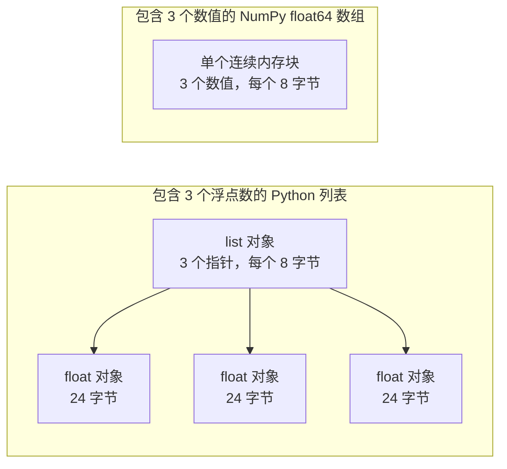

# AI 工程的 Python 基础

> 本课程绝大多数代码都使用同一套核心 Python 惯用法。在后续数学与模型课程依赖它们之前，先在这里彻底掌握。

**类型：** 构建
**语言：** Python
**前置要求：** 开发环境配置（Dev Environment）、Python 环境（Python Environments）
**预计时间：** ~120 分钟

## 学习目标

- 熟练读写课程代码最常用的惯用法，包括解包、f-string、dataclass 和推导式。
- 识别三类无报错却产生错误结果的 Python 陷阱：共享列表、可变默认参数和耗尽的生成器。
- 仅依赖标准库构建 CSV 与 JSON 加载器、固定种子的划分逻辑和 mini-batch 生成器。
- 纯 Python 实现点积、均值和标准差，并测量它们的运行速度与内存占用。
- 理解纯 Python 数值循环为什么缓慢，以及 NumPy 广播如何将循环下沉到编译期代码中。

## 问题背景

本阶段之后的课程使用纯 Python 实现各类数学算法与模型。在所有课程的 541 个 Python 文件中，有 276 个导入了 `dataclasses`，187 个调用了 `random.seed` 或创建了 `random.Random` 生成器。如果这些惯用法对你还很陌生，你就会在应当专注于数学逻辑时把精力耗费在语法细节上。

Python 中还存在一些不报任何错误却导致错误结果的隐蔽行为。两个变量名可能指向同一个底层列表，通过其中一个修改，另一个也会随之改变；函数的默认参数会在多次调用之间保持状态；生成器遍历一次后就变空，导致第二个训练 epoch 读不到任何数据，loss 停滞不变。

最后一个挑战是速度。在我们的测试笔记本上，遍历 100 万个浮点数的纯 Python 循环大约需要 30 毫秒，而 NumPy 计算相同的点积不到 1 毫秒。你需要理解其底层原因，才能在直观的循环与高效的数组操作之间做出正确取舍。

## 核心概念

### 课程代码使用了什么

我们使用 `ast` 模块解析了 `phases/*/*/code/` 下全部 541 个 Python 文件。下表统计了至少使用一次各语言特性的文件数量。这些数据截取自编写本课时的统计值，随着课程增补可能会有所变化。

| 语法结构 | 文件数 | 占比 |
|---------|-------|------|
| 函数定义 | 541 | 100% |
| `if __name__ == "__main__":` | 529 | 98% |
| f-string | 517 | 96% |
| 元组解包 | 448 | 83% |
| 类定义 | 379 | 70% |
| 列表推导式 | 375 | 69% |
| 函数类型注解 | 342 | 63% |
| 生成器表达式 | 326 | 60% |
| 切片操作 | 314 | 58% |
| `lambda` 表达式 | 175 | 32% |
| `try` 与 `except` | 120 | 22% |
| `with` 语句 | 96 | 18% |
| 字典推导式 | 93 | 17% |
| 带 `yield` 的生成器函数 | 14 | 3% |

模块导入揭示了哪些标准库最为关键。在 541 个文件中，340 个以 `from __future__ import annotations` 开头，276 个导入了 `dataclasses`。`math`、`random` 和 `json` 模块分别出现在 187、175 和 126 个文件中。`collections` 模块出现在 70 个文件中，而 `itertools` 仅出现在 4 个文件中。

课程中没有调用 `map()` 或 `filter()`，这类操作全部由推导式完成。在 140 多个文件中，调用 `sorted`、`min`、`max` 或 `.sort` 时都传入了 `key=` 函数。本课将把绝大部分篇幅集中在这些高频惯用法上。

### 变量名是指向对象的引用

在 Python 中，变量只是指向对象的名称。赋值操作将名称绑定到对象上，并不会复制该对象。当两个变量名指向同一个列表时，通过任一变量所做的修改对另一个都是可见的。数值、字符串和元组是不可变的，因此不会带来这种困扰；但列表、字典和集合是可变对象，当你需要一个独立副本时必须显式拷贝。

### 列表存指针，数组存数值

Python 列表并不直接存储数值，而是存储指针，每个指针都指向一个完整的 Python 对象。在 64 位 CPython 上，每个指针占用 8 字节，每个 `float` 对象占用 24 字节。而 NumPy `float64` 数组将原始的 8 字节数值紧凑地平铺在同一块连续内存中。



遍历普通列表时，解释器需要为每个元素做大量额外工作。它必须逐条执行字节码指令：对每个元素先寻址指针，检查操作数的类型，调用底层的浮点乘法，再创建一个全新的 Python 浮点对象来保存计算结果。

NumPy 则直接在底层编译好的 C 循环中处理连续的原始数值。它只需在整个数组层面检查一次数据类型，无需为每个元素创建 Python 对象。所谓向量化代码，就是用一条操作描述整个数组的计算（如 `(x - mean) / std`），由底层库直接运行编译好的循环。本课中的向量函数都遵循这一规则，每个函数执行单一数组操作，以便后续无缝替换为一行 NumPy 代码。

### 列表保留全部元素，生成器只产出当前项

列表推导式会在执行下一行代码之前一次性计算出所有元素；生成器则在调用方每次请求下一项时才动态计算当前项。列表占用的内存在元素增多时线性膨胀，而生成器的内存占用几乎与数据规模无关，始终保持恒定。

但生成器只能遍历一次。产出最后一项后，再次调用将触发 `StopIteration`，因此对同一个生成器执行第二个 `for` 循环将拿不到任何数据。训练代码在每个 epoch 都需要遍历一次数据集，因此必须在每个 epoch 重新创建新的生成器。

生成器函数在课程代码中并不频繁，但深度学习课程所使用的数据加载器本质上都是 batch 的可迭代对象，因此这一思想贯穿了每一个训练循环。下方的交互图表在相同的 8 行数据上直观展示了两种方式的内存差异。

```figure
s0-list-vs-generator
```

## 核心惯用法

本节中的每个代码块均可独立运行。将其保存为文件并使用 `python3` 执行即可。代码需要 Python 3.11 或更高版本（已在开发环境课中配置）。

### 1. 数值、集合与解包

Python 拥有四种内置容器类型，需要清楚它们各自的适用场景：

| 类型 | 示例 | 是否有序 | 是否可变 | 课程典型用途 |
|------|------|----------|----------|--------------|
| `list` | `[0.5, 1.2]` | 是 | 是 | 样本、loss、权重 |
| `tuple` | `(32, 784)` | 是 | 否 | 形状（shape）、固定记录、字典键 |
| `dict` | `{"lr": 0.01}` | 插入顺序 | 是 | 配置、词表、JSON 行数据 |
| `set` | `{"cat", "dog"}` | 否 | 是 | 去重 token、重叠检查 |

以下代码展示了赋值不会拷贝列表的机制：

```python
weights = [0.5, -1.2, 3.0]
alias = weights
alias[0] = 99.0
print(weights)

independent = list(weights)
independent[1] = 0.0
print(weights, independent)

grid = [[0] * 3] * 2
grid[0][0] = 1
print(grid)

grid = [[0] * 3 for _ in range(2)]
grid[0][0] = 1
print(grid)
```

```text
[99.0, -1.2, 3.0]
[99.0, -1.2, 3.0] [99.0, 0.0, 3.0]
[[1, 0, 0], [1, 0, 0]]
[[1, 0, 0], [0, 0, 0]]
```

表达式 `[[0] * 3] * 2` 创建的外层列表包含了对同一个内层列表的两个引用。而推导式则为每一行创建独立的内层列表。数学阶段中经常需要用列表构建矩阵，务必使用推导式形式。

解包可以在一行内将序列中的元素分配给多个变量，带星号的变量名用来收集剩余元素。f-string 支持将表达式值嵌入字符串中，并在冒号后支持格式化修饰符。

```python
shape = (32, 784)
batch_size, n_features = shape
first, *middle, last = [1, 2, 3, 4, 5]
x, y = 1.0, 3.0
x, y = y, x

config = {"lr": 0.01, "epochs": 5}
config["seed"] = 7
tokens = ["the", "cat", "sat", "on", "the", "mat"]
vocab = set(tokens)

print(batch_size, n_features, first, middle, last, x, y)
print(config.get("momentum", 0.9), "cat" in vocab, len(vocab))
print(f"lr={config['lr']:.0e} loss={0.123456:.3f} n={60_000:,} {batch_size=}")
```

```text
32 784 1 [2, 3, 4] 5 3.0 1.0
0.9 True 5
lr=1e-02 loss=0.123 n=60,000 batch_size=32
```

`dict.get` 在键不存在时会返回指定的默认值。在集合上使用 `in` 进行成员检查的时间复杂度与集合大小无关（接近 $O(1)$）。`{batch_size=}` 的形式会同时打印变量名与变量值，非常适合调试。

切片 `a[start:stop:step]` 包含 `start` 但不包含 `stop`，负索引从末尾向前计数。对列表切片会生成新列表，因此对超大列表切片会拷贝所有的内部指针。

```python
tokens = ["<s>", "the", "cat", "sat", "on", "the", "mat", "</s>"]
print(tokens[1:-1])
print(tokens[:3], tokens[-3:])
print(tokens[::2])
print(tokens[::-1][:2])
windows = [tokens[i:i + 3] for i in range(len(tokens) - 2)]
print(len(windows), windows[0])
```

```text
['the', 'cat', 'sat', 'on', 'the', 'mat']
['<s>', 'the', 'cat'] ['the', 'mat', '</s>']
['<s>', 'cat', 'on', 'mat']
['</s>', 'mat']
6 ['<s>', 'the', 'cat']
```

### 2. 推导式

推导式可以在单个表达式中从可迭代对象构建出列表、字典或集合，读起来非常贴近数学表达式。

```python
scores = [0.91, 0.42, 0.77, 0.15, 0.66]
labels = [1 if s >= 0.5 else 0 for s in scores]
high = [s for s in scores if s > 0.6]
squares = {i: i * i for i in range(4)}
lengths = {len(word) for word in ["a", "bb", "cc", "ddd"]}
sum_sq = sum(s * s for s in scores)

matrix = [[1, 2, 3], [4, 5, 6]]
transposed = [list(column) for column in zip(*matrix)]
flat = [v for row in matrix for v in row]

print(labels, high, squares, lengths, round(sum_sq, 4))
print(transposed, flat)
```

```text
[1, 0, 1, 0, 1] [0.91, 0.77, 0.66] {0: 0, 1: 1, 2: 4, 3: 9} {1, 2, 3} 2.0555
[[1, 4], [2, 5], [3, 6]] [1, 2, 3, 4, 5, 6]
```

尾部的 `if` 用于筛选元素。`for` 前方的表达式可以是三元条件式 `a if condition else b`。连续两个 `for` 子句的执行顺序与两层嵌套循环一致。

圆括号则会创建生成器表达式。在 `sum(s * s for s in scores)` 中，`sum` 每次只读取一个平方值，Python 无需在内存中分配列表。在 `zip(*matrix)` 中，星号将每行解包为独立实参，`zip` 将对应位置的元素配对起来。

### 3. 函数、参数与闭包

默认参数使参数变为可选。关键字参数在调用时显式指定形参名。参数列表中的单个 `*` 会强制后续参数必须以关键字形式传递（keyword-only）。

```python
def clip(value, low=0.0, high=1.0):
    return max(low, min(high, value))


def train(data, *, lr=0.01, epochs=3):
    return f"{len(data)} samples, lr={lr}, epochs={epochs}"


def make_scaler(factor):
    def scale(values):
        return [v * factor for v in values]
    return scale


print(clip(1.7), clip(-3.0, low=-1.0), clip(0.4, high=0.3))
print(train([1, 2, 3], lr=0.1))
to_percent = make_scaler(100)
print(to_percent([0.25, 0.5]))
```

```text
1.0 -1.0 0.3
3 samples, lr=0.1, epochs=3
[25.0, 50.0]
```

使用 keyword-only 参数时，像 `train(data, 0.1, 3)` 这样的位置调用会直接抛出 `TypeError`。调用方必须显式写出 `lr=0.1`，这样就杜绝了多个数字位置传错的低级失误。

内层函数 `scale` 捕获了外层创建它的函数作用域中的 `factor`。只要 `scale` 存在，Python 就会保留 `factor`。这种捕获了创建者作用域变量的函数就是闭包。动手构建小节中的标准化器（standardizer）就是通过闭包来持久保存训练集的统计指标。

`lambda` 是没有名字的单表达式匿名函数。课程代码主要将其用作 `key=` 排序函数（见第 8 部分）。

Python 在执行 `def` 定义语句时仅对默认参数求值一次，后续每次使用该默认值的调用都会共享同一个底层对象：

```python
def add_bad(item, bucket=[]):
    bucket.append(item)
    return bucket


def add_good(item, bucket=None):
    if bucket is None:
        bucket = []
    bucket.append(item)
    return bucket


add_bad("a")
print(add_bad("b"))
add_good("a")
print(add_good("b"))
```

```text
['a', 'b']
['b']
```

对于列表、字典或集合，务必将默认值设为 `None`，并在函数体内部显式创建新对象。

### 4. 类与 Dataclass

`@dataclass` 装饰器会自动根据带类型注解的字段生成 `__init__`、`__repr__` 和 `__eq__` 方法。添加 `frozen=True` 后，对象在创建后不可更改，可以直接作为字典键或存入集合中。

```python
from dataclasses import dataclass, field


@dataclass(frozen=True)
class Example:
    features: tuple[float, ...]
    label: int


@dataclass
class TrainConfig:
    lr: float = 0.01
    epochs: int = 5
    hidden: list[int] = field(default_factory=lambda: [64, 32])

    def describe(self):
        return f"lr={self.lr} epochs={self.epochs} hidden={self.hidden}"


ex = Example((1.5, 2.0), 1)
print(ex)
print(ex == Example((1.5, 2.0), 1), len({ex, Example((1.5, 2.0), 1)}))
print(TrainConfig(epochs=10).describe())
try:
    ex.label = 0
except AttributeError as err:
    print(type(err).__name__)
```

```text
Example(features=(1.5, 2.0), label=1)
True 1
lr=0.01 epochs=10 hidden=[64, 32]
FrozenInstanceError
```

`field(default_factory=...)` 会为每个实例创建独立的列表，解决了 dataclass 内部的默认可变参数共享陷阱。

特殊方法（魔术方法）将类与 Python 原生语法连接起来。`len(ds)` 调用 `__len__`，`ds[2]` 调用 `__getitem__`。

```python
class SquaresDataset:
    def __init__(self, n):
        self.n = n

    def __len__(self):
        return self.n

    def __getitem__(self, index):
        if not 0 <= index < self.n:
            raise IndexError(index)
        return index, index * index


ds = SquaresDataset(4)
print(len(ds), ds[2])
print(list(ds))
```

```text
4 (2, 4)
[(0, 0), (1, 1), (2, 4), (3, 9)]
```

`list(ds)` 内部的 `for` 循环即使没有 `__iter__` 方法也能正常工作。Python 会依次以 0、1、2... 调用 `__getitem__`，直到捕获 `IndexError` 为止。PyTorch 的 map-style 数据集也遵循这相同的两个方法：`__len__` 与 `__getitem__`。

### 5. 迭代器与生成器

可迭代对象（iterable）是指任何可以被 `for` 循环遍历的对象。`iter()` 可以从中获取迭代器（iterator），而 `next()` 会向迭代器索取下一个元素。当没有更多元素时，迭代器会抛出 `StopIteration`。`for` 循环会自动帮你调用 `next()` 并在捕获 `StopIteration` 时优雅退出。

```python
numbers = [10, 20, 30]
it = iter(numbers)
print(next(it), next(it), next(it))
try:
    next(it)
except StopIteration:
    print("no more items")


def countdown(n):
    while n > 0:
        yield n
        n -= 1


gen = countdown(3)
print(type(gen).__name__)
print(list(gen))
print(list(gen))
```

```text
10 20 30
no more items
generator
[3, 2, 1]
[]
```

函数体中包含 `yield` 的函数是生成器函数。调用它不会立即执行函数体代码，而是返回一个生成器对象。每次调用 `next()` 才会让代码执行到下一个 `yield` 并暂停挂起。第二次调用 `list(gen)` 返回空列表，因为第一次已经将该生成器彻底消耗完毕。

生成器可以逐行流式读取大文件：

```python
import os
import tempfile


def read_rows(path):
    with open(path, encoding="utf-8") as fh:
        header = fh.readline().rstrip("\n").split(",")
        for line in fh:
            yield dict(zip(header, line.rstrip("\n").split(",")))


with tempfile.TemporaryDirectory() as tmp:
    path = os.path.join(tmp, "rows.csv")
    with open(path, "w", encoding="utf-8") as fh:
        fh.write("x,label\n")
        fh.writelines(f"{i * 0.5},{i % 2}\n" for i in range(5))

    rows = read_rows(path)
    print(next(rows))
    print(sum(1 for _ in rows))
```

```text
{'x': '0.0', 'label': '0'}
4
```

`read_rows` 每次只在内存中保留文件的一行数据，这也是上方交互图表中展示的机制。为保持示例短小，这里直接使用逗号切分；而真实 CSV 文件常在引号内包含逗号，因此动手构建小节中会使用标准的 `csv` 模块。

```python
import sys

as_list = [i * i for i in range(1_000_000)]
as_generator = (i * i for i in range(1_000_000))
print(sys.getsizeof(as_list), sys.getsizeof(as_generator))
print(sum(as_list) == sum(as_generator))
```

在 64 位 CPython 上，该列表报告约 8 MB，而生成器仅占用约 200 字节。`sys.getsizeof` 仅计算列表指针本身，包含的整型对象还会占用更多显存/内存。动手构建小节中使用 `tracemalloc`（此前在调试与分析课程中介绍过）来测量真实的峰值内存。

### 6. 上下文管理器与异常

`with` 语句用于执行初始化设置逻辑、运行代码块主体，然后执行清理收尾逻辑。即使代码块抛出异常，收尾清理也会无条件执行。`open()` 返回的文件对象本身就是上下文管理器，负责在退出时自动关闭文件句柄。

在调试与分析课程中，我们编写过带 `__enter__` 和 `__exit__` 的 `Timer` 类。`contextlib.contextmanager` 装饰器能够通过生成器以更轻量的方式构造同样的上下文管理器：`yield` 之前的代码是 setup，`finally` 块中的代码是 cleanup。

```python
import time
from contextlib import contextmanager


@contextmanager
def timer(label):
    start = time.perf_counter()
    try:
        yield
    finally:
        print(f"{label}: {(time.perf_counter() - start) * 1000:.1f} ms")


def parse_label(text):
    try:
        return int(text)
    except ValueError:
        raise ValueError(f"label must be an integer, got {text!r}") from None


with timer("sum of squares"):
    total = sum(i * i for i in range(200_000))

print(parse_label("3"))
try:
    parse_label("cat")
except ValueError as err:
    print("rejected:", err)
```

```text
sum of squares: 9.4 ms
3
rejected: label must be an integer, got 'cat'
```

你机器上的耗时可能会有所不同。在 `except` 子句中务必明确声明预期的具体异常类型，如 `ValueError` 或 `KeyError`。缺少具体类型的裸 `except:` 会同时捕获 `KeyboardInterrupt`，导致 Ctrl+C 无法终止所在的循环。遇到非法输入时抛出清晰报错，并在替换原生调用栈时添加 `from None`。

### 7. 类型注解、模块与 Main 守卫

类型注解明确告知读者函数的输入与输出契约。Python 运行时并不会强制检查它们，通常由 mypy 等类型检查器在运行前做静态分析。

```python
from __future__ import annotations

from collections.abc import Iterable, Sequence


def mean(values: Sequence[float]) -> float:
    if not values:
        raise ValueError("mean() needs at least one value")
    return sum(values) / len(values)


def count_tokens(docs: Iterable[str]) -> int:
    return sum(len(doc.split()) for doc in docs)


def main() -> None:
    print(mean([1.0, 2.0, 4.0]))
    print(count_tokens(["the cat sat", "on the mat"]))
    print(mean.__annotations__)


if __name__ == "__main__":
    main()
```

```text
2.3333333333333335
6
{'values': 'Sequence[float]', 'return': 'float'}
```

使用 `from __future__ import annotations` 后，Python 会将每个类型注解以字符串形式存储。`Sequence` 代表支持 `len()` 和索引访问的对象（如列表或元组），`Iterable` 代表任何支持 `for` 循环遍历的对象。许多课程代码从 `typing` 中导入同名类型，效果相同。

每个 `.py` 文件都是一个模块。当使用 `python3 file.py` 直接运行它时，Python 会将其 `__name__` 设为 `"__main__"`；当它被其他文件导入时，`__name__` 则是该模块的名称。守卫确保仅在第一种情况下才执行 `main()`。得益于该守卫，`code/tests/` 下的单测可以直接导入 `main.py` 而无需启动演示程序。

### 8. 文件操作、JSON、CSV 与排序

`pathlib.Path` 支持使用 `/` 拼接路径，并能通过一行代码读取或写入整个文件。务必始终传入 `encoding="utf-8"`，因为操作系统默认编码各不相同。

```python
import csv
import json
import tempfile
from pathlib import Path

rows = [
    {"text": "great movie", "label": 1, "score": 0.93},
    {"text": "boring plot", "label": 0, "score": 0.12},
    {"text": "fine acting", "label": 1, "score": 0.58},
]

with tempfile.TemporaryDirectory() as tmp:
    json_path = Path(tmp) / "reviews.json"
    json_path.write_text(json.dumps(rows, indent=2), encoding="utf-8")
    from_json = json.loads(json_path.read_text(encoding="utf-8"))

    csv_path = Path(tmp) / "reviews.csv"
    with csv_path.open("w", newline="", encoding="utf-8") as fh:
        writer = csv.DictWriter(fh, fieldnames=["text", "label", "score"])
        writer.writeheader()
        writer.writerows(rows)
    with csv_path.open(newline="", encoding="utf-8") as fh:
        from_csv = list(csv.DictReader(fh))

print(from_json == rows)
print(from_csv[0])

by_score = sorted(rows, key=lambda r: r["score"], reverse=True)
print([r["text"] for r in by_score])
print(max(rows, key=lambda r: r["score"])["text"])
print([r["text"] for r in sorted(rows, key=lambda r: (-r["label"], r["text"]))])
```

```text
True
{'text': 'great movie', 'label': '1', 'score': '0.93'}
['great movie', 'fine acting', 'boring plot']
great movie
['fine acting', 'great movie', 'boring plot']
```

JSON 会保留数值类型，而 CSV 读回的每个字段都是字符串，必须显式进行数值类型转换。打开 CSV 文件时务必按官方文档要求指定 `newline=""`。

`key=` 函数返回 Python 在比较各元素时所依据的数值，`sorted`、`min` 和 `max` 均支持该参数。元组作为 key 时优先比较首个值，出现平局时再比对第二个值。负号表示将较大的标签排在前面。Python 的排序算法是稳定排序（Timsort），键值相等的元素会保持原本的相对顺序。

### 9. 计数、分组与迭代工具

以下两个模块提供了普通列表和字典所不具备的高效数据结构与迭代工具：

```python
from collections import Counter, defaultdict, deque
from itertools import chain, islice, product

labels = ["cat", "dog", "cat", "bird", "cat", "dog"]
counts = Counter(labels)
print(counts.most_common(2))

positions = defaultdict(list)
for i, label in enumerate(labels):
    positions[label].append(i)
print(dict(positions))

recent = deque(maxlen=3)
for loss in [2.0, 1.5, 1.2, 1.1, 0.9]:
    recent.append(loss)
print(list(recent), round(sum(recent) / len(recent), 3))

print(list(product([0.1, 0.01], [16, 32])))
print(list(chain([1, 2], [3], [4, 5])))
print(list(islice(range(100), 5, 10)))
```

```text
[('cat', 3), ('dog', 2)]
{'cat': [0, 2, 4], 'dog': [1, 5], 'bird': [3]}
[1.2, 1.1, 0.9] 1.067
[(0.1, 16), (0.1, 32), (0.01, 16), (0.01, 32)]
[1, 2, 3, 4, 5]
[5, 6, 7, 8, 9]
```

`Counter` 统计可哈希元素（如标签或 token）的频次。`defaultdict(list)` 在首次遇到新键时会自动创建空列表，分组循环无需做存在性检查。`deque(maxlen=3)` 在推入第 4 个元素时自动剔除最旧元素，非常适合维护近期 loss 的滑动窗口。`enumerate` 则在遍历时同时产出元素与对应索引。

`product` 计算笛卡尔积，常用于超参数网格搜索。`chain` 将多个可迭代对象首尾串联。`islice` 对任意迭代器（包括生成器）执行切片。动手构建中的 mini-batch 生成器便使用了 `islice`。

### 10. 纯数值循环为什么慢

`dis` 模块可以打印出解释器为函数执行的底层字节码指令：

```python
import dis


def dot(a, b):
    total = 0.0
    for x, y in zip(a, b):
        total += x * y
    return total


dis.dis(dot)
```

从 `FOR_ITER` 到跳回循环开头的指令，针对每个元素都会完整执行一遍。每次乘加运算背后对应着大约 10 条字节码指令。指令的具体名称在不同 Python 版本间略有差异。

当较少的计算步骤以字节码形式执行时，循环就会变快。`sum`、`map` 和 `zip` 等内置函数是在 C 语言层面上实现的。动手构建小节会在纯 Python 下测量这种性能差异，而在实际使用小节中则将整个循环下沉至 NumPy 中。

## 动手构建

现在来实现后续课程所需的通用工具模块。完整实现见 `code/main.py`，测试见 `code/tests/test_main.py`。每个步骤均可独立运行。

### 第 1 步：记录数据类型与数据集加载器

加载器将 CSV 或 JSON 文件读取为统一的结构：包含浮点特征元组与整型标签的不可变记录对象。

```python
import csv
import json
import tempfile
from dataclasses import dataclass
from pathlib import Path


@dataclass(frozen=True)
class Record:
    features: tuple[float, ...]
    label: int


def row_to_record(row, names, label_field="label"):
    if label_field not in row:
        raise ValueError(f"row has no {label_field!r} field: {row}")
    if set(row) != {*names, label_field}:
        raise ValueError(f"row fields {list(row)} do not match {[*names, label_field]}")
    return Record(tuple(float(row[name]) for name in names), int(row[label_field]))


def load_records(path, label_field="label"):
    path = Path(path)
    if path.suffix == ".json":
        rows = json.loads(path.read_text(encoding="utf-8"))
    elif path.suffix == ".csv":
        with path.open(newline="", encoding="utf-8") as fh:
            rows = list(csv.DictReader(fh))
    else:
        raise ValueError(f"unsupported file type: {path.suffix!r}")
    if not rows:
        return []
    names = [key for key in rows[0] if key != label_field]
    return [row_to_record(row, names, label_field) for row in rows]


with tempfile.TemporaryDirectory() as tmp:
    csv_path = Path(tmp) / "data.csv"
    csv_path.write_text("x1,x2,label\n1.5,60,1\n1.8,82.5,0\n", encoding="utf-8")
    json_path = Path(tmp) / "data.json"
    json_path.write_text('[{"x1": 1.5, "x2": 60, "label": 1}]', encoding="utf-8")
    print(load_records(csv_path))
    print(load_records(json_path))
```

```text
[Record(features=(1.5, 60.0), label=1), Record(features=(1.8, 82.5), label=0)]
[Record(features=(1.5, 60.0), label=1)]
```

首行数据确定了特征名称及其排列顺序。`DictReader` 和 `json.loads` 会保持文件中的键顺序，而字典本身也保留插入顺序。JSON 标准并没有对对象中的键强加顺序，因此 `row_to_record` 会严格按第一行的特征字段顺序逐行读取。缺少标签、多出或缺失特征、未知文件格式均会抛出 `ValueError`，在加载之初就拦截异常数据。`main.py` 中还实现了 `save_records` 以写回这两种格式。

### 第 2 步：固定种子的数据集划分

```python
import random


def train_test_split(items, test_fraction=0.2, seed=0):
    if not 0.0 < test_fraction < 1.0:
        raise ValueError(f"test_fraction must be between 0 and 1, got {test_fraction}")
    if len(items) < 2:
        raise ValueError(f"need at least 2 items to split, got {len(items)}")
    order = list(range(len(items)))
    random.Random(seed).shuffle(order)
    n_test = min(max(1, round(len(items) * test_fraction)), len(items) - 1)
    test = [items[i] for i in order[:n_test]]
    train = [items[i] for i in order[n_test:]]
    return train, test


items = list(range(10))
print(train_test_split(items, seed=1))
print(train_test_split(items, seed=1) == train_test_split(items, seed=1))
print(train_test_split(items, seed=2)[1])
print(items)
```

```text
([9, 7, 5, 3, 0, 4, 1, 2], [6, 8])
True
[5, 9]
[0, 1, 2, 3, 4, 5, 6, 7, 8, 9]
```

`random.Random(seed)` 创建了独立的伪随机数生成器。直接调用 `random.seed(seed)` 会重置所有模块共享的全局生成器，其他第三方库的随机调用可能会篡改你的随机序列。在课程代码中，有 100 个文件调用了 `random.seed`，96 个文件使用了 `random.Random`。新编写的代码推荐统一使用独立的生成器实例。

该函数对索引列表进行打乱，从而保证传入的原始列表不被修改。相同的 seed 始终产生完全一致的切分。划分两侧均保留至少 1 个样本，少于 2 个元素的列表会直接报错。必须在执行任何需要拟合统计量的步骤（如特征标准化）之前完成切分，防止测试集信息泄露导致测试指标虚高。

### 第 3 步：Mini-batch 生成器

```python
from itertools import islice


def batches(items, batch_size, drop_last=False):
    if batch_size < 1:
        raise ValueError(f"batch_size must be at least 1, got {batch_size}")
    return _batch_iter(iter(items), batch_size, drop_last)


def _batch_iter(iterator, batch_size, drop_last):
    while True:
        batch = list(islice(iterator, batch_size))
        if not batch or (drop_last and len(batch) < batch_size):
            return
        yield batch


print(list(batches(range(10), 4)))
print(list(batches(range(10), 4, drop_last=True)))
squares = (i * i for i in range(7))
print([len(b) for b in batches(squares, 3)])

for epoch in range(2):
    sizes = [len(b) for b in batches(range(10), 4)]
    print(f"epoch {epoch}: {sizes}")
```

```text
[[0, 1, 2, 3], [4, 5, 6, 7], [8, 9]]
[[0, 1, 2, 3], [4, 5, 6, 7]]
[3, 3, 1]
epoch 0: [4, 4, 2]
epoch 1: [4, 4, 2]
```

`islice` 每次从迭代器中抽取最多 `batch_size` 项。`batches` 仅依赖 `iter()`，因此能够无缝接收列表、文件或任意生成器。当样本总量不是 batch 大小的整数倍时，最后一个 batch 会较小；设置 `drop_last=True` 可以丢弃该尾部 batch，以满足某些要求固定 batch shape 的模型。

将逻辑拆分在两个函数中，是因为生成器函数在首次调用 `next()` 之前不会执行任何代码。如果校验写在生成器内部，`batches(data, 0)` 将直接返回而不报错，真正的报错会延后暴露在训练循环内部。外层普通函数能在第一时间校验参数有效性。外层 epoch 循环在每个 epoch 均重新调用 `batches()`，因为单个生成器只能消费一次。

### 第 4 步：向量计算与标准化器

```python
import math


def dot(a, b):
    return sum(x * y for x, y in zip(a, b, strict=True))


def mean(values):
    if not values:
        raise ValueError("mean() needs at least one value")
    return sum(values) / len(values)


def std(values):
    mu = mean(values)
    return math.sqrt(sum((v - mu) ** 2 for v in values) / len(values))


def make_standardizer(rows):
    columns = list(zip(*rows))
    means = [mean(c) for c in columns]
    scales = [s if s > 0 else 1.0 for s in (std(c) for c in columns)]

    def standardize(row):
        return [(v - m) / s for v, m, s in zip(row, means, scales, strict=True)]

    return standardize


print(dot([1.0, 2.0, 3.0], [4.0, 5.0, 6.0]))
values = [2.0, 4.0, 4.0, 4.0, 5.0, 5.0, 7.0, 9.0]
print(mean(values), std(values))

train_rows = [(1.0, 100.0), (2.0, 300.0), (3.0, 500.0)]
standardize = make_standardizer(train_rows)
print([[round(v, 3) for v in standardize(r)] for r in train_rows])
print([round(v, 3) for v in standardize((4.0, 700.0))])
```

```text
32.0
5.0 2.0
[[-1.225, -1.225], [0.0, 0.0], [1.225, 1.225]]
[2.449, 2.449]
```

使用 `strict=True` 时，若两个向量长度不一致，`zip` 会抛出 `ValueError`。如果不加该参数，`zip` 会静默以较短的输入截断，无报错却产出错误结果（该参数需要 Python 3.10+）。

`std` 除以样本总数 $n$，计算的是总体标准差（与 `statistics.pstdev` 一致）；从样本估算更大总体的离散度时通常除以 $n - 1$。

`make_standardizer` 返回一个闭包。它在训练样本上计算一次均值和标准差，内部的 `standardize` 将其固化保存。将完全相同的函数应用到测试集，能够确保测试数据不会对统计量产生任何污染。针对常数列（标准差为 0），标准化器自动将其缩放因子保底为 1。

### 第 5 步：完整运行演示

`code/main.py` 将上述组件拼装串联。它从两个聚类簇中生成 400 条记录，分别保存为 CSV 和 JSON，再读回校验一致性。随后切分数据集，在训练集上拟合标准化器，并按每批 48 条计算各类别质心。

最近质心分类器（Nearest-Centroid Classifier）存储每个类别的均值特征向量，预测时将输入划归到均值距离最近的类别。`fit_centroids` 逐 batch 累加样本，无需将整个训练集全部加载到内存。`predict` 通过带 `key=` 的 `min()` 找出距离最近的质心。

```bash
python3 phases/00-setup-and-tooling/13-python-for-ai-engineering/code/main.py
```

```text
Python for AI engineering: a standard-library toolkit
data     400 records, CSV and JSON load back unchanged: True
split    320 train, 80 test, records in both: 0
batches  size 48: [48, 48, 48, 48, 48, 48, 32]
scale    train feature means after standardizing: [0.0, 0.0]
model    nearest-centroid test accuracy: raw 0.86, standardized 0.89
speed    dot product of 200,000 floats, best of 5:
           index loop         6.60 ms
           zip generator      5.93 ms
           map + mul          2.89 ms
memory   peak bytes to sum 100,000 squares:
           list              4,000,616
           generator               472
```

这里的两个特征具有完全不同的量纲：第二个特征的数值分布范围是第一个的 10 倍，导致原始距离被大尺度特征完全主导，原始准确率较低。标准化后两者权重对齐，准确率明显提升。

### 第 6 步：测量速度与内存

```python
import operator
import random
import time
import tracemalloc


def dot_index_loop(a, b):
    total = 0.0
    for i in range(len(a)):
        total += a[i] * b[i]
    return total


def dot_zip(a, b):
    return sum(x * y for x, y in zip(a, b, strict=True))


def dot_map(a, b):
    return sum(map(operator.mul, a, b))


def best_time(fn, *args, repeat=5):
    times = []
    for _ in range(repeat):
        start = time.perf_counter()
        fn(*args)
        times.append(time.perf_counter() - start)
    return min(times)


def peak_bytes(fn):
    tracemalloc.start()
    try:
        fn()
        return tracemalloc.get_traced_memory()[1]
    finally:
        tracemalloc.stop()


rng = random.Random(0)
a = [rng.random() for _ in range(1_000_000)]
b = [rng.random() for _ in range(1_000_000)]
for fn in (dot_index_loop, dot_zip, dot_map):
    print(f"{fn.__name__:15} {best_time(fn, a, b) * 1000:7.2f} ms")

print(peak_bytes(lambda: sum([i * i for i in range(100_000)])))
print(peak_bytes(lambda: sum(i * i for i in range(100_000))))
```

`best_time` 取多次运行中的最小值。由于系统后台的其他进程只会引入额外干扰延迟，因此最小值最贴近代码真实的执行开销。这也是标准库 `timeit` 模块的核心设计原则。

在配备 Python 3.11 的测试笔记本上，索引循环耗时约 33 毫秒，zip 版本约 30 毫秒，而 `map` 版本仅约 14 毫秒。三者完成了完全相同的算术计算，`map` 之所以更快，是因为 `map` 与 `operator.mul` 均由 C 语言实现，逐元素执行的 Python 字节码指令大幅减少。内存统计则印证了开头的图表结论：列表占用约 4 MB，而生成器不到 1 KB。

## 实际使用

### 标准库内置实现对照

Python 标准库为我们手写的大部分模块提供了经过充分测试的内置版本：

| 手写实现 | 标准库内置 | 说明 |
|----------|------------|------|
| `mean`、`std` | `statistics.fmean`、`statistics.pstdev` | 测试用例直接与它们比对验证 |
| `dot` | `math.sumprod` | Python 3.12+ |
| `batches` | `itertools.batched` | Python 3.12+，返回元组 |
| `best_time` | `timeit.repeat` | 运行期间会自动禁用垃圾回收 |
| `peak_bytes` | `tracemalloc` | 同名内置模块，支持快照与逐行分析 |

```python
import statistics
import sys

values = [2.0, 4.0, 4.0, 4.0, 5.0, 5.0, 7.0, 9.0]
print(statistics.fmean(values), statistics.pstdev(values))

if sys.version_info >= (3, 12):
    import math
    from itertools import batched

    print(math.sumprod([1.0, 2.0, 3.0], [4.0, 5.0, 6.0]))
    print(list(batched(range(10), 4)))
```

```text
5.0 2.0
32.0
[(0, 1, 2, 3), (4, 5, 6, 7), (8, 9)]
```

由于本课程向下兼容 Python 3.11，因此 `main.py` 内部保留了手写的 `dot` 和 `batches` 实现。

### 使用编译期数组做相同计算

在虚拟环境中安装 NumPy（例如 `uv pip install numpy`）。本课主体代码和测试用例不依赖它。

```python
import time

import numpy as np

n = 1_000_000
rng = np.random.default_rng(0)
a = rng.random(n)
b = rng.random(n)
a_list, b_list = a.tolist(), b.tolist()

start = time.perf_counter()
slow = sum(x * y for x, y in zip(a_list, b_list))
python_ms = (time.perf_counter() - start) * 1000

start = time.perf_counter()
fast = float(a @ b)
numpy_ms = (time.perf_counter() - start) * 1000

print(f"pure Python {python_ms:8.2f} ms")
print(f"NumPy       {numpy_ms:8.2f} ms")
print(f"difference  {abs(slow - fast):.1e}")
print(a.dtype, a.itemsize, a.nbytes)
```

在测试笔记本上，NumPy 耗时不到 1 毫秒，而纯 Python 版本耗时约 30 毫秒。两者计算结果在末尾几位上略有差异，因为浮点数乘积累加的先后顺序不同，而浮点数加法并不满足完全的结合律。

NumPy 更快的原因主要有三点：

- 数组直接在连续内存块中存储紧凑的 `float64` 原始数值（每个 8 字节）。普通 Python 浮点列表每个元素都需要 8 字节指针加 24 字节对象头。
- 循环在编译好的 C 代码中运行，整块数组只需检查一次类型，无需为每个元素创建 Python 对象。
- 内存紧凑排列使得现代 CPU 能够启用 SIMD 指令，一条指令并发计算多个浮点乘加。

对于极小规模的数组，单次调用 NumPy 的固定开销甚至可能超过短小的 Python 循环。练习 4 将带你找出这一性能拐点。

### 广播机制（Broadcasting）

广播允许 NumPy 在不写任何显式循环的情况下对不同形状（shape）的数组执行逐元素运算。以下代码与第 4 步中的 `make_standardizer` 完成完全相同的计算：

```python
import numpy as np

X = np.array([[1.0, 100.0], [2.0, 300.0], [3.0, 500.0]])
mu = X.mean(axis=0)
sigma = X.std(axis=0)
Z = (X - mu) / sigma
print(X.shape, mu.shape, Z.shape)
print(Z.round(3))

norms = np.sqrt((X ** 2).sum(axis=1, keepdims=True))
print(norms.shape, (X / norms).shape)
```

```text
(3, 2) (2,) (3, 2)
[[-1.225 -1.225]
 [ 0.     0.   ]
 [ 1.225  1.225]]
(3, 1) (3, 2)
```

NumPy 会从末尾维度向前逐维比对两个数组的形状。当对应维度的长度相等，或者其中一个为 1 时，这两个维度就被判定为兼容。缺失的前置维度自动视为长度 1。长度为 1 的维度会沿较大维度虚拟复用，NumPy 不会产生额外的数据拷贝。

| `X` 的形状 | 另一个数组的形状 | 广播计算结果 |
|------------|------------------|--------------|
| `(3, 2)` | `(2,)`（列均值） | `(3, 2)` |
| `(3, 2)` | `(3, 1)`（带 `keepdims=True` 的行范数） | `(3, 2)` |
| `(3, 2)` | `(3,)`（不带 `keepdims` 的行范数） | `ValueError` |

最后一行属于高频报错。NumPy 尝试将末尾维度的 2 与 3 进行比对，两者均不等于 1，无法匹配。在沿行归约随后需要与原数组执行广播时，务必保留 `keepdims=True`。

## 拿去用

本课交付的产物为 `outputs/prompt-python-review.md`。它是一个用于审查 AI 与数据工程 Python 代码的专业 Prompt 模板。你可以将代码文件或 git diff 喂给它，它会自动扫描本课涉及的隐蔽错误与低效循环：

- 共享引用与默认可变参数陷阱
- 在第二个 epoch 被意外消耗殆尽的生成器
- 未设置随机种子或仅设置了全局种子的随机数调用
- 统计量计算受测试集污染的问题
- 在超大规模数值数组上运行纯 Python 循环

它会输出包含具体文件行号、问题性质及现成可粘贴修复建议的审查表格。

## 练习

1. 在 `main.py` 中以 `seed=8` 运行 `run_demo`。找出哪些输出发生变化、哪些输出保持一致，并解释为何划分数据集的大小始终相同。
2. 纯 Python 实现 `median(values)` 函数，并在奇数长度和偶数长度列表上与 `statistics.median` 比对验证。
3. 实现 `stream_records(path)` 生成器，逐行从 CSV 文件产出 `Record`。创建一个包含 200,000 行的数据集，使用 `tracemalloc` 对比 `stream_records` 与 `load_records` 的内存峰值开销。
4. 分别用纯 Python 和 NumPy 实现 `matvec(matrix, vector)` 矩阵向量乘法。使用 `best_time` 在大小为 4、64 和 1024 时进行基准测试，找出 NumPy 开始胜出当前机器的尺寸拐点。
5. 编写代码重现核心概念小节中的语法统计：使用 `ast.parse` 和 `ast.walk` 遍历 `phases/*/*/code/*.py` 下的所有文件，统计包含 `ast.ListComp`、`ast.Yield` 和 `ast.With` 的文件数量并与表中数字比对。

### 提示

**练习 1。** 从 `code/main.py` 导入 `run_demo`，分别用 `seed=7` 和 `seed=8` 调用，再用 `format_report` 输出两个结果。由随机数据决定的值会变；切分大小只取决于 `n` 和 `test_fraction`，所以不会变。

**练习 2。** 先对列表副本排序。长度为奇数时取中间元素，为偶数时取中间两个元素的均值。用 `[3, 1, 2]`、`[4, 1, 3, 2]` 等列表与 `statistics.median` 对照，结果必须一致。

**练习 3。** 阅读 `code/main.py` 中的 `load_records`，保留解析步骤，但用 `yield` 逐条返回 `Record`，不再追加到列表。用 `save_records` 和 `make_dataset(200_000)` 生成文件，再比较 `peak_bytes(lambda: load_records(path))` 与 `peak_bytes(lambda: sum(1 for _ in your_generator(path)))`。必须在可调用对象内部消费生成器，否则 `peak_bytes` 只测到创建开销。生成器版本的内存峰值应小得多。

**练习 4。** 纯 Python 版本参考 `dot`，对每一行调用一次；NumPy 版本使用 `np.array(matrix) @ np.array(vector)`。用 `best_time` 计时，为每种规模输出一行表格。比较耗时前，先确认两种结果相等。

**练习 5。** 用 `Path.read_text` 读取每个文件，经 `ast.parse` 解析，再用 `any(isinstance(node, ast.ListComp) for node in ast.walk(tree))` 检查某种结构。每个文件只计一次，因为“核心概念”中的表格统计的是文件数。

## 关键术语

| 术语 | 常见说法 | 实际含义 |
|------|----------|----------|
| 可迭代对象（Iterable） | "可以被循环遍历的东西" | 任何可以传入 `iter()` 的对象，例如列表、文件或生成器 |
| 迭代器（Iterator） | "游标指针" | 拥有 `__next__` 方法的对象，每次调用返回一项，无更多元素时抛出 `StopIteration` |
| 生成器（Generator） | "惰性列表" | 由带 `yield` 的函数或生成器表达式创建的迭代器，按需动态生成元素，且只能遍历一次 |
| 推导式（Comprehension） | "单行循环" | 从可迭代对象中以单行紧凑语法构建列表、字典或集合的表达式，支持可选条件过滤 |
| 闭包（Closure） | "函数里的函数" | 捕获并保留了创建者函数作用域中变量的内部函数 |
| 数据类（Dataclass） | "类似结构体" | 由 Python 根据字段类型注解自动生成 `__init__`、`__repr__` 与 `__eq__` 方法的类 |
| 上下文管理器（Context manager） | "with 代码块" | 在进入 `with` 块时执行初始化、退出时无条件执行收尾逻辑的对象，发生异常亦不受影响 |
| 随机种子（Seed） | "随机数初始值" | 伪随机数生成器的起点。设置相同的种子能确保产生完全相同的确定性随机序列 |
| 向量化代码（Vectorized code） | "高性能底层代码" | 将单项操作整体应用到整个数组的代码，循环在编译后的 C/底层硬件中执行 |
| 广播机制（Broadcasting） | "自动维度对齐" | NumPy 在不同形状数组间复用长度为 1 的维度来执行元素级运算的规则，无内存拷贝开销 |

## 延伸阅读

- [Python 官方教程：数据结构](https://docs.python.org/3/tutorial/datastructures.html)：列表、元组、集合、字典与推导式。
- [Python 官方教程：类](https://docs.python.org/3/tutorial/classes.html)：作用域、类定义、迭代器与生成器。
- [dataclasses 官方文档](https://docs.python.org/3/library/dataclasses.html)：装饰器的各项高级参数，包括 `frozen` 与 `field`。
- [collections 官方文档](https://docs.python.org/3/library/collections.html)：`Counter`、`defaultdict`、`deque` 及其他容器类型。
- [itertools 官方文档](https://docs.python.org/3/library/itertools.html)：`islice`、`chain`、`product`、`batched` 及经典迭代器组合范式。
- [Python 排序指南](https://docs.python.org/3/howto/sorting.html)：key 函数、稳定排序与多键排序。
- [timeit 官方文档](https://docs.python.org/3/library/timeit.html)：如何精准测量短小代码片段的耗时，以及为何应取最小值。
- [random 官方文档](https://docs.python.org/3/library/random.html)：全局随机生成器、`random.Random` 实例及实验可复现性。
- [PEP 255: Simple Generators](https://peps.python.org/pep-0255/)：引入 `yield` 关键字的最初提案与设计考量。
- [NumPy 官方文档：广播机制](https://numpy.org/doc/stable/user/basics.broadcasting.html)：完整的形状匹配规则与图示。
- [Harris et al., Array programming with NumPy, Nature 585, 2020](https://doi.org/10.1038/s41586-020-2649-2)：NumPy 数组的设计哲学及其实现极速运行的原因。
