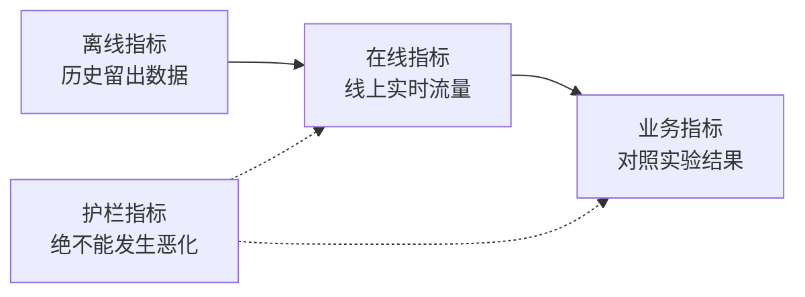

# ML 系统设计 —— 从业务问题到落地模型

> 模型只是整个系统中的一个组件。系统设计决定了模型预测什么、由谁依据预测采取行动、运行成本几何，以及发生故障时该如何安全兜底。

**类型：** 构建
**语言：** Python
**前置要求：** 阶段 2，第 09 课（模型评估）与第 13 课（ML 流水线）
**预计时间：** ~110 分钟

## 学习目标

- 将业务目标拆解为明确的 ML 任务：定义预测目标、消费预测的行动决策，并阐明为何简单业务规则无法满足需求。
- 区分离线指标、在线指标、业务指标与护栏指标，并将模型与简易基线及经验规则基线做严格对比。
- 基于线上真实流量估算批处理推理与在线实时推理的每日成本、响应延迟与数据陈旧度。
- 选择恰当的模型发布策略（影子部署、金丝雀发布、A/B 测试），并为各类故障模式设计安全的兜底方案。
- 识别潜在的反馈循环（Feedback Loops），防止模型决策污染未来训练自身的数据分布。
- 编写规范的 ML 系统设计文档，并使用固定检查清单对其做完备性打分。

## 问题背景

一家订阅制公司提出想要一个“用户流失预测模型”。算法工程师训练了一个梯度提升决策树（GBDT）分类器，汇报离线 AUC 达到了 0.91。然而三个月过去了，线上没有任何系统在实际使用它。

导致这一局面的原因与算法本身毫无关系：从一开始就没有人定义过预测分数应该触发何种业务动作；流失分数每周才批量产出一次，但客服挽留团队每天都在主动致电客户；标签取自一张不仅记录注销记录而且包含“注销原因”的退订表，导致特征中直接泄露了答案；而且从没有人拿模型与客服团队现成的经验规则（直接致电所有连续两周未登录的用户）做过对比。

以上所有问题在模型开始训练之前就已经注定。这些都属于系统设计层面的缺陷，而一份严谨的单页系统设计文档就是为了把这些隐患逐一问清。本课将系统梳理这些关键架构决策，构建一套实用的工程工具包：测算批处理与在线推理成本、量化模型相对于基线的实际提升，并基于规则清单对系统设计文档进行自动评分。

## 核心概念

### 从业务目标到 ML 任务

业务目标绝不等于 ML 任务。你需要通过以下四个问题完成转化：

1. 模型究竟预测什么？针对什么实体（用户、支付单、门店、商品）？
2. 哪项业务决策会消费这一预测？由谁或什么自动化系统来执行该决策？
3. 什么时候需要这一预测？在该精确时刻，哪些输入数据是切实存在的？
4. 你如何衡量这一决策是否真正得到了改善？

| 业务目标 | 预测目标 | 消费预测的决策 | ML 任务类型 |
|---|---|---|---|
| 降低用户流失率 | 用户在未来 30 天内注销的概率 | 每晚向风险排名前 5% 的用户发放专属挽留优惠券 | 二分类 |
| 减少欺诈损失 | 某笔支付属于欺诈交易的概率 | 在 100 ms 内决定放行、人工审核或直接拦截 | 二分类 |
| 保持货架库存充足 | 下周各门店每天各商品的销售件数 | 计算各门店的具体补货订购量 | 时间序列预测 |
| 展示高相关性商品 | （用户，商品）二元组的相关度分数 | 决定信息流中商品的排列先后顺序 | 排序（Ranking） |

第二列的定义尤为关键。“预测流失”留下了预测窗口、实体定义和具体动作等诸多模糊地带；而“预测该用户在未来 30 天内是否会注销，以便今晚的定时任务决定向谁发放挽留优惠券”则将这三点彻底锁定。

### 何时不应使用机器学习

Google 的《Rules of Machine Learning》第一条准则明确写道：不要害怕在没有机器学习的情况下发布产品。机器学习依赖大量数据，而简易的启发式规则往往已经能解决大半问题。在以下场景中切勿盲目上马 ML：

- 一条简短规则就能达成业务目标且长期稳定。规则更廉价、更易测试、也更易向业务方解释。
- 缺少标签，且缺乏切实可行的大规模标签收集手段。
- 没有系统或团队会依据预测采取行动——更准的预测改变不了任何现实结果。
- 预测发生时所能获取的数据中根本不包含有效信号。
- 业务完全容忍不了任何单次误判，且没有人力介入二次复核。
- 构建和维护 ML 系统的综合成本超过了优化决策所能带来的边际业务收益。

但当启发式规则变得冗长、脆弱且难以维护时，ML 就开始展现出巨大价值。同一指南的第三条准则建议：宁要复杂的机器学习模型，也不要维护复杂脆弱的规则堆叠，因为学到的模型更新和维护成本往往更低。

### 指标的三层结构

衡量一个 ML 系统需要观测三个层次的指标，外加一组硬性护栏限制：

| 层级 | 何时能够度量 | 流失预测示例 |
|---|---|---|
| 离线指标 | 上线前，在历史留出数据集上计算 | 在优惠券决策阈值下的 F1，Top 5% 风险人群的精准率 |
| 在线指标 | 上线灰度时，在真实生产流量上观测 | 优惠券采纳率、被成功评分的用户占比、分数分布 |
| 业务指标 | 上线数周后，通过严格的对照实验测算 | 实验组相比对照组在 30 天后的真实自然流失率变化 |
| 护栏指标 | 持续全程监控 | 每个成功挽留用户的优惠券发放成本、退订投诉率、p99 推理延迟 |



不同层次的指标经常会出现分歧。离线指标仅评估静态的历史切片，而历史数据中并没有你部署的模型；在线指标受用户对业务决策的即时反应影响；而宏观的业务指标变化极其缓慢，且饱受公司其他业务波动的噪声干扰。

务必选取与真实业务决策直接绑定的离线指标。如果下游任务只联系风险最高的前 5% 用户，就必须度量 Top 5% 时的精准率（Precision@top 5%）。全局 AUC 是在所有可能阈值上的宏观平均，其中绝大多数阈值在生产中根本不会用到。上述准则的第二条明确指出：在决定 ML 系统要做什么之前，先设计并实现对应的指标体系。

### 设立基线（Baselines）

单一指标数值没有任何孤立的绝对意义。0.56 的 F1 分数，如果现有最优方案只有 0.30 则是巨大突破，但如果一条单行规则就能达到 0.60 则是彻底的失败。必须将每个模型与三类基线进行对标：

- **基础平庸基线（Trivial baseline）。** 永远预测多数类，或始终预测训练集的全局均值。我们在模型评估课中用过这种方法。
- **启发式经验基线（Heuristic baseline）。** 来自业务领域专家的经验规则，或者在训练集上搜索最佳切分阈值的单特征简单规则。
- **现役系统基线（Current system）。** 当前真正在做决策的系统，即便它只是一个拿着 Excel 表格人工打分的操作人员。

提升（Lift）等于模型的得分减去最强基线的得分。在查看实验结果前，预先设定一个最低提升门槛，确保这部分增益足以覆盖引入一套新系统的工程与运维成本。平庸基线通常很容易击败，经验规则基线才是真正坚硬的对手。

### 数据与标签规范

在动手训练前必须明确以下问题：

- **标签数据源。** 哪张数据表或哪个上游埋点事件定义了标签？该资产的数据 Owner 是谁？
- **标签延迟（Label delay）。** 预测产生后多久才能拿到最终的真实结果？信用卡欺诈的拒付通知可能在交易数周后才收到；流失标签则必须等待完整的 30 天周期结束。
- **标签质量。** 谁负责打标？打标的失误率大概是多少？
- **预测时刻的数据可用性。** 每个特征在做出预测的精确时刻是否已经存在？如果在结果产生之后才被系统写入的字段被当作特征，就会将标签信息泄漏进训练集。
- **各类别样本量。** 稀缺的正样本究竟有多少？只有 200 个正样本意味着你只能使用极度简单的线性模型。
- **时间切分。** 留出最近一段时间的数据作为验证集。我们在时间序列课程中出于同样的原因严格采用时间切分。

### 延迟、吞吐与成本预算

有三个核心数字约束着所有线上推理架构设计：

- **延迟预算（Latency budget）。** p99 延迟是指 99% 的请求耗时都必须低于该上限。线上支付拦截往往要求在 50 ms 内完成；而离线日报表生成耗费数小时也完全可以接受。
- **峰值吞吐量（Peak throughput）。** 必须按最高峰的一分钟来配置系统容量，绝不能用全天的平均吞吐来估算。峰值 QPS 往往是全天均值的数倍。
- **成本预算（Cost budget）。** 按每天消耗金额或每千次预测成本进行量化，以便在不同架构方案之间进行横向对齐。

利特尔法则（Little's Law）将前两者联系起来：系统在任意时刻并发处理的请求数等于吞吐量乘以平均延迟。当吞吐为每秒 400 次请求且平均延迟为 50 ms 时，系统内部在任意瞬时都有 20 个请求处于处理中。

### 批处理推理对比在线实时推理

线上模型服务主要有两种基本范式：

- **批处理推理（Batch inference）。** 定时调度任务为每一个实体计算预测分数，并将结果批量写入数据表或分布式键值数据库（KV Store）。线上业务在请求到来时直接按 Key 读取现成分数。
- **在线实时推理（Online inference）。** 业务应用在收到用户请求时，实时将最新特征动态发送给模型推理服务，并在等待返回分数后继续执行业务逻辑。

| 维度 | 批处理推理 | 在线实时推理 |
|---|---|---|
| 数据时效性 | 取决于上次任务运行时间 + 任务执行耗时 | 实时计算，使用请求发生时的瞬时特征 |
| 请求查询延迟 | 单次 KV 查表，仅需数毫秒 | 动态拉取特征耗时 + 神经网络前向计算耗时 |
| 成本驱动要素 | 实体总数 × 每日批处理调度频次 | 应对峰值 QPS 预留的常驻计算副本数 |
| 新加入实体 | 在下次批处理运行前没有可用分数 | 首个请求到来时即时打分 |
| 服务故障表现 | 旧分数依然可以正常被读取 | 请求直接超时或报错失败 |

本课中的工具包对两者的成本进行了量化测算。批处理成本随待评分的实体总数以及每日调度次数线性增长，时效性要求越严苛，意味着调度频次越高；在线推理成本则受峰值 QPS 支配，因为在流量波谷期你也必须为闲置的冗余副本付费。如果单次批处理计算本身就需要 1 小时，那么任何代价都无法满足 1 小时以内的时效性要求。

工业界常见的是混合架构：每晚通过批处理为全量存量用户离线打分，针对没有历史分数的全新注册用户或对时效性极度敏感的请求开辟在线实时推理通道。

### 发布模式

新版本模型上线通常遵循渐进式灰度发布流程：

1. **影子发布（Shadow）。** 新模型旁路接收线上真实流量的镜像副本。系统静默记录其预测结果，业务层完全不予消费。用于对比新旧模型的响应延迟、异常率与预测分数分布。
2. **金丝雀发布（Canary）。** 新模型开始为极小比例的线上真实流量（如 1% 到 5%）做真实决策。逐步放大流量比例，一旦护栏指标发生异常立即秒级回滚。
3. **A/B 测试（A/B test）。** 将用户按比例随机分流，分别由新旧模型处理。通过假设检验评估业务指标的真实因果效应，需要积累足够的样本量与观测时长来确保统计功效。

每个灰度阶段都必须配备分钟级生效的回滚方案。保留旧版本模型的部署实例，仅通过配置中心动态切换流量路由。我们在基础设施阶段的[影子发布与金丝雀发布](../../../17-infrastructure-and-production/20-shadow-canary-progressive/docs/zh.md)以及 [A/B 测试](../../../17-infrastructure-and-production/21-ab-testing-llm-features/docs/zh.md)课程中，针对大语言模型同样探讨过这三种发布范式。

### 反馈循环（Feedback Loops）

当模型做出的决策反过来污染了用于训练其后续版本的数据时，就形成了反馈循环。Sculley 等人在经典论文中将直接与隐式的反馈循环列为 ML 系统技术债的核心来源之一。三种最常见的场景如下：

- **业务干预掩盖真实标签。** 流失预警模型识别出高危用户并发放了优惠券，成功挽留了其中一部分人。到了下个月，这些高危用户在数据上表现为忠诚留存，重新训练的模型就会错误地学到“具备这些特征的用户不容易流失”。
- **被拦截的动作无法产生真实反馈。** 欺诈拦截模型直接阻断了一笔支付，导致这笔交易永远无法被银行记入真实的欺诈拒付记录。新训练的数据集在被拦截的特征区间内就会严重缺失正样本。
- **曝光限制反馈收集。** 推荐排序模型永远把最热门的条目排在最顶部，导致只有排在前几项的商品才能收集到用户的点击与转化数据。

解决这些问题的核心思想高度一致：**保留一部分完全不受模型影响的纯净基准数据**。设置一个长期不施加任何干预的微型随机留出对照组（Holdout）；或者为极小比例的流量随机分配探索性决策；在日志中为每个样本同时记录模型预测分数以及系统最终采取的实际决策，以便后续训练时能清晰区分受干预数据与自然数据。

### 故障模式与安全默认兜底

分布式系统中的任何组件终将发生故障。在系统设计阶段就应敲定每个故障的安全兜底动作，而不是等到线上报警故障时手忙脚乱地排查：

| 故障场景 | 无预案时的灾难后果 | 安全默认兜底策略 |
|---|---|---|
| 模型推理服务超时 | 客户端业务请求直接报错 | 自动降级回退到经验规则基线 |
| 夜间批处理任务失败 | 线上查表大面积缺失或拿到过期数据 | 沿用上一次有效历史分数（设有效时限），超时则回退到规则 |
| 特征字段缺失或数值越界 | 模型在非法脏输入上产生荒谬预测 | 采用文档明确约定的默认中位数/均值，并打点报警 |
| 无任何历史行为的新实体 | 查无此人，无法打分 | 回退到静态规则，或直接赋予全量群体的先验平均分 |
| 分数分布发生异常突变 | 线上业务产生系统性大规模误伤 | 立即自动熔断暂停自动化动作，通知人工介入研判 |

前面指标章节中构建的经验规则基线，通常就是各类故障最理想的兜底方案，因此务必在系统开发之初就将其实现完备。

### 系统设计文档

系统设计文档在模型开始训练之前，将上述所有决策凝聚在一份可复查的单一权威清单中。本课配套的代码工具包可以直接对 JSON 格式的设计文档进行自动评分。其中有六个核心检查项被列为阻断项（Blocking），因为缺少其中任何一项都会导致系统变得危险或毫无价值：

| 模块 | 解答的核心问题 | 是否阻断 |
|---|---|---|
| 问题定义 | 预测什么、消费预测的决策是什么、为何简单规则不够？ | 决策动作（Decision） |
| 指标体系 | 适用的离线指标、在线指标、业务指标与护栏指标是什么？ | 业务指标（Business metric） |
| 基线对标 | 设立了哪些平庸基线、经验规则基线以及现役系统基线？ | 经验规则或现役基线 |
| 数据与标签 | 标签从哪来、延迟多久、每个特征在预测时刻是否已经存在？ | 无特征泄露（No leakage） |
| 预算与推理模式 | 延迟、峰值 QPS、成本预算上限是多少，哪种推理模式能够匹配？ | 否 |
| 发布策略 | 采用何种影子、金丝雀与 A/B 测试方案，如何实现快速回滚？ | 灰度方案与回滚机制 |
| 反馈循环 | 模型决策会如何污染未来数据，如何保留纯净样本？ | 否 |
| 故障模式 | 针对各种故障组件的安全默认兜底策略是什么？ | 每种故障的默认兜底动作 |
| 监控告警 | 上线后需要持续观测哪些层级的指标？ | 否 |

```figure
mlprod-serving-cost
```

## 动手构建

`code/main.py` 中的代码仅依赖 Python 标准库，包含三个核心工具：推理成本测算模型、基线比对评估器，以及设计文档合规性检查器。

### 第 1 步：描述业务负载与成本模型

Workload 承载业务流量指标与预算限制，CostModel 记录各基础设施的单价。

```python
@dataclass(frozen=True)
class Workload:
    name: str
    entities: int
    requests_per_day: int
    peak_qps: float
    max_staleness_hours: float
    latency_budget_ms: float


@dataclass(frozen=True)
class CostModel:
    batch_dollars_per_million: float = 0.40
    batch_job_hours: float = 1.0
    lookup_dollars_per_million: float = 0.25
    lookup_latency_ms: float = 4.0
    replica_dollars_per_hour: float = 0.50
    replica_qps: float = 200.0
    min_replicas: int = 2
    online_latency_ms: float = 35.0
```

### 第 2 步：测算批处理与在线推理成本

批处理任务必须在数据陈旧度上限内完成。两次任务运行的间隔为陈旧度上限减去单次任务执行耗时。每次任务需要对全部实体全量重新打分，无论后续是否有人真正读取这些分数。

```python
def batch_plan(workload: Workload, costs: CostModel) -> ServingPlan:
    refresh_hours = workload.max_staleness_hours - costs.batch_job_hours
    if refresh_hours <= 0:
        return ServingPlan(
            "batch", False, math.inf, costs.lookup_latency_ms, math.inf, 0.0,
            "staleness limit is shorter than one batch job",
        )
    runs_per_day = 24.0 / refresh_hours
    predictions = workload.entities * runs_per_day
    dollars = (
        predictions / 1e6 * costs.batch_dollars_per_million
        + workload.requests_per_day / 1e6 * costs.lookup_dollars_per_million
    )
    ...
```

在线实时推理则需要为承接峰值流量预留足够的副本，并保持至少 2 个副本以满足高可用容灾：

```python
def online_plan(workload: Workload, costs: CostModel) -> ServingPlan:
    replicas = max(costs.min_replicas, math.ceil(workload.peak_qps / costs.replica_qps))
    dollars = replicas * costs.replica_dollars_per_hour * 24.0
    feasible = costs.online_latency_ms <= workload.latency_budget_ms
    ...
```

`choose_serving` 筛选出同时满足延迟与陈旧度上限的可行方案，并挑选其中成本最低的模式。若两种方案皆不可行，则返回 `None`，提示必须重新调整业务预算或架构指标。

### 第 3 步：比对模型与基线

基线比对器使用统一的评估指标对模型及各基线统一打分，并严格计算模型相对于最强基线（而非最弱基线）的净提升。

```python
def compare_to_baselines(
    y_true: list,
    model_pred: list,
    baselines: dict[str, list],
    metric,
    metric_name: str,
    higher_is_better: bool = True,
    min_lift: float = 0.02,
) -> BaselineReport:
    if not baselines:
        raise ValueError("a model needs at least one baseline")
    scores = {name: metric(y_true, pred) for name, pred in baselines.items()}
    pick = max if higher_is_better else min
    best_name = pick(scores, key=scores.get)
    model_score = metric(y_true, model_pred)
    lift = model_score - scores[best_name] if higher_is_better else scores[best_name] - model_score
    return BaselineReport(metric_name, {"model": model_score, **scores}, best_name, lift, min_lift)
```

经验规则基线是一个单特征阈值规则。`fit_rule` 遍历训练集中该特征的所有取值，找到取得最高 F1 的切分阈值。演示程序在合成流失数据集上训练小型逻辑回归模型，并与三个基线进行对比。

### 第 4 步：设计文档自动打分

检查清单中的每一项均包含键名、权重、是否阻断、提示信息以及校验函数。阻断项的权重设为 2。

```python
CheckItem("decision", 2, True, "name the action that uses each prediction", lambda d: _text(d, "problem.decision")),
CheckItem("baselines", 2, True, "add a heuristic or current-system baseline", check_baselines),
CheckItem("no_leakage", 2, True, "confirm every feature exists at prediction time",
          lambda d: get_path(d, "data.features_available_at_prediction_time") is True),
CheckItem("serving_fit", 1, False, "pick a serving mode that meets the staleness, latency, and cost budgets",
          check_serving_fit),
```

`check_serving_fit` 复用成本模型。它从设计文档中读取负载数字并对所选推理模式测算成本。若该模式无法满足陈旧度限制、突破延迟预算或超出每日成本限额，检查便会失败。例如文档声明使用“批处理”却要求 3 分钟的陈旧度上限，便会被当场拦截。成本模型默认未包含混合方案，因此声明使用“hybrid”的文档在完成练习 1 之前也会触发未通过提示。

`review_design_doc` 累加通过项的权重并除以总权重计算合规得分。只有在得分达到 0.85 且没有触发任何阻断项时，结论才会被判定为“可以评审（ready for review）”。

### 第 5 步：运行验证

```bash
python3 phases/02-ml-fundamentals/19-ml-system-design/code/main.py
```

```console
nightly churn scores
  ok batch        $0.91/day      4 ms  1.0 runs per day over 2,000,000 entities
  ok online      $24.00/day     35 ms  2 replicas sized for 40 peak QPS
  choose: batch

feed ranking, 2-hour freshness
  ok batch       $48.50/day      4 ms  24.0 runs per day over 5,000,000 entities
  ok online      $24.00/day     35 ms  2 replicas sized for 120 peak QPS
  choose: online

=== Model versus baselines (churn, metric F1) ===
  model                    0.564
  days_idle > 12.8688      0.500
  random at base rate      0.232
  majority class           0.000
  model beats the strongest baseline (days_idle > 12.8688) by +0.064
```

多数类基线的 F1 得分为 0，因为它从不预测流失。拟合出的单特征规则才是真正有力的竞争对手。模型超越了该规则 0.064，证明其具备落地的架构价值。如果特征信号较弱导致规则基线获胜，那么上线该规则才是最具工程理性的方案。

设计文档审查器首先打印出包含六项阻断缺陷的不合格示例，随后输出评分为 1.00 的完整合规设计文档。你也可以传入自定义文档路径对其进行打分：

```bash
python3 phases/02-ml-fundamentals/19-ml-system-design/code/main.py my_design_doc.json
```

## 实际使用

本工具包的各个组件与工业界主流生产系统有着高度对应关系。

**基线对标。** scikit-learn 提供了 Dummy 估算器，可以直接嵌入模型流水线中：

```python
from sklearn.dummy import DummyClassifier, DummyRegressor
from sklearn.metrics import f1_score

majority = DummyClassifier(strategy="most_frequent").fit(X_train, y_train)
base_rate = DummyClassifier(strategy="stratified", random_state=0).fit(X_train, y_train)
mean_value = DummyRegressor(strategy="mean").fit(X_train, y_reg_train)

print(f1_score(y_test, majority.predict(X_test)))
```

`most_frequent` 对应多数类基线，`stratified` 对应按先验比例采样的随机基线。scikit-learn 没有内置经验规则基线，因为规则必须来自你的具体业务领域。

**批处理推理。** Apache Airflow 或 Dagster 等工作流编排引擎负责按调度策略运行离线打分任务。任务将计算出的分数写入数据仓库，或同步至 Redis、DynamoDB 等高性能分布式 KV 存储中。

**在线推理。** KServe、BentoML、NVIDIA Triton 和 TorchServe 等专业模型服务网关将模型包装在 HTTP 或 gRPC 接口之后。针对小型模型，基于 FastAPI/Flask 自建加载常驻模型的 Web 服务同样十分常见。

**灰度发布。** Kubernetes 生态的 Argo Rollouts 等工具可实现精确的流量切分金丝雀发布；GrowthBook 和 Statsig 等实验分流平台负责将用户随机哈希到 A/B 测试组并计算置信区间。

**设计文档审查。** Breck 等人提出了著名的“ML 测试分数（ML Test Score）”，包含了生产级 ML 系统所需的 28 项测试与监控要求。我们的检查器聚焦于在启动那些测试之前就必须彻底理清的系统设计问题。

## 拿去用

本课交付的产物为 `outputs/skill-ml-design-review.md`。该 Skill 能够逐章节审查一份 ML 系统设计文档，优先拦截阻断性缺陷，并基于本课推导的算术公式对批处理与在线推理架构选择进行量化校验。

## 练习

1. 在 `choose_serving` 中添加混合推理方案（Hybrid Plan）：对已知存量用户采用夜间批处理，对新注册用户采用在线实时推理。测算其综合每日成本。
2. 调整合成流失数据集的生成参数，直到模型无法战胜经验规则基线。找出能够消除模型净提升的最小权重扰动。
3. 在检查清单中新增 `budgets.max_dollars_per_1k_predictions` 项，并编写对应的测试用例。
4. 为线上支付欺诈拦截系统编写一份 JSON 格式的系统设计文档，运行检查器并修复所有阻断项。
5. 模拟用户流失预警的反馈循环：剔除所有收到优惠券用户的真实流失标签，重新训练模型，并观察评估 F1 分数的变化。

## 关键术语

| 术语 | 常见说法 | 实际含义 |
|---|---|---|
| ML 任务 | "做一个流失模型" | 包含明确预测目标、实体定义、预测窗口及消费该预测的具体业务决策的建模规范 |
| 离线指标 | "模型测试跑分" | 上线前在静态历史留出数据集上计算的传统评价指标 |
| 在线指标 | "线上实时监控" | 模型承接生产真实流量时即时统计的在线表现数据 |
| 业务指标 | "业务终极目标" | 业务决策最终旨在改变的宏观经营结果，通过对照实验量化 |
| 护栏指标 | "底线不能崩" | 新模型上线时必须确保绝不发生恶化的安全与成本底线指标 |
| 基线（Baseline） | "对照基准" | 平庸基线、经验规则基线或现役系统，新模型必须以明确边际幅度战胜它 |
| 批处理推理 | "离线预先算好" | 定时任务全量计算各实体分数并持久化，供线上实时查表 |
| 在线推理 | "实时动态打分" | 在客户端请求到达时动态前向计算并返回预测分数 |
| 影子部署 | "暗度陈仓测试" | 新模型旁路接收线上真实流量打分，业务不消费其输出，仅做技术评估 |
| 金丝雀发布 | "灰度放量" | 新模型先承接极小比例真实流量做决策，观察正常后再平滑扩量 |
| 反馈循环 | "模型自己影响自己" | 模型做出的业务决策反过来污染了未来用于训练自身版本的数据分布 |

## 延伸阅读

- [Sculley et al., Hidden Technical Debt in Machine Learning Systems (NeurIPS 2015)](https://papers.nips.cc/paper/2015/hash/86df7dcfd896fcaf2674f757a2463eba-Abstract.html)：反馈循环、复杂纠缠与 ML 系统周围的巨大隐性技术债
- [Google, Rules of Machine Learning](https://developers.google.com/machine-learning/guides/rules-of-ml)：首个模型构建、指标设计与训练推理一致性的最佳工程指南
- [Breck et al., The ML Test Score (IEEE Big Data 2017)](https://research.google/pubs/the-ml-test-score-a-rubric-for-ml-production-readiness-and-technical-debt-reduction/)：衡量 ML 生产就绪度与技术债削减的 28 项工程测试准则
- [Kohavi, Tang, and Xu, Trustworthy Online Controlled Experiments (Cambridge University Press, 2020)](https://experimentguide.com/)：如何设计与运行结果可信的线上 A/B 对照实验
- [Sato, Wider, and Windheuser, Continuous Delivery for Machine Learning (2019)](https://martinfowler.com/articles/cd4ml.html)：数据、模型与部署流水线的多维版本化持续交付
- [Google Cloud, MLOps: Continuous delivery and automation pipelines in machine learning](https://cloud.google.com/architecture/mlops-continuous-delivery-and-automation-pipelines-in-machine-learning)：训练与推理自动化的三级成熟度模型
