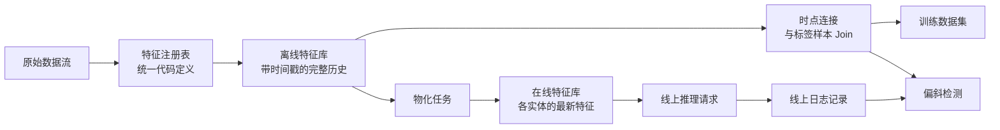

# 特征平台与训练-推理偏斜

> 特征只有一种业务定义，却有两个读取端：训练端按每个打标时刻回溯历史切片，而推理端读取当下的最新状态。当两端读取的数据产生分歧时，模型看到的将是它在离线阶段从未见过的奇异输入。

**类型：** 构建
**语言：** Python
**前置要求：** 阶段 2，第 08 课（特征工程）、第 13 课（ML 流水线）、第 15 课（时间序列）与第 19 课（ML 系统设计）
**预计时间：** ~100 分钟

## 学习目标

- 理解离线特征库、在线特征库、实体、事件时间戳与生存时间（TTL）的架构分工。
- 纯 Python 从零实现时点连接（Point-in-Time Join），并用数据证明朴素关联如何将未来信息泄露给训练集。
- 掌握导致训练-推理偏斜的四大根因：双轨独立代码路径、陈旧特征、默认兜底值不一致，以及时空穿越。
- 构建特征注册表（Feature Registry），实现由单一中心化定义同时驱动训练集生成与线上推理查询。
- 对历史时间段执行特征回填（Backfill），严格杜绝使用各时间点之后才产生的数据。
- 通过比对线上采样的真实特征日志与离线训练路径的重算结果，精准定位偏斜根因。

## 问题背景

算法团队正在构建一个流失预警模型。业务标签定义为：用户在打标基准日之后的 30 天内是否没有产生任何购买行为。团队按 `user_id` 将流失标签表与用户特征表进行关联，并在 `days_since_last_purchase`（距上次购买天数）特征上训练了一条单特征阈值规则，离线准确率高达 0.948。

然而一上线承接真实流量，模型的实际表现甚至不如先前极其简陋的旧版本。深入排查发现：特征表中始终保存着每个用户的最新状态（来自打标基准日后数周的快照）。某位在第 115 天完成最后一次消费的用户，在第 175 天的特征快照中显示为“连续 60 天未活跃”，特征直接把答案泄露给了模型。与此同时，另一个工程团队在独立的推理微服务中重新手写了特征计算逻辑：他们的 30 天滑动窗口多算了一天，且对无历史记录新用户的默认填充值是 -1，而训练端填充的是 365。

这两项缺陷有着共同的本质根源：训练和推理用两种完全独立的方式计算了所谓“同一个特征”。本课将带你纯 Python 从零实现特征平台（Feature Store）的核心基础设施：特征注册表、历史回填引擎、时点连接器、带 TTL 的在线特征库，以及偏斜检测组件，并用精确的数值重现上述两类灾难级缺陷。

## 核心概念

### 同一特征的两类读取端

训练与推理以完全不同的数据形态消费特征：

| 维度 | 离线训练端 | 线上推理端 |
|---|---|---|
| 查询场景 | "1000 万个（实体，历史时间点）二元组在当时的特征值各是多少？" | "当前这个实体在此时此刻的最新特征值是多少？" |
| 时间轴 | 历史上的多个离散时点 | 此时此刻的现在 |
| 吞吐体量 | 单次任务吞吐数千万行数据 | 每次用户请求仅查单行数据 |
| 延迟要求 | 跑数十分钟完全可以接受 | 必须在数毫秒内极速返回 |
| 底层存储 | **离线特征库**：携带事件时间戳的完整历史全量，通常存为列式 Parquet 文件或数仓大宽表 | **在线特征库**：每个实体的最新特征状态，通常存为 Redis、DynamoDB 等高性能分布式 KV 存储 |

特征平台的核心使命，就是通过一套唯一的特征代码定义，自动化持续同步并填满离线与在线两个存储端。将离线历史数据中的最新快照持续复制到在线 KV 存储中的同步任务被称为物化（Materialization）。



### 实体、时间戳与 TTL

四个核心概念定义了特征库中的每一条记录：

- **实体（Entity）。** 特征所描述的主体键（Primary Key），例如 `user_id` 或 `card_id`。
- **事件时间戳（Event timestamp）。** 该特征值在客观现实中生效成立的时间点。例如“截至第 14 天的 30 天购买量”对应的事件时间戳就是第 14 天。
- **创建时间戳（Created timestamp）。** 系统在底层将该条特征数据真正写入存储的时间点。今天执行的历史回填任务会写入带有极旧事件时间戳但带有极新创建时间戳的记录。
- **生存时间（TTL，Time to Live）。** 特征值的最大允许保鲜期。比 TTL 更陈旧的历史快照会被判定为缺失，读取端自动回退至预设的默认值。

一组具有相同实体键、相同数据源和相同 TTL 配置的特征集合通常被称为特征视图（Feature View）。

### 时点正确连接（Point-in-Time Join）

训练集样本必须将历史标签与该标签发生时刻客观存在的最精准特征进行配对。时点连接（亦称 As-of Join）针对每条标签样本严格执行以下四步：

1. 检索该实体对应的所有特征历史快照。
2. 过滤仅保留事件时间戳小于等于标签时间戳的历史记录。
3. 在符合条件的记录中选取事件时间戳最新的一条。
4. 若标签时间减去该记录的时间戳超过了 TTL，判定为过期并剔除。

假设某用户在第 16 天产生了一条流失标签，其每周离线特征快照如下：

| 快照产生日期 | `purchases_30d` | 时点连接（正确做法） | 按 `user_id` 朴素关联（错误做法） |
|---|---|---|---|
| 第 7 天 | 4 | | |
| 第 14 天 | 3 | **中选（最新有效）** | |
| 第 21 天 | 1 | 属于未来信息 | |
| 第 28 天 | 0 | 属于未来信息 | **中选（直接泄露答案）** |

这里的流失标签旨在预测用户在第 17 天到第 46 天期间是否会发生消费。第 28 天的特征已经把标签发生之后的静默流失期忠实地统计了进去，显现出 0 次购买。朴素关联直接将模型试图预测的结果当作输入喂给了模型。

我们在时间序列课程中出于完全相同的理由要求严格按时间切分。时点连接则是将这一防穿越原则细化落实到了每一个样本行的特征拼接中。

### 训练-推理偏斜的根因

Google 的《Rules of Machine Learning》将训练-推理偏斜（Training-Serving Skew）定义为模型在训练期的评估效果与在线上的真实表现之间的性能落差。指南列出了三大诱因：两套流水线处理数据的方式不同、训练与推理之间数据自身发生了漂移，以及反馈循环。在特征工程管道中，以下四类具体缺陷屡见不鲜：

| 缺陷类型 | 发生机制 | 课程演示中的具体表现 |
|---|---|---|
| 双轨独立代码实现 | 训练与推理端分别由不同人/语言独立手写特征逻辑 | 线上服务滑动窗口包含了 `now - 30` 当天，离线窗口未包含 |
| 特征陈旧度落差 | 线上读取的值与离线训练使用的特征快照存在时间跨度落差 | 离线训练基于每周一次的批量快照，线上微服务实时重算 |
| 默认兜底值不一致 | 两条路径在特征缺失时使用了不同的保底默认值 | 离线无购买记录填 365 天，线上微服务填 -1 |
| 时空穿越（未来泄露） | 离线训练集读取了标签时间点之后的未来特征值 | 朴素关联直接将第 175 天的最新快照赋给所有历史标签 |

同一指南的第 32 条准则强调：只要有可能，必须在训练流水线与服务流水线之间最大程度复用完全相同的代码。特征平台正是通过“一套代码定义、两端统一消费”来实现这一目标。

### 特征注册表（Feature Registry）

注册表是全公司所有特征定义的中心元数据目录。每一个条目清晰记录其名称、实体键、底层数据源、转换函数、滑动窗口、默认值、TTL、负责人、版本号与业务释义。

两大铁律确保注册表的架构安全：

- 离线批处理与在线实时服务均直接通过注册表调用同一套特征转换逻辑，任何业务服务严禁私自维护特征逻辑的本地副本。
- 特征定义的任何修改必须升级版本号派生新特征（如 `spend_30d@2`）。旧版本定义永久保留，确保线上存量模型能够稳定读取与训练时完全一致的特征数据。

### 历史特征回填（Backfills）

全新开发的特征在数仓中没有历史累积，但模型训练必须获取其在历史各个标签时刻的数值。回填任务遍历过去的每个关键日期节点，严格仅读取该日期或之前的事件数据来计算特征。

回填需要消耗可观的计算算力，且极易引入隐蔽的数据泄露。例如今天运行的历史回填如果读取了上个月由于上游对账才延迟修正补录的脏数据，就引发了隐式时空穿越。因此严格的时点连接除了校验事件时间戳，还应同时校验创建时间戳必须早于或等于标签时间。

### 偏斜检测

上述指南的第 29 条准则建议：在推理时将特征快照持久化打点到日志中，并用于模型训练与对齐。即使只抽取极小比例的线上日志样本，也能帮助我们建立端到端的一致性校验门禁。

通过三组对比能够精准定位偏斜的根源：

1. **在线存储读取 vs 离线训练时点连接。** 检验两套存储端是否完全同步，正常情况下偏斜应为 0。
2. **离线实时动态重算 vs 离线训练时点连接。** 排查因时效性（批处理周期 vs 实时）引起的单纯陈旧度落差。
3. **第二套独立代码 vs 离线实时动态重算。** 剥离时效性影响，纯粹排查代码逻辑实现差异（如窗口边界、默认兜底值）。

```figure
mlprod-pit-join
```

## 动手构建

`code/main.py` 中的代码仅依赖 Python 标准库。时间以整数天表示。模拟的每周批处理任务会在第 7、14... 直至第 175 天输出特征快照。

### 第 1 步：特征定义与注册表

`FeatureDefinition` 将转换逻辑抽象为数据驱动的对象：包含聚合类型、时间窗口与默认值。其 `compute` 方法坚决不读取晚于 `as_of` 的事件。

```python
@dataclass(frozen=True)
class FeatureDefinition:
    name: str
    entity: str
    aggregate: str
    window_days: int | None
    default: float
    version: int = 1
    owner: str = "growth-team"
    description: str = ""

    def compute(self, events: list[Event], as_of: int) -> float:
        visible = [e for e in events if e.day <= as_of]
        if self.window_days is not None:
            visible = [e for e in visible if e.day > as_of - self.window_days]
        if self.aggregate == "count":
            return float(len(visible))
        if self.aggregate == "sum":
            return round(sum(e.amount for e in visible), 2)
        if self.aggregate == "days_since_last":
            return float(as_of - max(e.day for e in visible)) if visible else self.default
        raise ValueError(f"unknown aggregate {self.aggregate!r}")
```

`FeatureRegistry.register` 幂等支持重复注册相同的定义，但会当场拦截名称与版本相同但具体逻辑有分歧的定义。`fill_defaults` 保证两端采用一致的默认值。

模型通过带版本的引用语法（如 `spend_30d@1`）锁定特征定义，省略 `@` 则默认读取最新版本。若带了 `@` 却缺少版本号则会触发报错，杜绝因拼写笔误意外读取未经测试的新特征。该版本化引用同时作为持久化存储中的列名 Key，确保回填、在线存储和推理读取始终对齐。

### 第 2 步：离线特征库历史回填

```python
def backfill(registry: FeatureRegistry, names: list[str], events: list[Event], days: list[int]) -> list[FeatureRow]:
    rows = []
    for entity, entity_events in sorted(group_events(events).items()):
        for day in days:
            rows.append(FeatureRow(entity, day, registry.compute(names, entity_events, day)))
    return rows
```

演示程序为 299 名用户在 25 个快照日期上回填了 3 个核心特征，共生成 7475 行历史数据。

### 第 3 步：时点连接实现

按实体对历史特征快照按日期进行预排序。针对每条标签样本，利用 `bisect_right` 二分查找在标签日期或之前产生的最后一条快照。随后的 TTL 校验会自动剔除过于久远的陈旧记录。

```python
def point_in_time_join(labels: list[LabelRow], rows: list[FeatureRow], ttl_days: int | None = None) -> list[JoinedRow]:
    by_entity: dict[str, list[FeatureRow]] = defaultdict(list)
    for row in rows:
        by_entity[row.entity].append(row)
    days_index = {}
    for entity, entity_rows in by_entity.items():
        entity_rows.sort(key=lambda r: r.day)
        days_index[entity] = [r.day for r in entity_rows]
    joined = []
    for label in labels:
        days = days_index.get(label.entity, [])
        pos = bisect.bisect_right(days, label.day) - 1
        match = by_entity[label.entity][pos] if pos >= 0 else None
        if match is not None and ttl_days is not None and label.day - match.day > ttl_days:
            match = None
        joined.append(JoinedRow(
            label.entity, label.day, label.label,
            match.day if match else None, match.values if match else None,
        ))
    return joined
```

### 第 4 步：量化朴素关联带来的未来信息泄露

`naive_latest_join` 仅凭实体键进行关联，直接为每个样本关联其最新的特征状态。演示程序在第 100、120 和 140 天生成标签，并在两组训练集上分别训练单特征规则，随后在第 145 天的新样本上进行验证：

```console
  naive join used a snapshot from after the label day for 100% of rows
  offline accuracy, naive join: 0.948 (rule: idle > 53 days)
  offline accuracy, PIT join:   0.893 (rule: idle > 19 days)
  accuracy on day 145, trained with naive join: 0.763
  accuracy on day 145, trained with PIT join:   0.876
```

朴素关联在离线评估时看起来极其惊艳（0.948 vs 0.893）。但在真实新样本上其实际准确率暴跌至 0.763（落后正确时点连接的 0.876）。泄露的未来特征直接误导模型把分类阈值从真实的 19 天错误抬高到了 53 天。

### 第 5 步：在线特征存储与数据物化

在线存储维护每个实体当前的最新特征状态，且自动拒绝超出 TTL 的过期数据。`materialize` 仅同步写入日期小于等于当前批次时间的记录。

```python
class OnlineStore:
    def __init__(self, ttl_days: int):
        self.ttl_days = ttl_days
        self._latest: dict[str, FeatureRow] = {}

    def write(self, row: FeatureRow) -> None:
        current = self._latest.get(row.entity)
        if current is None or row.day >= current.day:
            self._latest[row.entity] = row

    def read(self, entity: str, now: int) -> dict[str, float] | None:
        row = self._latest.get(entity)
        if row is None or row.day > now or now - row.day > self.ttl_days:
            return None
        return dict(row.values)
```

在 TTL 设为 10 天时，第 145 天发起查询能顺利命中第 140 天同步的快照；而第 160 天查询时若中途未发生新的物化同步，由于数据已陈旧达 20 天，在线存储会自动降级返回系统默认值。

### 第 6 步：偏斜检测器

`detect_skew` 接收以 `(entity, day)` 为键的两份特征视图，统计每个特征的不一致比例与平均绝对差值，当不一致比例超出 1% 时标记报警。

```python
def detect_skew(
    training: dict[tuple[str, int], dict[str, float]],
    serving: dict[tuple[str, int], dict[str, float]],
    features: list[str],
    tolerance: float = 1e-6,
    max_mismatch_rate: float = 0.01,
) -> list[SkewReport]:
    if set(training) != set(serving):
        raise ValueError(f"{len(set(training) ^ set(serving))} keys are in only one view: log and compare the same requests")
    if not training:
        raise ValueError("no requests to compare")
    keys = sorted(training)
    reports = []
    for feature in features:
        diffs = [abs(training[k][feature] - serving[k][feature]) for k in keys]
        mismatches = sum(1 for d in diffs if d > tolerance)
        rate = mismatches / len(keys)
        mean_diff = sum(diffs) / len(keys)
        reports.append(SkewReport(feature, len(keys), rate, mean_diff, rate > max_mismatch_rate))
    return reports
```

演示程序在第 141 天到第 150 天采样记录线上真实请求，并运行核心概念小节的三组对比：

```bash
python3 phases/02-ml-fundamentals/21-feature-stores-and-training-serving-skew/code/main.py
```

```console
=== Skew checks on 383 logged requests, days 141 to 150 ===
  online store read  vs  training join (one definition, same snapshots)
    ok   days_since_last_purchase   mismatch   0.0%  mean |diff|    0.00
    ok   purchases_30d              mismatch   0.0%  mean |diff|    0.00
    ok   spend_30d                  mismatch   0.0%  mean |diff|    0.00
  fresh compute      vs  training join (staleness only)
    SKEW days_since_last_purchase   mismatch  83.0%  mean |diff|    2.77
    SKEW purchases_30d              mismatch  30.5%  mean |diff|    0.38
    SKEW spend_30d                  mismatch  37.1%  mean |diff|   16.77
  second code path   vs  fresh compute (code differences only)
    SKEW days_since_last_purchase   mismatch   5.5%  mean |diff|   20.07
    SKEW purchases_30d              mismatch  12.5%  mean |diff|    0.13
    SKEW spend_30d                  mismatch  12.5%  mean |diff|    5.09
```

- **统一代码、相同快照。** 在线存储读取与离线训练关联直接对应同一批物化数据，偏斜为 0。
- **单纯时效性落差。** 实时动态重算的值与离线周快照在绝大多数请求上存在数值差。在这里更实时的数据并不意味着更好，因为模型是在长达 6 天前的快照上训练出来的。
- **独立代码差异。** 独立实现的第二套代码在 12.5% 的滑动窗口计数上发生偏斜（因为窗口多算了一天）；且在针对无行为新用户时，`days_since_last_purchase` 产生了 -1 与 365 的巨大分歧。

## 实际使用

**Feast 工业级特征平台。** Feast 是业界主流的开源特征存储框架。我们手写的组件在 Feast 中均有精准对照：

| 手写组件 | Feast 对应概念 |
|---|---|
| `FeatureDefinition`、`FeatureRegistry` | `Entity`、`FeatureView` 与 `Field`，通过 `feast apply` 声明与发布 |
| `FeatureRow` 历史表 | 离线特征库（如基于 Parquet 文件的 `FileSource` 或数仓大宽表） |
| 带 TTL 的 `point_in_time_join` | `store.get_historical_features(entity_df=..., features=[...])` |
| `materialize` 物化 | `feast materialize-incremental <截止时间>` CLI 命令或定时任务 |
| `OnlineStore.read` | `store.get_online_features(features=[...], entity_rows=[...])` |
| 创建时间戳防泄露 | 数据源上的 `created_timestamp_column` 与参数 `filter_by_created_timestamp=True` |

```python
from datetime import timedelta

from feast import Entity, FeatureView, Field, FileSource
from feast.types import Float32, Int64

user = Entity(name="user", join_keys=["user_id"])

user_activity_source = FileSource(
    name="user_activity_source",
    path="data/user_activity.parquet",
    timestamp_field="event_timestamp",
    created_timestamp_column="created",
)

user_activity = FeatureView(
    name="user_activity",
    entities=[user],
    ttl=timedelta(days=10),
    schema=[
        Field(name="purchases_30d", dtype=Int64),
        Field(name="spend_30d", dtype=Float32),
        Field(name="days_since_last_purchase", dtype=Int64),
    ],
    source=user_activity_source,
)
```

训练与在线推理直接消费同一个特征视图：

```python
from feast import FeatureStore

store = FeatureStore(repo_path=".")

training_df = store.get_historical_features(
    entity_df=labels_df,
    features=["user_activity:purchases_30d", "user_activity:days_since_last_purchase"],
    filter_by_created_timestamp=True,
).to_df()

online = store.get_online_features(
    features=["user_activity:purchases_30d", "user_activity:days_since_last_purchase"],
    entity_rows=[{"user_id": 42}],
).to_dict()
```

Feast 官方文档明确说明：TTL 是相对于实体数据集（`labels_df`）中的各时间戳计算的，这与我们手写的时点连接机制完全一致。参数 `filter_by_created_timestamp=True` 能够确保后来补填修正的数据不会穿越回流至早期的训练切片中。

Tecton、Hopsworks 以及各大公有云 ML 平台均遵循相同的离线/在线分层解耦架构；而对于偏斜检测，TensorFlow Data Validation 同样支持在训练与线上日志间建立自动化偏差检测流水线。

## 拿去用

本课交付的产物为 `outputs/skill-feature-skew-audit.md`。该 Skill 能够系统审计特征流水线中的时空穿越与训练-推理偏斜风险，逐一核查关联逻辑、特征代码定义、默认值处理、两端时效性差异，以及偏斜检测所需的埋点日志规范。

## 练习

1. 将快照生成的间隔从 7 天缩短到 1 天。重新运行演示程序并分析时效性落差对比的变化。
2. 将 TTL 缩短为 3 天。统计有多少训练样本行因为超出时效而被迫降级填充了默认值。
3. 为 `FeatureRow` 新增创建时间戳字段（created day），修改时点连接使其自动忽略在标签时间点之后才写入的记录。
4. 将 `spend_7d` 注册为 `spend_30d` 的第 2 个版本。运行回填并在注册表中同时打印出两个版本。
5. 修复 `legacy_serving_features` 中的双轨代码缺陷，直到第三组偏斜检测完全通过。

## 关键术语

| 术语 | 常见说法 | 实际含义 |
|---|---|---|
| 特征平台（Feature store） | "特征数据库" | 依据统一代码定义计算特征，并同时向离线训练与线上推理供给数据的平台系统 |
| 离线特征库（Offline store） | "训练特征底表" | 携带事件时间戳的完整全量特征历史，供批量训练与回填任务使用 |
| 在线特征库（Online store） | "特征缓存" | 实体当前的最新有效特征状态，供线上推理微服务在数毫秒内高速查表 |
| 实体（Entity） | "主体 ID" | 特征所描述的主键对象，例如用户 ID、店铺 ID 或银行卡号 |
| 事件时间戳 | "发生时间" | 某项特征数据在客观现实世界中成立生效的时间点 |
| 时点连接（Point-in-time join） | "防穿越关联" | 将每个标签样本与在该标签时间或之前生成的最新有效特征记录进行关联的算法 |
| 生存时间（TTL） | "过期时间" | 特征快照的最大保鲜期，超出该期限的数据在读取时直接被视为缺失 |
| 物化（Materialization） | "同步到线上" | 将离线特征库中产生的最新快照批量搬运并刷新到在线 KV 存储中的调度任务 |
| 特征回填（Backfill） | "补算历史特征" | 在历史多个离散时间点上回溯运行特征代码定义，为其生成历史序列数据 |
| 训练-推理偏斜 | "离线很强线上拉胯" | 离线训练阶段所见特征与线上实际承接特征在统计分布或数值计算上存在的系统性分歧 |

## 延伸阅读

- [Feast, Point-in-time joins 官方文档](https://docs.feast.dev/getting-started/concepts/point-in-time-joins)：TTL 语义定义与创建时间戳过滤机制
- [Feast 核心架构文档](https://docs.feast.dev/)：特征视图、离线库、在线库与物化流程详解
- [Google, Rules of Machine Learning](https://developers.google.com/machine-learning/guides/rules-of-ml)：关于训练-推理偏斜的经典工程指导准则（Rule #29 至 Rule #37）
- [Breck et al., Data Validation for Machine Learning (SysML 2019)](https://research.google/pubs/data-validation-for-machine-learning/)：Google TFX 平台中的数据校验与偏斜检测实战
- [TensorFlow Data Validation 官方指南](https://www.tensorflow.org/tfx/guide/tfdv)：Schema 校验、偏斜检测与漂移检测
- [Sculley et al., Hidden Technical Debt in Machine Learning Systems (NeurIPS 2015)](https://papers.nips.cc/paper/2015/hash/86df7dcfd896fcaf2674f757a2463eba-Abstract.html)：机器学习系统中的数据依赖与流水线技术债务剖析
