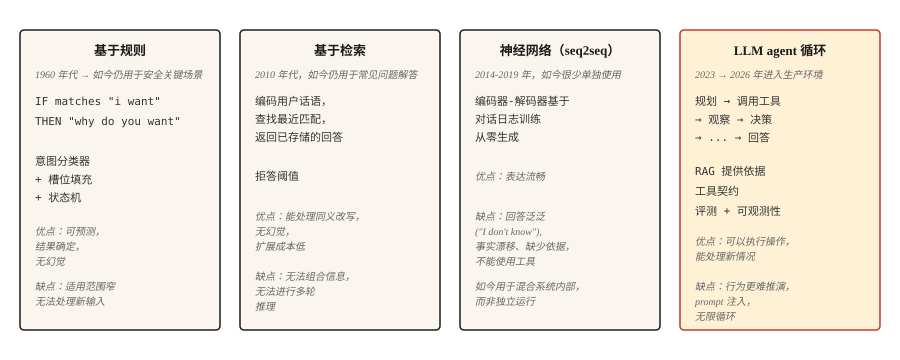

# 聊天机器人 —— 从规则到神经再到 LLM agent

> ELIZA 用模式匹配回复。DialogFlow 映射意图。GPT 从权重里答题。Claude 跑工具并核验。每个时代都解决了上一个时代最显眼的失败。

**类型：** Learn
**语言：** Python、TypeScript
**前置要求：** Phase 5 · 13（问答）、Phase 5 · 14（信息检索）
**预计时间：** ~75 分钟

## 问题背景

用户说 "I want to change my flight."。系统得弄清他们想要什么、缺哪些信息、怎么拿到、怎么完成动作。然后用户又说 "wait, what if I cancel instead?"，系统得记住上下文、切换任务、保住状态。

对话对 ML 系统来说很难。输入是开放式的。输出得在很多轮里保持连贯。系统可能需要对世界采取行动（改签、扣款）。每一步走错用户都看得见。

聊天机器人架构循环过四个范式，每个的引入都是因为前一个失败得太显眼。这节课按顺序走一遍。2026 年的生产格局是后两个的混合。

## 核心概念



### 脚本机器人的半个世纪：1950-2001

第一个范式延续的不是五年，而是整整五十年。理解这段历史很重要，因为其中每个系统本质上都是同一台机器：匹配输入、输出预制回复、更新少量状态。给这台机器添加了五十年规则，仍没有得到通用能力。正是这个上限，催生了后面的三个范式。

**1950 年。** Turing 没有直接回答“机器能思考吗”，而是提出了一个可操作的替代问题：如果询问者通过电传打字无法分辨机器和人，那么原来的哲学问题就失去了实际意义。这个领域还没有名字，对话就先成了它的基准。

**1956 年。** 名字出现了。Dartmouth 夏季研讨会提出“智能的每个方面，原则上都能被精确描述到可由机器模拟”，并由此创造了“人工智能”一词。提案原本只为取得实质进展预留了两个月。

**1966 年。** ELIZA 带来了你会在第 1 步实现的反射技巧：分解规则从输入中抽取片段，重组规则再把它们变成问题反射回去。总共约 200 个模式，没有状态，也没有理解，但用户仍愿意向它倾诉。Weizenbaum 的余生都在警惕：让人产生这种错觉所需的机制竟如此之少。

**1972 年。** Stanford 为模拟偏执症而开发的 PARRY，补上了 ELIZA 缺少的内部状态。恐惧、愤怒和不信任三个数值变量会在每轮更新，并决定下一段脚本能否触发，因此相同输入会因之前的对话而产生不同回复。在一次盲测中，精神科医生区分 PARRY 和真实患者的表现与随机猜测相当。它是人格条件化的直接祖先，相当于用三个浮点数实现系统 prompt。同年，人们让两个机器人通过 ARPANET 对话：治疗师脚本采访偏执状态机，成为网络上的第一次机器人对机器人对话。

**1995 年。** ALICE 用 AIML 扩展了 ELIZA 的配方。AIML 是一种描述模式-模板对的 XML 方言，包含约 4 万个手写类别，并三次赢得 Loebner Prize。它证明了基于规则系统的扩展规律：更多规则可以买到覆盖率，却买不到通用性；每条规则都成了需要维护的负债。

**2001 年。** SmarterChild 把这套配方带给 3000 万即时通信用户，并把天气、股票和电影场次等后端查询嵌入模板。换个角度看，这就是披着 2001 年外衣的工具调用：解析意图、调用服务、把结果渲染进回复。

五十年，一套机制，不断增长的规则数量。这个范式的终结并非因为它被理论推翻，而是因为手写状态机的维护成本随覆盖范围线性增长，用户预期却会跟着上周见过的最好产品不断上涨。

```figure
chatbot-lineage
```

**基于规则（ELIZA、AIML、DialogFlow）。** 手工撰写的模式匹配用户输入并产出回复。意图分类器把请求路由到预定义的流程。槽位填充状态机收集所需信息。在为它设计的窄范围内运转得漂亮，一出范围立刻翻车。在不容忍幻觉的安全关键领域（银行身份认证、机票预订）至今还在用。

**基于检索。** 一个 FAQ 式系统。把每一对（话语，回复）编码。运行时，编码用户的消息，检索出最近的已存回复。想想 Zendesk 经典的"相似文章"功能。比规则更能处理复述。不生成，所以不幻觉。

**神经（seq2seq）。** 在对话日志上训练的编码器-解码器。从零生成回复。流畅，但容易给出泛泛输出（"I don't know"）和事实漂移。从不可靠地切题。这是 Google、Facebook、Microsoft 在 2016-2019 年都做出令人失望的聊天机器人的原因。

**LLM agent。** 一个语言模型，包在一个会规划、调工具、核验结果的循环里。这不是带长 prompt 的聊天机器人，而是一个 agent 循环：规划 → 调工具 → 观察结果 → 决定下一步。检索优先的接地（RAG）让它不至于幻觉。工具调用让它能真的做事。这就是 2026 年的架构。

这四个范式不是顺序替换关系。一个 2026 年的生产聊天机器人会穿过全部四个：基于规则做认证和破坏性动作，检索做 FAQ，神经生成做自然措辞，LLM agent 做模糊的开放式查询。

## 动手构建

### 第 1 步：基于规则的模式匹配

```python
import re


class RulePattern:
    def __init__(self, pattern, response_template):
        self.regex = re.compile(pattern, re.IGNORECASE)
        self.template = response_template


PATTERNS = [
    RulePattern(r"my name is (\w+)", "Nice to meet you, {0}."),
    RulePattern(r"i (need|want) (.+)", "Why do you {0} {1}?"),
    RulePattern(r"i feel (.+)", "Why do you feel {0}?"),
    RulePattern(r"(.*)", "Tell me more about that."),
]


def rule_based_respond(user_input):
    for pattern in PATTERNS:
        m = pattern.regex.match(user_input.strip())
        if m:
            return pattern.template.format(*m.groups())
    return "I don't understand."
```

20 行的 ELIZA。那个反射小把戏（"I feel sad" → "Why do you feel sad"）是 Weizenbaum 1966 年经典的心理治疗师演示。至今仍有启发。

### 第 2 步：基于检索（FAQ）

这个示例片段需要 `pip install sentence-transformers`（它会带进 torch）。本课可运行的 `code/main.py` 改用标准库的 Jaccard 相似度，所以这节课无需外部依赖也能跑。

```python
from sentence_transformers import SentenceTransformer
import numpy as np


FAQ = [
    ("how do i reset my password", "Go to Settings > Security > Reset Password."),
    ("how do i cancel my order", "Go to Orders, find the order, click Cancel."),
    ("what is your return policy", "30-day returns on unused items, original packaging."),
]


encoder = SentenceTransformer("sentence-transformers/all-MiniLM-L6-v2")
faq_questions = [q for q, _ in FAQ]
faq_embeddings = encoder.encode(faq_questions, normalize_embeddings=True)


def faq_respond(user_input, threshold=0.5):
    q_emb = encoder.encode([user_input], normalize_embeddings=True)[0]
    sims = faq_embeddings @ q_emb
    best = int(np.argmax(sims))
    if sims[best] < threshold:
        return None
    return FAQ[best][1]
```

基于阈值的拒答是关键的设计选择。如果最佳匹配不够接近，就返回 `None`，让系统升级处理。

### 第 3 步：神经生成（基线）

用一个小的指令微调编码器-解码器（FLAN-T5）或一个微调过的对话模型。2026 年它单独用是没法上生产的（自相矛盾、跑题漂移、事实胡言），但在混合系统里它负责自然措辞。DialoGPT 式的仅解码器模型需要显式的轮次分隔符和 EOS 处理才能产出连贯回复；一个 FLAN-T5 的 text2text 流水线开箱即用，适合教学例子。

```python
from transformers import pipeline

chatbot = pipeline("text2text-generation", model="google/flan-t5-small")

response = chatbot("Respond politely to: Hi there!", max_new_tokens=40)
print(response[0]["generated_text"])
```

### 第 4 步：LLM agent 循环

2026 年的生产形态：

```python
def agent_loop(user_message, tools, llm, max_steps=5):
    history = [{"role": "user", "content": user_message}]
    for _ in range(max_steps):
        response = llm(history, tools=tools)
        tool_call = response.get("tool_call")
        if tool_call:
            tool_name = tool_call.get("name")
            args = tool_call.get("arguments")
            if not isinstance(tool_name, str) or tool_name not in tools:
                history.append({"role": "assistant", "tool_call": tool_call})
                history.append({"role": "tool", "name": str(tool_name), "content": f"error: unknown tool {tool_name!r}"})
                continue
            if not isinstance(args, dict):
                history.append({"role": "assistant", "tool_call": tool_call})
                history.append({"role": "tool", "name": tool_name, "content": f"error: arguments must be a dict, got {type(args).__name__}"})
                continue
            fn = tools[tool_name]
            result = fn(**args)
            history.append({"role": "assistant", "tool_call": tool_call})
            history.append({"role": "tool", "name": tool_name, "content": result})
        else:
            return response["content"]
    return "I could not complete the task in the step budget."
```

三件事要点名。工具是 LLM 能调用的可调函数。当 LLM 返回最终答案而非工具调用时循环终止。步数预算防止在模糊任务上无限循环。

真实生产还会加上：检索优先的接地（每次 LLM 调用前注入相关文档）、护栏（未经确认拒绝破坏性动作）、可观测性（记录每一步）、评估（自动检查 agent 行为是否守规）。

### 第 5 步：混合路由

```python
def hybrid_chat(user_input):
    if is_destructive_action(user_input):
        return structured_flow(user_input)

    faq_answer = faq_respond(user_input, threshold=0.6)
    if faq_answer:
        return faq_answer

    return agent_loop(user_input, tools, llm)


def is_destructive_action(text):
    danger_words = ["delete", "cancel", "charge", "refund", "transfer"]
    return any(w in text.lower() for w in danger_words)
```

这个模式：任何破坏性的事用确定性规则，套话 FAQ 用检索，其他一切用 LLM agent。这就是 2026 年客服系统里上线的东西。

## 实际使用

2026 年的栈：

| 用例 | 架构 |
|---------|---------------|
| 预订、支付、认证 | 基于规则的状态机 + 槽位填充 |
| 客服 FAQ | 在精选答案上做检索 |
| 开放式帮助对话 | 配 RAG + 工具调用的 LLM agent |
| 内部工具 / IDE 助手 | 配工具调用（搜索、读、写）的 LLM agent |
| 陪伴 / 角色聊天机器人 | 带人设系统 prompt 的微调 LLM，在知识上做检索 |

生产里永远用混合路由。没有单一架构能把每个请求都处理好。路由层本身通常是一个小的意图分类器。

## 至今仍在上线的翻车方式

- **自信编造。** LLM agent 声称完成了一个它没做的动作。缓解：核验结果、记录工具调用、绝不让 LLM 在没有成功的工具返回时声称做了某事。
- **prompt 注入。** 用户插入文本来覆盖系统 prompt。在 OWASP Top 10 for LLM Applications 2025 里排第一（LLM01）。两种口味：直接注入（粘进聊天里）和间接注入（藏在 agent 读取的文档、邮件或工具输出里）。

  攻击成功率因场景而异。在通用工具使用和编码基准里，前沿模型的实测成功率在 ~0.5-8.5% 之间。特定高风险设置（针对 AI 编码 agent 的自适应攻击、脆弱的编排）已达到 ~84%。生产中的 CVE 包括 EchoLeak（CVE-2025-32711，CVSS 9.3）——Microsoft 365 Copilot 里一个由攻击者控制的邮件触发的零点击数据外泄漏洞。

  缓解：在整个循环里把用户输入视为不可信；工具调用前消毒；把工具输出与主 prompt 隔离；用 Plan-Verify-Execute（PVE）模式，让 agent 先规划，再对照规划核验每个动作后才执行（这阻止工具结果注入新的、未规划的动作）；破坏性动作要求用户确认；对工具权限范围施加最小权限。

  再多 prompt 工程也无法完全消除这个风险。需要外部运行时防御层（LLM Guard、白名单校验、语义异常检测）。

- **范围蔓延。** agent 因为一次工具调用返回了沾边的信息而跑题。缓解：收窄工具契约；让系统 prompt 聚焦；为跑题率加评估。
- **无限循环。** agent 一直调同一个工具。缓解：步数预算、工具调用去重、用 LLM 裁判判断"我们在取得进展吗"。
- **上下文窗口耗尽。** 长对话把最早的轮次挤出上下文。缓解：摘要旧轮次、按相似度检索相关的过往轮次，或用长上下文模型。

## 拿去用

存为 `outputs/skill-chatbot-architect.md`：

```markdown
---
name: chatbot-architect
description: Design a chatbot stack for a given use case.
version: 1.0.0
phase: 5
lesson: 17
tags: [nlp, agents, chatbot]
---

Given a product context (user need, compliance constraints, available tools, data volume), output:

1. Architecture. Rule-based, retrieval, neural, LLM agent, or hybrid (specify which paths go where).
2. LLM choice if applicable. Name the model family (Claude, GPT-4, Llama-3.1, Mixtral). Match to tool-use quality and cost.
3. Grounding strategy. RAG sources, retrieval method (see lesson 14), tool contracts.
4. Evaluation plan. Task success rate, tool-call correctness, off-task rate, hallucination rate on held-out dialogs.

Refuse to recommend a pure-LLM agent for any destructive action (payments, account deletion, data modification) without a structured confirmation flow. Refuse to skip the prompt-injection audit if the agent has write access to anything.
```

## 练习

1. **简单。** 为一个咖啡店点单机器人，用 10 个模式实现上面的基于规则回复。测边界情况：重复下单、修改、取消、意图不清。
2. **中等。** 搭一个混合 FAQ + LLM 兜底。为一个 SaaS 产品准备 50 条套话 FAQ 条目，LLM 兜底在文档站上做检索。在 100 个真实客服问题上测拒答率和准确率。
3. **困难。** 用三个工具（搜索、读用户数据、发邮件）实现上面的 agent 循环。用 50 个测试场景（含 prompt 注入尝试）跑一次评估。报告跑题率、失败任务率，以及任何注入成功的情况。

## 关键术语

| 术语 | 人们怎么说 | 它实际是什么 |
|------|-----------------|-----------------------|
| 意图（Intent） | 用户想要什么 | 类别标签（book_flight、reset_password）。路由到一个处理器。 |
| 槽位（Slot） | 一条信息 | 机器人需要的参数（日期、目的地）。槽位填充是一连串的提问。 |
| RAG | 检索加生成 | 检索相关文档，再为 LLM 的回复接地。 |
| 工具调用（Tool call） | 函数调用 | LLM 发出一个带名字 + 参数的结构化调用。运行时执行，返回结果。 |
| agent 循环 | 规划、行动、核验 | 一个控制器，把 LLM 调用与工具调用交错运行，直到任务完成。 |
| prompt 注入 | 用户攻击 prompt | 试图覆盖系统 prompt 的恶意输入。 |

## 延伸阅读
- [Turing (1950). Computing Machinery and Intelligence](https://academic.oup.com/mind/article/LIX/236/433/986238) —— 让对话成为这个领域基准的论文。

- [Colby, Weber, Hilf (1971). Artificial Paranoia](https://doi.org/10.1016/0004-3702(71)90002-6) —— PARRY 的情绪变量架构，也是第一个有状态聊天机器人。
- [Weizenbaum (1966). ELIZA — A Computer Program For the Study of Natural Language Communication](https://web.stanford.edu/class/cs124/p36-weizenabaum.pdf) —— 原始的基于规则聊天机器人论文。
- [Thoppilan et al. (2022). LaMDA: Language Models for Dialog Applications](https://arxiv.org/abs/2201.08239) —— Google 后期的神经聊天机器人论文，恰在 LLM agent 接管之前。
- [Yao et al. (2022). ReAct: Synergizing Reasoning and Acting in Language Models](https://arxiv.org/abs/2210.03629) —— 给 agent 循环模式命名的那篇论文。
- [Anthropic's guide on building effective agents](https://www.anthropic.com/research/building-effective-agents) —— 2024 年的生产指南，到 2026 年仍然成立。
- [Greshake et al. (2023). Not what you've signed up for: Compromising Real-World LLM-Integrated Applications with Indirect Prompt Injection](https://arxiv.org/abs/2302.12173) —— prompt 注入论文。
- [OWASP Top 10 for LLM Applications 2025 — LLM01 Prompt Injection](https://genai.owasp.org/llmrisk/llm01-prompt-injection/) —— 让 prompt 注入成为头号安全顾虑的那个排名。
- [AWS — Securing Amazon Bedrock Agents against Indirect Prompt Injections](https://aws.amazon.com/blogs/machine-learning/securing-amazon-bedrock-agents-a-guide-to-safeguarding-against-indirect-prompt-injections/) —— 实用的编排层防御，包括 Plan-Verify-Execute 和用户确认流程。
- [EchoLeak (CVE-2025-32711)](https://www.vectra.ai/topics/prompt-injection) —— 间接 prompt 注入导致零点击数据外泄的经典 CVE。说明为什么有写权限的 agent 需要运行时防御的参考案例。
