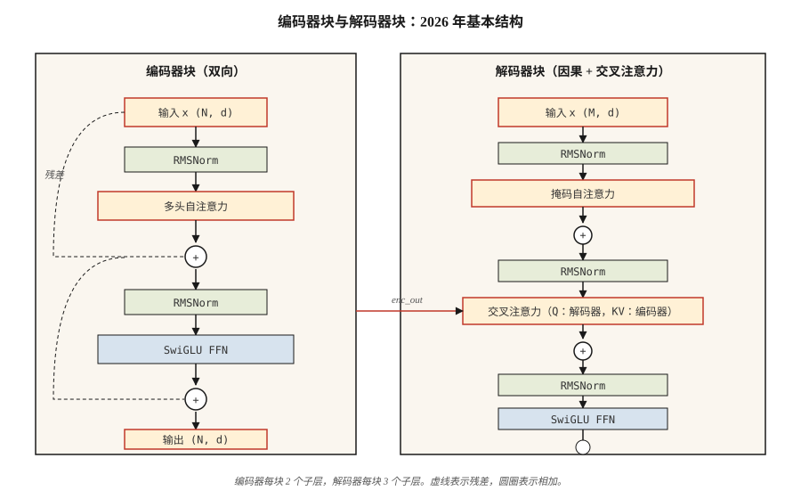

# 完整的 Transformer —— Encoder + Decoder

> 注意力是主角。其他一切——残差、归一化、前馈、cross-attention——都是让你能把它叠深的脚手架。

**类型：** Build
**语言：** Python
**前置要求：** 阶段 7 · 02（Self-Attention）、阶段 7 · 03（Multi-Head Attention）、阶段 7 · 04（Positional Encoding）
**预计时间：** ~75 分钟

## 问题背景

单个注意力层是一个特征提取器，不是一个模型。每层一次 matmul 的容量喂不饱语言。你需要深度——而没有正确的管道铺设，深度就会崩。

2017 年 Vaswani 论文打包了六个设计决策，把一个注意力层变成了可堆叠的 block。此后的每个 transformer——纯编码器（BERT）、纯解码器（GPT）、编码器-解码器（T5）——都继承了同一副骨架。2026 年这些 block 被打磨过（RMSNorm、SwiGLU、pre-norm、RoPE），但骨架一模一样。

这节课讲的是骨架。后面几课把它特化——06 讲编码器，07 讲解码器，08 讲编码器-解码器。

## 核心概念



### 六个部件

1. **嵌入 + 位置信号。** token → 向量。位置通过 RoPE（现代）或正弦（经典）注入。
2. **Self-attention。** 每个位置关注其他每个位置。解码器里要掩码。
3. **前馈网络（FFN）。** 逐位置的两层 MLP：`W_2 · activation(W_1 · x)`。默认扩展比 4×。
4. **残差连接。** `x + sublayer(x)`。没有它，梯度过了约 6 层就消失。
5. **层归一化。** `LayerNorm` 或 `RMSNorm`（现代）。稳定残差流。
6. **Cross-attention（仅解码器）。** query 来自解码器，key 和 value 来自编码器输出。

看一个向量怎么流过一个 block：注意力跨位置做混合，残差把它往前带，FFN 做变换，归一化保持残差流稳定。

```figure
transformer-block
```

### Encoder block（BERT、T5 编码器在用）

```
x → LN → MHA(self) → + → LN → FFN → + → out
                     ^              ^
                     |              |
                     └── residual ──┘
```

编码器是双向的。无掩码。所有位置都能看到所有位置。

### Decoder block（GPT、T5 解码器在用）

```
x → LN → MHA(masked self) → + → LN → MHA(cross to encoder) → + → LN → FFN → + → out
```

解码器每个 block 有三个子层。中间那个——cross-attention——是信息从编码器流向解码器的唯一地方。在纯解码器架构（GPT）里，cross-attention 被省掉，你只有 masked self-attention + FFN。

### Pre-norm vs post-norm

原论文：`x + sublayer(LN(x))` 对比 `LN(x + sublayer(x))`。post-norm 在 2019 年前后失宠——不仔细做 warmup 就难以训深。pre-norm（`LN` 在子层*之前*）是 2026 年的默认：Llama、Qwen、GPT-3+、Mistral 全用它。

### 2026 年的现代化 block

Vaswani 2017 出厂的是 LayerNorm + ReLU。现代栈把两个都换了。生产 block 实际长这样：

| 组件 | 2017 | 2026 |
|-----------|------|------|
| 归一化 | LayerNorm | RMSNorm |
| FFN 激活 | ReLU | SwiGLU |
| FFN 扩展 | 4× | 2.6×（SwiGLU 用三个矩阵，总参数对齐） |
| 位置 | 正弦绝对位置 | RoPE |
| 注意力 | 完整 MHA | GQA（或 MLA） |
| 偏置项 | 有 | 无 |

RMSNorm 砍掉了 LayerNorm 的均值中心化（少一次减法），省算力，而且经验上至少同样稳定。SwiGLU（`Swish(W1 x) ⊙ W3 x`）在 Llama、PaLM 和 Qwen 论文里一致地比 ReLU/GELU FFN 好约 0.5 个点的 ppl。

### 参数量

对于一个 `d_model = d`、FFN 扩展 `r` 的 block：

- MHA：`4 · d²`（Q、K、V、O 投影）
- FFN（SwiGLU）：`3 · d · (r · d)` ≈ `3rd²`
- 归一化：可忽略

在 `d = 4096, r = 2.6, layers = 32`（大致是 Llama 3 8B）时，每层约有 `4 · 4096² = 67M` 个注意力参数，以及 `3 · 2.6 · 4096² = 131M` 个 FFN 参数，合计约 198M；32 层约 6.3B。再加上约 1B 的嵌入和输出头（词表 128K × 4096，权重不共享），总量接近公布的 8B。真实模型使用 GQA（更小的 K、V 投影）和更宽的 FFN（`r = 3.5`），注意力参数减少、FFN 参数增加，总量仍接近 8B。

## 动手构建

### 第 1 步：构件

用第 03 课那个迷你 `Matrix` 类（拷到本文件以便独立运行）：

- `layer_norm(x, eps=1e-5)` —— 减均值，除标准差。
- `rms_norm(x, eps=1e-6)` —— 除以 RMS。不减均值。
- `gelu(x)` 和 `silu(x) * W3 x`（SwiGLU）。
- `ffn_swiglu(x, W1, W2, W3)`。
- `encoder_block(x, params)` 和 `decoder_block(x, enc_out, params)`。

完整接线见 `code/main.py`。

### 第 2 步：接一个 2 层编码器和一个 2 层解码器

把它们堆起来。把编码器输出传进每个解码器的 cross-attention。在输出投影之前加一个最终的 LN。

```python
def encode(tokens, params):
    x = embed(tokens, params.emb) + sinusoidal(len(tokens), params.d)
    for block in params.encoder_blocks:
        x = encoder_block(x, block)
    return x

def decode(target_tokens, encoder_out, params):
    x = embed(target_tokens, params.emb) + sinusoidal(len(target_tokens), params.d)
    for block in params.decoder_blocks:
        x = decoder_block(x, encoder_out, block)
    return x
```

### 第 3 步：在玩具例子上跑前向

喂一个 6 token 的源和一个 5 token 的目标。验证输出形状是 `(5, vocab)`。不训练——这节课关心的是架构，不是损失。

### 第 4 步：换成 RMSNorm + SwiGLU

把 LayerNorm 和 ReLU-FFN 换成 RMSNorm 和 SwiGLU。确认形状仍然对齐。这就是 2026 年的现代化，一次函数替换搞定。

## 实际使用

PyTorch/TF 的参考实现：`nn.TransformerEncoderLayer`、`nn.TransformerDecoderLayer`。但 2026 年大多数生产代码自己写 block，因为：

- Flash Attention 在注意力内部调用，不走 `nn.MultiheadAttention`。
- GQA / MLA 不在标准库参考里。
- RoPE、RMSNorm、SwiGLU 不是 PyTorch 默认值。

HF `transformers` 有干净的参考 block 值得你读：`modeling_llama.py` 是 2026 年规范的纯解码器 block。约 500 行，值得通读一遍。

**编码器 vs 解码器 vs 编码器-解码器——什么时候选哪个：**

| 需求 | 选择 | 例子 |
|------|------|------|
| 分类、嵌入、文本问答 | 纯编码器 | BERT、DeBERTa、ModernBERT |
| 文本生成、聊天、代码、推理 | 纯解码器 | GPT、Llama、Claude、Qwen |
| 结构化输入 → 结构化输出（翻译、摘要） | 编码器-解码器 | T5、BART、Whisper |

纯解码器赢下语言，因为它扩展得最干净，同时搞定理解和生成。当输入有明确的"源序列"身份时（翻译、语音识别、结构化任务），编码器-解码器仍然最好。

## 拿去用

见 `outputs/skill-transformer-block-reviewer.md`。这个 skill 会拿一个新的 transformer block 实现对照 2026 年的默认值做审查，标出缺失的部件（pre-norm、RoPE、RMSNorm、GQA、FFN 扩展比）。

## 练习

1. **简单。** 在 `d_model=512, n_heads=8, ffn_expansion=4, swiglu=True` 下数一数你的 encoder_block 的参数量。通过实现该 block 并用 `sum(p.numel() for p in block.parameters())` 验证。
2. **中等。** 从 post-norm 切到 pre-norm。两者都初始化，在随机输入上叠 12 层后测量激活范数。post-norm 的激活应该爆炸；pre-norm 的应该保持有界。
3. **困难。** 在一个玩具复制任务（把 `x` 反转着复制）上实现一个 4 层编码器-解码器。训 100 步。报告损失。换成 RMSNorm + SwiGLU + RoPE——损失下降了吗？

## 关键术语

| 术语 | 大家嘴上怎么说 | 实际是什么意思 |
|------|-----------------|-----------------------|
| Block | "一个 transformer 层" | 归一化 + 注意力 + 归一化 + FFN 的堆叠，外面包着残差连接。 |
| 残差 | "跳跃连接" | `x + f(x)` 输出；让梯度能穿过深堆叠流动。 |
| Pre-norm | "在之前归一化，不是之后" | 现代做法：`x + sublayer(LN(x))`。不用 warmup 体操就能训更深。 |
| RMSNorm | "去掉均值的 LayerNorm" | 除以 RMS；少一个操作，经验稳定性相同。 |
| SwiGLU | "大家都换过去的那个 FFN" | `Swish(W1 x) ⊙ W3 x → W2`。在 LM ppl 上胜过 ReLU/GELU。 |
| Cross-attention | "解码器怎么看编码器" | Q 来自解码器、K/V 来自编码器输出的 MHA。 |
| FFN 扩展 | "中间那个 MLP 多宽" | 隐藏层大小与 d_model 之比，通常 4（LayerNorm）或 2.6（SwiGLU）。 |
| 无偏置 | "丢掉 +b 项" | 现代栈在线性层省掉偏置；ppl 略有改善，模型更小。 |

## 延伸阅读

- [Vaswani et al. (2017). Attention Is All You Need](https://arxiv.org/abs/1706.03762) —— 最初的 block 规格。
- [Xiong et al. (2020). On Layer Normalization in the Transformer Architecture](https://arxiv.org/abs/2002.04745) —— 为什么 pre-norm 在深处胜过 post-norm。
- [Zhang, Sennrich (2019). Root Mean Square Layer Normalization](https://arxiv.org/abs/1910.07467) —— RMSNorm。
- [Shazeer (2020). GLU Variants Improve Transformer](https://arxiv.org/abs/2002.05202) —— SwiGLU 论文。
- [HuggingFace `modeling_llama.py`](https://github.com/huggingface/transformers/blob/main/src/transformers/models/llama/modeling_llama.py) —— 2026 年规范的纯解码器 block。
