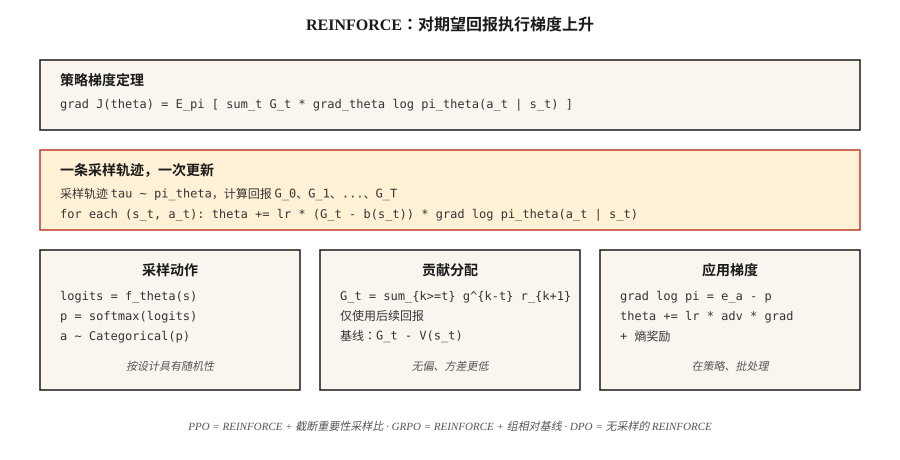

# 策略梯度 —— 从零写 REINFORCE

> 别再估计价值了。直接参数化策略，算出期望回报的梯度，朝上走。Williams（1992）用一个定理写完了它。PPO、GRPO 以及每个 LLM RL 循环之所以存在，都是因为它。

**类型：** Build
**语言：** Python
**前置要求：** Phase 3 · 03（反向传播）、Phase 9 · 03（蒙特卡洛）、Phase 9 · 04（TD 学习）
**预计时间：** ~75 分钟

## 问题背景

Q-learning 和 DQN 参数化的是*价值*函数。你靠 `argmax Q` 来挑动作。对离散动作和离散状态这没问题。但当动作连续时（在 10 维力矩上 `argmax` 哪个？）或者你想要一个随机策略时（`argmax` 天生是确定性的），它就崩了。

策略梯度改为参数化*策略*本身。$\pi_\theta(a \mid s)$ 是一个输出动作分布的神经网络。从中采样来行动。算出期望回报对 $\theta$ 的梯度。朝上走。没有 `argmax`。没有贝尔曼递归。就是在 $J(\theta) = \mathbb E_{\pi_\theta}[G]$ 上做梯度上升。

REINFORCE 定理（Williams 1992）告诉你这个梯度是可计算的：$\nabla J(\theta) = \mathbb E_\pi[ G \cdot \nabla_\theta \log \pi_\theta(a \mid s) ]$。跑一个 episode。算回报。每一步乘上 $\nabla \log \pi_\theta(a \mid s)$。求平均。梯度上升。完事。

2026 年的每个 LLM-RL 算法——PPO、DPO、GRPO——都是 REINFORCE 的精炼。把它练到指尖上，是这一阶段其余内容、以及 Phase 10 · 07（RLHF 实现）和 Phase 10 · 08（DPO）的前置条件。

## 核心概念



**策略梯度定理。** 对任何由 $\theta$ 参数化的策略 $\pi_\theta$：

```math
\nabla J(\theta) = \mathbb{E}_{\tau \sim \pi_\theta}[ \sum_{t=0}^{T} G_t \cdot \nabla_\theta \log \pi_\theta(a_t \mid s_t) ]
```

其中 $G_t = \sum_{k=t}^{T} \gamma^{k-t} r_{k+1}$ 是从第 $t$ 步起的折扣回报。期望是对从 $\pi_\theta$ 采样的完整轨迹 $\tau$ 取的。

**证明很短。** 在期望下对 $J(\theta) = \sum_\tau P(\tau; \theta) G(\tau)$ 求导。用 $\nabla P(\tau; \theta) = P(\tau; \theta) \nabla \log P(\tau; \theta)$（对数导数技巧）。把 $\log P(\tau; \theta) = \sum \log \pi_\theta(a_t \mid s_t) + \text{不依赖 }\theta\text{ 的环境项}$ 因式拆开。环境项消失。两行代数推导就给出了定理。

**方差削减技巧。** 原版 REINFORCE 方差大到要命——回报有噪声，$\nabla \log \pi$ 有噪声，两者乘积噪声极大。两个标准修法：

1. **减基线。** 把 $G_t$ 换成 $G_t - b(s_t)$，其中 $b(s_t)$ 是任何不依赖 $a_t$ 的基线。无偏，因为 $\mathbb{E}[b(s_t) \cdot \nabla \log \pi(a_t \mid s_t)] = 0$。典型选择：由 critic 学到的 $b(s_t) = \hat{V}(s_t)$ → actor-critic（第 07 课）。
2. **reward-to-go。** 把 $\sum_t G_t \cdot \nabla \log \pi_\theta(a_t \mid s_t)$ 换成 $\sum_t G_t^{\text{来自 } t} \cdot \nabla \log \pi_\theta(a_t \mid s_t)$。对一个给定动作，只有未来回报才要紧——过去奖励贡献的是零均值噪声。

合起来，你得到：

```math
\nabla J \approx (1/N) \sum_{i=1}^{N} \sum_{t=0}^{T_i} [ G_t^{(i)} - \hat{V}(s_t^{(i)}) ] \cdot \nabla_\theta \log \pi_\theta(a_t^{(i)} \mid s_t^{(i)})
```

这就是带基线的 REINFORCE——A2C（第 07 课）和 PPO（第 08 课）的直系祖先。

**softmax 策略参数化。** 对离散动作，标准选择：

```math
\pi_\theta(a \mid s) = \exp(f_\theta(s, a)) / \sum_{a'} \exp(f_\theta(s, a'))
```

其中 $f_\theta$ 是任何为每个动作输出一个分数的神经网络。梯度有干净的形式：

```math
\nabla_\theta \log \pi_\theta(a \mid s) = \nabla_\theta f_\theta(s, a) - \sum_{a'} \pi_\theta(a' \mid s) \nabla_\theta f_\theta(s, a')
```

也就是：所采取动作的分数，减去它在策略下的期望值。

**连续动作的高斯策略。** $\pi_\theta(a \mid s) = N(\mu_\theta(s), \sigma_\theta(s))$。$\nabla \log N(a; \mu, \sigma)$ 有闭式解。Phase 9 · 07 的 SAC 要的全部就是这个。

```figure
policy-gradient-landscape
```

## 动手构建

### 第 1 步：softmax 策略网络

```python
def policy_logits(theta, state_features):
    return [dot(theta[a], state_features) for a in range(N_ACTIONS)]

def softmax(logits):
    m = max(logits)
    exps = [exp(l - m) for l in logits]
    Z = sum(exps)
    return [e / Z for e in exps]
```

对表格环境用线性策略（每个动作一个权重向量）。对 Atari，换成 CNN，保留 softmax 头。

### 第 2 步：采样与对数概率

```python
def sample_action(probs, rng):
    x = rng.random()
    cum = 0
    for a, p in enumerate(probs):
        cum += p
        if x <= cum:
            return a
    return len(probs) - 1

def log_prob(probs, a):
    return log(probs[a] + 1e-12)
```

### 第 3 步：rollout 并记下 log-prob

```python
def rollout(theta, env, rng, gamma):
    trajectory = []
    s = env.reset()
    while not done:
        logits = policy_logits(theta, s)
        probs = softmax(logits)
        a = sample_action(probs, rng)
        s_next, r, done = env.step(s, a)
        trajectory.append((s, a, r, probs))
        s = s_next
    return trajectory
```

### 第 4 步：REINFORCE 更新

```python
def reinforce_step(theta, trajectory, gamma, lr, baseline=0.0):
    returns = compute_returns(trajectory, gamma)
    for (s, a, _, probs), G in zip(trajectory, returns):
        advantage = G - baseline
        grad_log_pi_a = [-p for p in probs]
        grad_log_pi_a[a] += 1.0
        for i in range(N_ACTIONS):
            for j in range(len(s)):
                theta[i][j] += lr * advantage * grad_log_pi_a[i] * s[j]
```

梯度 $\nabla \log \pi(a \mid s) = e_a - \pi(\cdot \mid s)$（$a$ 的 one-hot 减去概率）是 softmax 策略梯度的核心。把它烙进肌肉记忆。

### 第 5 步：基线

对最近若干 episode 的 $G$ 取滑动均值，这点方差削减就足以让一个 4×4 GridWorld 跑起来；约 500 个 episode 收敛。把基线升级成学到的 $\hat{V}(s)$，你就得到了 actor-critic。

## 注意事项

- **梯度爆炸。** 回报可能很大。乘上 $\nabla \log \pi$ 之前，永远把 $G$ 在 batch 内归一化到 `~N(0, 1)`。
- **熵坍缩。** 策略太早收敛到一个近确定性动作，停止探索，卡住。修法：在目标里加熵奖励 $\beta \cdot H(\pi(\cdot \mid s))$。
- **高方差。** 原版 REINFORCE 需要上千个 episode。critic 基线（第 07 课）或 TRPO/PPO 的信任域（第 08 课）是标准修法。
- **样本低效。** 同策略意味着每条转移更新一次后就扔掉。通过重要性采样做离策略修正能把数据找回来，代价是方差（PPO 的比率就是一个裁剪过的 IS 权重）。
- **非平稳梯度。** 来自 100 个 episode 之前的同一个梯度用的是旧 $\pi$。正因如此，同策略方法每几次 rollout 就更新一次。
- **信用分配。** 不用 reward-to-go，过去奖励就会贡献噪声。永远用 reward-to-go。

## 实际使用

到了 2026 年，REINFORCE 很少被直接跑，但它的梯度公式无处不在：

| 用途 | 衍生方法 |
|----------|---------------|
| 连续控制 | 配高斯策略的 PPO / SAC |
| LLM RLHF | 带 KL 惩罚、在 token 级策略上跑的 PPO |
| LLM 推理（DeepSeek） | GRPO —— 带组相对基线、无 critic 的 REINFORCE |
| 多 agent | 中心化 critic 的 REINFORCE（MADDPG、COMA） |
| 离散动作机器人 | A2C、A3C、PPO |
| 仅有偏好的场景 | DPO —— 把 REINFORCE 改写成偏好似然损失、无需采样 |

当你在 2026 年的训练脚本里读到 `loss = -advantage * log_prob`，那就是带基线的 REINFORCE。整篇整篇的论文（DPO、GRPO、RLOO）都是建立在这一行之上的方差削减技巧。

## 拿去用

存为 `outputs/skill-policy-gradient-trainer.md`：

```markdown
---
name: policy-gradient-trainer
description: Produce a REINFORCE / actor-critic / PPO training config for a given task and diagnose variance issues.
version: 1.0.0
phase: 9
lesson: 6
tags: [rl, policy-gradient, reinforce]
---

Given an environment (discrete / continuous actions, horizon, reward stats), output:

1. Policy head. Softmax (discrete) or Gaussian (continuous) with parameter counts.
2. Baseline. None (vanilla), running mean, learned `V̂(s)`, or A2C critic.
3. Variance controls. Reward-to-go on by default, return normalization, gradient clip value.
4. Entropy bonus. Coefficient β and decay schedule.
5. Batch size. Episodes per update; on-policy data freshness contract.

Refuse REINFORCE-no-baseline on horizons > 500 steps. Refuse continuous-action control with a softmax head. Flag any run with `β = 0` and observed policy entropy < 0.1 as entropy-collapsed.
```

## 练习

1. **简单。** 在 4×4 GridWorld 上用线性 softmax 策略实现 REINFORCE。不带基线训 1000 个 episode。画出学习曲线；测方差（回报的标准差）。
2. **中等。** 加一个滑动均值基线。再训一次。和原版那次对比样本效率和方差。基线把收敛步数减少了多少？
3. **困难。** 加一个熵奖励 $\beta \cdot H(\pi)$。扫 $\beta \in \lbrace 0, 0.01, 0.1, 1.0 \rbrace$。画出最终回报和策略熵。这个任务上的甜点区在哪？

## 关键术语

| 术语 | 大家嘴上怎么说 | 它实际是什么 |
|------|-----------------|-----------------------|
| 策略梯度 | "直接训练策略" | $\nabla J(\theta) = \mathbb{E}[G \cdot \nabla \log \pi_\theta(a \mid s)]$；由对数导数技巧推出。 |
| REINFORCE | "最初的 PG 算法" | Williams（1992）；蒙特卡洛回报乘以对数策略梯度。 |
| 对数导数技巧 | "score function 估计器" | $\nabla P(\tau;\theta) = P(\tau;\theta) \cdot \nabla \log P(\tau;\theta)$；让期望的梯度变得可处理。 |
| 基线 | "方差削减" | 从 $G$ 里减掉的任何 $b(s)$；无偏，因为 $\mathbb{E}[b \cdot \nabla \log \pi] = 0$。 |
| reward-to-go | "只有未来回报算数" | 用 $G_t^{\text{来自 } t}$ 代替完整的 $G_0$；正确且方差更低。 |
| 熵奖励 | "鼓励探索" | $+\beta \cdot H(\pi(\cdot \mid s))$ 项，防止策略坍缩。 |
| 同策略 | "用你刚看到的来训练" | 梯度期望是对当前策略取的——不能直接复用旧数据。 |
| 优势 | "比平均好多少" | $A(s, a) = G(s, a) - V(s)$；带基线 REINFORCE 所乘的那个带符号量。 |

## 延伸阅读

- [Williams (1992). Simple Statistical Gradient-Following Algorithms for Connectionist Reinforcement Learning](https://link.springer.com/article/10.1007/BF00992696) —— 最初的 REINFORCE 论文。
- [Sutton et al. (2000). Policy Gradient Methods for Reinforcement Learning with Function Approximation](https://papers.nips.cc/paper_files/paper/1999/hash/464d828b85b0bed98e80ade0a5c43b0f-Abstract.html) —— 带函数近似的现代策略梯度定理。
- [Sutton & Barto (2018). Ch. 13 — Policy Gradient Methods](http://incompleteideas.net/book/RLbook2020.pdf) —— 教科书呈现。
- [OpenAI Spinning Up — VPG / REINFORCE](https://spinningup.openai.com/en/latest/algorithms/vpg.html) —— 配 PyTorch 代码的清晰教学讲解。
- [Peters & Schaal (2008). Reinforcement Learning of Motor Skills with Policy Gradients](https://homes.cs.washington.edu/~todorov/courses/amath579/reading/PolicyGradient.pdf) —— 方差削减，以及把 REINFORCE 和信任域家族（TRPO、PPO）连起来的自然梯度视角。
