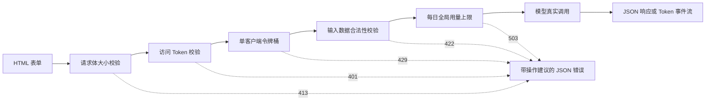

# 模型演示接口 —— 从函数到可分享应用

> 一个模型 Demo 本质上是一份契约：输入、模型调用与输出。在公开分享链接之前，必须为每个组成部分设定严格的边界限制。

**类型：** 构建
**语言：** Python
**前置要求：** 阶段 11 · 第 13 课（构建生产级 LLM 应用）、阶段 17 · 第 08 课（推理指标）、阶段 17 · 第 19 课（AI 网关）
**预计时间：** ~90 分钟

## 学习目标

- 明确界定 Demo 的输入、模型调用与输出契约，并为每个环节施加严格的边界限制。
- 仅依赖 Python 标准库构建包含单 HTML 页面、JSON 接口与 Server-Sent Events（SSE）流式接口的轻量 Web 应用。
- 按计算成本由低到高的顺序执行输入校验，并返回告知用户明确下一步操作的友好 JSON 错误。
- 借助单客户端令牌桶限流、每日全局用量上限与可选访问 Token 保护公开演示链接。
- 规范化请求访问日志，绝不记录用户原始输入文本与明文客户端 IP 地址。
- 将标准库 Demo 与两款主流开源框架进行架构对比，识别 Demo 迈向正式产品化的关键演进信号。

## 问题背景

你的模型在 Jupyter Notebook 里跑得非常完美。现在评审人员想要测试 10 组输入，客户想在手机上亲眼看看效果——但他们谁都不会去打开你的 Notebook。

Notebook 单元格没有任何输入长度限制，也没有实时进度提示。一旦出错，它只会打印一长串除了你谁也看不懂的内部 Python 调用栈（Traceback）。最危险的是，它以你的账号凭证和你的资金预算在运行。如果你直接将这个单元格原封不动地挂在公网链接上，就会遭遇这类灾难场景：

- 用户直接粘贴了一篇 40,000 字的长文档，模型调用卡死整整一分钟后崩溃退出，抛出一大屏调用栈。
- 某个爬虫脚本在一分钟内发起了 500 次请求，每次请求都在真金白银地消耗你的付费 API 额度。
- 页面点击后持续 8 秒毫无动静，用户以为没点上，又连点了四次提交按钮。
- 服务端日志忠实地打印了每一次请求的明文输入，直接泄露了某个客户账单中的敏感账号信息。

一个严谨的 Demo 接口只需极少量的工程代码就能彻底杜绝这些隐患。本课将首先仅使用 Python 标准库带你手写出每一个核心组件，搞清内部运作机制；随后使用两款流行框架构建同等 Demo，对比它们开箱即用的默认行为。

## 核心概念

### Demo 是一份接口契约

任何演示程序都包含三个基本部分：输入是用户可以提交的内容；模型调用将输入转换为输出；输出是用户最终看到的结果（包括各种错误提示）。

在动手编写页面之前，先将这份契约白纸黑字明确下来：

| 契约部分 | 必须解答的问题 | 本课中的具体设定 |
|---|---|---|
| 输入（Input） | 允许什么数据类型、多大尺寸上限、包含哪些字符？ | 长度在 1 到 500 字符之间的文本字符串，严禁包含隐藏控制字符 |
| 模型调用（Model call） | 单次前向耗时多久？消耗多少成本？ | 毫秒内运行完毕、毫无外部 API 成本的玩具关键词模型 |
| 输出（Output） | 成功与失败时用户各自会看到什么？ | 成功时展示分类标签、置信分数与流式文本；失败时下发带修复建议的 JSON 错误 |

Notebook 单元格对这三部分毫无边界约束；而生产级 Demo 对每个环节都设立了防线，且由服务端强制对每一个客户端生效。



所有前置校验必须严格按照**计算成本从低到高**的顺序依次推进。非法请求在首次校验失败处立即被拒，几乎不消耗服务器算力。真正消耗真金白银的模型调用必须排在最后一步。

### 在调用模型之前完成所有校验

浏览器可以在真正发送网络请求前做初步拦截。在前端输入框上添加 `maxlength` 和 `required` 属性能够在不产生网络开销的情况下给守规矩的用户即时反馈。但这些前端校验防君子不防小人，任何第三方客户端都可以脱离浏览器直接向接口发起原始 HTTP 请求，因此服务端必须无条件重复全部校验。

服务端的校验顺序同样遵循成本递增原则：

1. 首先读取 `Content-Length` 请求头。在读取请求体内容之前，直接拒绝超出尺寸上限的超大包体。
2. 解析 JSON 请求体。直接拒绝非合法 JSON 对象的请求。
3. 校验业务字段内容。拒绝空字符串、超长文本以及包含不可见控制字符的内容。
4. 唯有在完全通过上述全部前置校验后，才允许向底层模型分配一次宝贵的调用。

| 未通过的检查项 | HTTP 状态码 | 业务错误码 |
|---|---|---|
| 请求体超出 4,096 字节 | 413 Content Too Large | `body_too_large` |
| 请求体在传输到达声明的 `Content-Length` 之前断流超时 | 408 Request Timeout | `request_timeout` |
| Content-Type 不是 application/json | 415 Unsupported Media Type | `unsupported_media_type` |
| 请求体不是合法的 JSON 对象 | 400 Bad Request | `bad_json` |
| 文本字段缺失、为空、超长或含有控制字符 | 422 Unprocessable Content | `missing_text`, `empty_text`, `text_too_long`, `control_characters` |

RFC 9110 标准对上述状态码及其语义给出了权威定义。

预置示例（Examples）同样是输入契约不可分割的一部分。好示例能直观示范何谓标准合法输入，还能为外部评审者提供一键测试的快捷入口。尽量为每个输出类别各提供至少一个示例（本课 Demo 配备了正面、负面与中性三个示例）。

### 向用户展示模型正在处理

模型前向推理往往需要耗费数秒钟。若缺乏即时反馈，用户根本无法分辨是模型在深度思考还是页面已经卡死崩溃。面对毫无变化的页面，用户往往会重复点击提交按钮，导致服务端成倍承受昂贵的重复调用。

本课的前端页面提供了四层用户反馈：

- 请求发起瞬间立即禁用并置灰提交按钮，防止重复提交。
- 展示耗时秒表计时器，并以 100 毫秒的频率动态刷新。
- 首个 Token 生成并抵达浏览器时，即时展示首字生成时间（TTFT）。
- 请求全部结束时，展示总计耗时。

在[推理指标课程](../../08-inference-metrics-goodput/)中，首字到达延迟（TTFT）是服务端核心指标；而 Demo 页面直接在浏览器端测量并向用户呈现这一指标。

### 以流式（Streaming）形式发送结果

大语言模型是逐个 Token 串行生成输出的。如果服务端非要等待最后一个 Token 生成完毕才统一返回，用户就必须在屏幕前干等完整的生成周期；如果服务端在每个 Token 生成后立即流式推送给前端，用户在首字到达时就能立即开始阅读。

Server-Sent Events（SSE）是实现文本流的标准传输格式，其响应头为 `Content-Type: text/event-stream`。每个事件由若干 `event:` 与 `data:` 行组成，以空行表示单个事件的结束。WHATWG HTML 规范对该协议进行了标准化定义：

```text
event: token
data: {"index":0,"text":"Label:"}

event: token
data: {"index":1,"text":" positive."}

event: done
data: {"label":"positive","score":1.0,"tokens":11}
```

浏览器内置了用于处理 SSE 的 `EventSource` API，但规范限制其只能发起 GET 请求。GET 请求会将用户输入直接拼接在 URL 中，导致各级 Web 反向代理服务器将敏感的用户内容原封不动打印进访问日志。因此本课 Demo 采用标准的 POST 请求与 JSON 请求体，前端通过原生的 `fetch()` 配合 `response.body.getReader()` 直接流式读取网络字节块并自行解析事件帧。

流式传输带来了一个单体 JSON 响应所没有的全新边界：服务端在下发首个 Token 之前就已经向客户端输出了 HTTP 200 状态行。如果模型在流式输出中途突然崩溃报错，HTTP 状态码已无法更改。因此服务端必须在现有的 SSE 流中推送一个结构化的 `error` 事件，由前端脚本将其捕获并渲染为错误卡片。

在[构建生产级 LLM 应用课程](../../../11-llm-engineering/13-production-app/)中，框架帮你封装了 SSE 通信细节；而在本课中，我们将手写每一行协议代码，彻底搞清其底层机制。

### 编写对用户具备指导意义的错误提示

一条优秀的错误消息必须肩负两项使命：清楚说明刚才究竟发生了什么事实，以及明确指引用户下一步该采取什么行动。对于外部非开发人员，晦涩的内部堆栈追踪（Stack Trace）不仅毫无帮助，还会暴露系统内部实现。

本课中的所有错误均遵循统一的 JSON 规范：

```json
{
  "error": {
    "code": "text_too_long",
    "message": "The text has 812 characters. The limit is 500.",
    "hint": "Shorten the text to 500 characters or fewer.",
    "request_id": "a8f3c2b435e3"
  }
}
```

- `code` 是长期稳定的机器可读标识符，便于自动化测试与前端脚本比对。
- `message` 客观陈述事实，并带出关键数值（如实际字符数与上限）。
- `hint` 向用户提供清晰的修复动作指引。
- `request_id` 将用户报告的问题与服务端后台的一条精准日志记录严密关联起来。

RFC 9457 定义了 HTTP API 的问题详情规范（Problem Details）。本课使用其紧凑子集；当跨团队对外暴露通用生产 API 时，推荐严格遵循 RFC 9457。

### 安全分享公开演示链接

一旦生成公网可访问的分享链接，任何人都可能发起请求。必须为每一项潜在风险部署对应的防护措施：

| 风险场景 | 本课 Demo 中的防护措施 | 面向更大规模受众时的演进方案 |
|---|---|---|
| 单客户端高频刷接口滥用 | 单客户端令牌桶限流，返回 429 与 `Retry-After` 标头 | 登录后按用户 UID 进行多级配额流控 |
| 陌生未授权访客随意进入 | 在 `Authorization` 请求头中支持可选访问凭证 Token | 接入企业单点登录（SSO）与身份提供商（IdP） |
| 整体调用预算发生失控击穿 | 每日全局调用量熔断上限，返回 503 与 `Retry-After` | 在模型 API 提供商后台配置硬性消费预警与额度熔断 |
| 异常超长文本或恶意构造输入 | 请求体大小硬性拦截、文本长度截断、控制字符校验 | 在输入与输出两端引入安全合规审查过滤器（Content Moderation） |
| 敏感隐私数据泄露在服务器日志中 | 日志仅保留输入字符长度与加盐哈希后的客户端标识 | 日志数据脱敏、访问审计与自动化生命周期过期清理机制 |

令牌桶算法由两项核心参数控制：**容量（Capacity）**决定了单客户端能够承受的最大瞬时突发请求并发（Burst）；**补充速率（Refill rate）**决定了长期平稳请求频率。每次请求消耗一枚令牌，桶以恒定速率持续自动补充直到上限：

```text
tokens = min(capacity, tokens + refill_rate * seconds_since_last_request)
若 tokens >= 1 则允许请求并扣除 1，否则拒绝请求
```

当令牌耗尽时，服务端直接回复 `429 Too Many Requests`。RFC 6585 标准定义了 429 状态码，并允许服务端附带 `Retry-After` 响应头告知剩余等待秒数。本课 Demo 始终返回精确的等待时间，前端页面读取该标头并在倒计时期间自动置灰禁用提交按钮。

Demo 默认以客户端 IP 作为令牌桶的隔离标识。在反向代理（如 Nginx、Cloudflare）之后，所有外部流量看起来都来自代理服务器的同一个局域网 IP，导致所有用户被迫共享同一个令牌桶。在此类架构下，必须且只能从反向代理服务器自身注入的可信请求头中提取真实客户端 IP，严禁轻信客户端伪造传来的任意请求头。

在 [AI 网关课程](../../19-ai-gateways/)中，网关负责按租户实施细粒度流控。Demo 同样需要这一防护机制：单客户端限流只能防范单个坏家伙，无法控制宏观总量——100 个各自分散但合法的客户端依然能在短时间内把你的全天预算消耗殆尽。因此每日全局使用量上限负责统计当天所有客户端调用的总和，一旦达标便整体熔断。

服务端的访问日志同样必须杜绝隐私泄露。Python 内置的 `http.server` 默认会将客户端明文 IP 和完整请求行打印到标准错误流中，若把输入拼在 URL 里，敏感信息就会落盘留存。本课 Demo 覆写了该日志逻辑：仅记录路由标识、HTTP 状态码、错误代码、响应耗时以及输入字符长度；客户端 IP 统一通过带盐哈希（Keyed Hash）脱敏保存，既能区分不同客户端，又杜绝了明文存储。

同时在前端页面中向用户坦诚声明隐私政策：明确告知服务端仅统计输入字符长度，绝不存储任何用户输入的原始内容。

### 何时应将 Demo 演进为正式产品

Demo 旨在面向熟悉的特定群体提供单进程、短会话的交互验证。当以下信号出现时，说明它已经实质演进为一款真实产品：

- 团队外部人员每周都在高频日常使用它。
- 有人开始向你询问服务高可用目标（SLA/SLO），或在挂掉时主动提单反馈。
- 用户提出需要账号注册登录、保存计算结果，或查阅历史记录。
- 模型调用的账单在公司财务预算中被单独立项。
- 输入数据触及商业合同、法律法规或个人隐私合规要求。

| 架构特性 | 演示应用（Demo） | 正式产品（Product） |
|---|---|---|
| 用户群体 | 熟悉内部成员，短会话即用即走 | 陌生外部用户，日常高频依赖 |
| 状态存储 | 无状态（Stateless） | 账号体系、持久化存储、历史记录、收藏夹 |
| 服务可用性 | 尽力而为（Best effort），单进程单节点 | SLA/SLO 承诺、多副本冗余部署、值班机制 |
| 成本管控 | 单个全局每日使用量硬上限 | 分用户独立配额、用量计费与精细化限额 |
| 可观测性 | 单条脱敏请求摘要日志 | 分布式追踪（Tracing）、全链路指标度量与实时告警 |

一旦出现上述演进信号，务必将 Demo 迁移升级至生产级 LLM 应用课程所介绍的正规生产技术栈，引入严格的身份鉴权、自动灾备降级、链路追踪与分用户成本归集。

```figure
demo-token-bucket
```

## 动手构建

全部核心代码收敛在单个文件 `code/main.py` 中，零第三方依赖，纯标准库实现。首先运行其自带的自检单元测试：

```bash
python3 phases/17-infrastructure-and-production/29-model-demo-interfaces/code/main.py
```

该自检测试会全面覆盖输入校验器、令牌桶限流算法、SSE 事件流封装以及一次完整的 HTTP 网络回环交互。测试会自动在随机闲置端口启动临时服务、发送三组网络请求、安全退出服务并输出验证报告。当需要启动常驻服务供浏览器访问时，添加 `--serve` 参数：

```bash
python3 phases/17-infrastructure-and-production/29-model-demo-interfaces/code/main.py --serve
```

在浏览器中打开 `http://127.0.0.1:8000`，按 Ctrl+C 可停止运行。

### 第 1 步：模型前向调用抽象

本课构建了一个基于关键词统计的情感极性玩具模型。它将文本标记为正面、负面或中性，并模拟大模型以生成器的方式逐个 Token 产出自然语言解释文本。

```python
def classify(text):
    words = WORD_RE.findall(text.lower())
    positive = sum(1 for word in words if word in POSITIVE)
    negative = sum(1 for word in words if word in NEGATIVE)
    score = (positive - negative) / max(1, positive + negative)
    if score > 0:
        label = "positive"
    elif score < 0:
        label = "negative"
    else:
        label = "neutral"
    return {"label": label, "score": round(score, 3), "positive_cues": positive,
            "negative_cues": negative, "words": len(words)}


def generate(text):
    result = classify(text)
    reply = (
        f"Label: {result['label']}. Positive cues: {result['positive_cues']}. "
        f"Negative cues: {result['negative_cues']}. Words read: {result['words']}."
    )
    parts = reply.split(" ")
    yield parts[0]
    for part in parts[1:]:
        yield " " + part
```

在真实工程落地中，只需将 `generate` 内部替换为真实的云厂商 API 流式调用或本地大模型即可。保持相同的函数签名：接收字符串输入，逐个产出 Token 文本。上层的输入校验器、流控限额与前端交互无需任何改动。

### 第 2 步：校验器与结构化异常处理

自定义异常类 `DemoError` 统一承载所有业务异常，包含 HTTP 状态码、固定错误代码、事实说明、行动建议以及可选的响应头。

```python
class DemoError(Exception):
    def __init__(self, status, code, message, hint, headers=None):
        super().__init__(message)
        self.status = status
        self.code = code
        self.message = message
        self.hint = hint
        self.headers = dict(headers or {})


def validate_text(payload, max_chars=MAX_CHARS):
    if "text" not in payload:
        raise DemoError(422, "missing_text", 'The field "text" is missing.', 'Add a "text" field with your input.')
    text = payload["text"]
    if not isinstance(text, str):
        raise DemoError(422, "text_not_string", 'The field "text" is not a string.', "Send the input as a string.")
    text = text.strip()
    if not text:
        raise DemoError(422, "empty_text", "The text is empty.", "Type a sentence or pick an example.")
    if len(text) > max_chars:
        raise DemoError(422, "text_too_long", f"The text has {len(text)} characters. The limit is {max_chars}.",
                        f"Shorten the text to {max_chars} characters or fewer.")
    if CONTROL_RE.search(text):
        raise DemoError(422, "control_characters", "The text contains control characters.",
                        "Remove the hidden characters, then send the text again.")
    return text
```

校验器首先对字符串去除两端空白字符。纯空格字符串会被当场判定为空并被拦截，错误提示会明确指引用户输入有效句子。`check_body_size` 与 `parse_json_body` 同样遵循这一规范处理 411、413、415 与 400 异常。`error_body` 负责将任何 `DemoError` 序列化为规范的 JSON 结构。

### 第 3 步：令牌桶限流实现

```python
class TokenBucket:
    def __init__(self, capacity, refill_per_second, now):
        if capacity < 1:
            raise ValueError("capacity must be at least 1")
        if refill_per_second <= 0:
            raise ValueError("refill_per_second must be positive")
        self.capacity = float(capacity)
        self.refill_per_second = float(refill_per_second)
        self.tokens = float(capacity)
        self.updated = now

    def take(self, now, cost=1.0):
        elapsed = max(0.0, now - self.updated)
        self.tokens = min(self.capacity, self.tokens + elapsed * self.refill_per_second)
        self.updated = now
        if self.tokens >= cost:
            self.tokens -= cost
            return 0.0
        return (cost - self.tokens) / self.refill_per_second
```

`take` 在允许请求时返回 0.0；若令牌不足，则计算并返回距离恢复足够令牌所需的精确秒数。服务端向上取整该数值并通过 `Retry-After` 响应头下发。

`RateLimiter` 在线程安全的 `OrderedDict` 中按客户端维护各自的令牌桶（`ThreadingHTTPServer` 为每个请求分配独立线程）。当客户端数量超出容量上限时，采用 LRU 淘汰策略清理最久未访问的记录。`UsageCap` 采用相同的时钟抽象维护全天 86,400 秒的全局调用额度计数。

### 第 4 步：事件流封装

```python
def sse_event(event, data):
    payload = json.dumps(data, separators=(",", ":"), ensure_ascii=False)
    return f"event: {event}\ndata: {payload}\n\n".encode("utf-8")


def stream_events(text, generate_fn=generate, delay=0.0, sleep=time.sleep):
    count = 0
    try:
        for token in generate_fn(text):
            yield sse_event("token", {"index": count, "text": token})
            count += 1
            if delay:
                sleep(delay)
    except Exception:
        yield sse_event("error", MODEL_ERROR)
        return
    result = classify(text)
    yield sse_event("done", {"label": result["label"], "score": result["score"], "tokens": count})
```

`json.dumps` 自动将字符串内部的真实换行符转义为 `\n`，保证每条事件帧内部绝不出现破坏 SSE 协议格式的裸换行。生成器内部主动捕获模型异常，在必要时向流中注入 `error` 事件。

### 第 5 步：请求处理器

`DemoHandler` 继承自标准库的 `BaseHTTPRequestHandler`。POST 处理器严格按安全成本由低到高执行各项防线：

```python
def do_POST(self):
    app = self.server.app
    request_id = uuid.uuid4().hex[:12]
    client_id = self.client_address[0]
    started = time.perf_counter()
    route = self.path if self.path in self.routes else "other"
    status, code, chars = 200, None, 0
    try:
        declared = self.headers.get("Content-Length")
        try:
            if route == "other":
                raise DemoError(404, "not_found", "This endpoint does not exist.",
                                "Send requests to /api/predict or /api/stream.")
            size = check_body_size(declared, app.config.max_body_bytes)
        except DemoError:
            self.drain(int(declared) if declared and declared.isdigit() else 0)
            raise
        try:
            body = self.rfile.read(size)
        except TimeoutError:
            self.close_connection = True
            raise DemoError(408, "request_timeout", "The request body did not arrive in time.",
                            "Send the request again with the full body.") from None
        app.admit(client_id, self.headers.get("Authorization"))
        text = app.read_text(self.headers.get("Content-Type"), body)
        chars = len(text)
        app.charge()
        if route == "/api/predict":
            self.send_json(200, predict(text), request_id)
        else:
            code = self.send_stream(text, request_id)
    except DemoError as err:
        status, code = err.status, err.code
        self.send_error_json(err, request_id)
    except TimeoutError:
        status, code = 408, "request_timeout"
        self.close_connection = True
    except Exception:
        status, code = 500, "internal_error"
        self.send_error_json(DemoError(500, "internal_error", "The server failed on this request.",
                                       "Try again. Quote the request id if you report the problem."), request_id)
    finally:
        latency_ms = (time.perf_counter() - started) * 1000
        app.log.record(request_id, route, client_id, status, chars, latency_ms, code)
```

`admit` 校验访问 Token 和单客户端令牌桶，`charge` 扣减每日全局配额（排在校验之后，确保只有合法请求才计入成本）。四处关键的工程防御细节：

- 处理器类上配置了 `timeout = 10`。若客户端声明发送 100 字节却只发了 10 字节就挂起，服务端会在 10 秒后强制超时释放线程，杜绝慢速连接攻击（Slowloris）。
- 覆写了 `log_message` 方法，彻底消除默认包含明文 IP 和请求行的日志输出。
- `drain` 方法在拒绝超大包体时主动读空并丢弃前 64 KiB 字节。RFC 1122 说明：若服务端在 TCP 缓冲区尚有未读数据时直接掐断连接，TCP 会向客户端发送 RST 复位包，导致客户端可能收不到服务端的 413 响应体。
- `send_stream` 捕获了 `BrokenPipeError` 并在用户中途关闭浏览器标签页时立即主动中止生成器执行，杜绝为已经关闭的客户端继续白白空耗模型算力。

### 第 6 步：前端页面与安全策略

`render_page` 返回单体 HTML 文档，样式与交互脚本全内联，不引入任何外部 CDN 资源。前端读取流的核心逻辑如下：

```javascript
const reader = response.body.getReader();
const decoder = new TextDecoder();
let buffer = "";
while (true) {
  const chunk = await reader.read();
  if (chunk.done) { break; }
  buffer += decoder.decode(chunk.value, { stream: true });
  let cut = buffer.indexOf("\n\n");
  while (cut >= 0) {
    const frame = parseFrame(buffer.slice(0, cut));
    buffer = buffer.slice(cut + 2);
    cut = buffer.indexOf("\n\n");
    if (frame.event === "token") { output.textContent += frame.data.text; }
  }
}
```

网络数据包可能会在某个事件帧的中间截断。解析器在 `buffer` 中缓冲未完成的部分，直到遇到双换行分隔符才进行解帧。

页面对模型输出严格使用 `textContent` 赋值，严禁使用 `innerHTML`。大模型的输出属于不可信输入，若将模型返回的字符串以 HTML 形式插入页面，包含恶意脚本或 `onerror` 的输入将直接在访问者浏览器中触发跨站脚本攻击（XSS）。

服务端同时下发带 SHA-256 哈希校验的 `Content-Security-Policy: default-src 'none'` 响应头，浏览器会断然拒绝执行任何未经授权注入的恶意外部脚本：

```python
def csp_hash(source):
    digest = hashlib.sha256(source.encode("utf-8")).digest()
    return "'sha256-" + base64.b64encode(digest).decode("ascii") + "'"
```

### 第 7 步：实战演练与破坏性测试

启动服务，在另一个终端窗口中利用 `curl` 发送连续 7 次请求。初始令牌桶容量为 5，每 2 秒补充 1 枚：

```bash
for i in 1 2 3 4 5 6 7; do
  curl -s -o /dev/null -w '%{http_code} ' -X POST http://127.0.0.1:8000/api/predict \
    -H 'Content-Type: application/json' -d '{"text": "ok"}'
done
```

```text
200 200 200 200 200 429 429
```

等待 10 秒后发送空文本测试：

```bash
curl -s -X POST http://127.0.0.1:8000/api/predict \
  -H 'Content-Type: application/json' -d '{"text": ""}'
```

```json
{"error": {"code": "empty_text", "message": "The text is empty.", "hint": "Type a sentence or pick an example.", "request_id": "e3e3599feaea"}}
```

使用 `curl -N`（禁用输出缓冲）直观查阅 SSE 事件流：

```bash
curl -N -X POST http://127.0.0.1:8000/api/stream \
  -H 'Content-Type: application/json' -d '{"text": "The screen is bright."}'
```

如需强制启用访问密码保护，在启动服务前注入环境变量 `DEMO_ACCESS_TOKEN`：

```bash
export DEMO_ACCESS_TOKEN="$(python3 -c 'import secrets; print(secrets.token_urlsafe(24))')"
echo "$DEMO_ACCESS_TOKEN"
python3 phases/17-infrastructure-and-production/29-model-demo-interfaces/code/main.py --serve
```

运行完整自动化单测：

```bash
python3 -m unittest discover -s phases/17-infrastructure-and-production/29-model-demo-interfaces/code/tests -v
```

测试用例自动在端口 0 绑定由操作系统动态分配的闲置端口，并在 `tearDown` 中优雅清理释放线程。

## 实际使用

Gradio 与 Streamlit 是两款在开源社区极其普及的 Python 演示界面框架。以下代码示例直接复用本课 `main.py` 中的校验逻辑与模型契约：

### 函数组件驱动：Gradio

Gradio 围绕单一 Python 函数构建 Web 交互界面：

```python
import os

import gradio as gr

from main import EXAMPLES, MAX_CHARS, DemoError, classify, generate, validate_text


def label_text(text):
    try:
        clean = validate_text({"text": text})
    except DemoError as err:
        raise gr.Error(f"{err.message} {err.hint}")
    label = classify(clean)["label"]
    reply = ""
    for token in generate(clean):
        reply += token
        yield reply, label


demo = gr.Interface(
    fn=label_text,
    inputs=gr.Textbox(label="Text to label", lines=5, max_length=MAX_CHARS),
    outputs=[gr.Textbox(label="Reply"), gr.Textbox(label="Label")],
    examples=list(EXAMPLES),
    flagging_mode="never",
)

if __name__ == "__main__":
    demo.queue(max_size=20).launch(auth=("demo", os.environ["DEMO_PASSWORD"]))
```

在公网分享链接前务必显式设置 `flagging_mode="never"`。Gradio 默认会在界面展示“标错（Flag）”按钮，一旦用户点击，框架会自动将该次输入与输出明文追加保存到服务器本地的 CSV 文件中，容易带来隐私合规隐患。

`queue(max_size=20)` 限制了并发等待队列的深度。Gradio 在启动时还会默认暴露底层 HTTP API 接口，你的限流策略同样需要覆盖这些派生路由。

### 脚本全量重跑模式：Streamlit

Streamlit 在用户每次改动任何组件时都会从头到尾完整重新执行整个 Python 脚本：

```python
import streamlit as st

from main import EXAMPLES, MAX_CHARS, DemoError, classify, generate, validate_text

st.title("Toy sentiment demo")
st.caption("Do not paste private data.")

example = st.selectbox("Start from an example", ["", *EXAMPLES])
with st.form("demo"):
    text = st.text_area("Text to label", value=example, max_chars=MAX_CHARS)
    submitted = st.form_submit_button("Run model")

if submitted:
    try:
        clean = validate_text({"text": text})
    except DemoError as err:
        st.error(f"{err.message} {err.hint}")
    else:
        st.write_stream(generate(clean))
        st.write(f"Label: {classify(clean)['label']}")
```

`st.write_stream` 原生接收生成器并在每个文本块到达时即时流式渲染。真实大模型务必使用 `@st.cache_resource` 装饰器进行缓存，避免在脚本每次重跑时重复加载沉重的模型权重。

### 核心能力对照

| 需求特性 | Python 标准库原生实现（本课） | Gradio | Streamlit |
|---|---|---|---|
| 表单、示例与结果卡片 | 手写原生语义化 HTML | `Interface` 依据组件声明自动渲染 | `st.text_area`、`st.selectbox` 等组件 |
| 输入长度硬性截断 | 前端 `maxlength` 加服务端严格双校验 | `Textbox(max_length=...)` | `st.text_area(max_chars=...)` |
| 流式渐进式输出 | 手写 SSE 编码器与前端 Reader 管道 | 生成器函数逐次 yield | `st.write_stream` 消费生成器 |
| 实时进度指示 | 纯前端每 100ms 驱动的秒表计时器 | 组件自带的进度动画指示 | `st.write_stream` 实时流式伴随指示 |
| 面向用户的清晰错误信息 | 带 `code`、`message`、`hint` 的统一 JSON | `raise gr.Error(...)` 弹窗展示 | `st.error(...)` 卡片展示 |
| 请求并发与队列 | 每连接独立线程并发，带总容量保护 | 内置异步队列，默认单事件串行执行 | 每次交互触发脚本在独立会话中全量重跑 |
| 公网分享 | 挂载到指定端口与反向代理域名 | `launch(share=True)` 生成公网穿透链接 | 部署到服务器或 Streamlit Cloud |
| 访问鉴权 | 自带 Bearer Token 校验头拦截 | `launch(auth=...)` 内置账号密码对话框 | `st.login()` 接入标准 OIDC 协议 |
| 单客户端限流与全局预算熔断 | 内置令牌桶与每日全局使用量熔断器 | 需自行编码实现 | 需自行编码实现 |
| 用户输入在磁盘落盘留存 | **坚决不落盘**，访问日志仅保留输入长度 | 默认保存标错样本（除非 `never`） | 由开发者业务代码全权控制 |

主流第三方框架极大地简化了前端页面与 UI 组件的搭建成本，但在公网安全、精细化限流、成本熔断与日志脱敏隐私保护方面，工程兜底的责任依然完全由开发者承担。搞清标准库的原生实现，能让你在面对任何上层框架时都能清晰知道应当核查哪些关键安全防线。

## 拿去用

本课交付的产物为 `outputs/skill-demo-interface-checklist.md`。向其提供一份模型 Demo 的技术描述或实现源码，它会依照接口契约、用户反馈、错误处理、公开链接防护和隐私日志等维度输出逐项通过性审查报告，并对不合格项给出具体的针对性修复指南。

## 练习

1. 将 `BUCKET_CAPACITY` 调整为 2，`REFILL_PER_SECOND` 调整为 1。推导此前 7 次请求循环的输出状态码序列，随后实际运行比对验证。
2. 在请求体中新增 `language` 字段，且仅放行 `"en"`。若收到其他值，返回带操作提示的 422 错误，并补充编写两项单元测试。
3. 构造一个能让本课玩具模型发生错误分类的句子（例如 "The screen is not good."），将其添加为页面的第 4 个内置示例，并在页面补充说明模型的误判原因。
4. 将该 Demo 挂载在本地 Nginx 反向代理之后，新增 `trust_proxy` 配置项使其仅从可信代理地址读取 `X-Forwarded-For` 请求头，并编写测试证明外部客户端无法伪造自身的限流桶 Key。
5. 将 `generate` 替换为真实的云厂商大模型流式调用。保持校验器、限流器和 SSE 事件流格式不变，比对页面测得的首字到达时间与服务端后台记录的端到端延迟。

## 关键术语

| 术语 | 常见说法 | 实际含义 |
|---|---|---|
| Demo 契约（Contract） | "前后台接口约定" | 输入类型与大小限制、模型调用预期及包含错误在内的输出规范 |
| 令牌桶（Token bucket） | "限流算法" | 以恒定速率补充至固定容量的单客户端计数器，每次请求消耗一枚令牌 |
| Retry-After | "稍后再试" | HTTP 429 或 503 响应头，指示客户端必须等待多少秒后才允许发起重试 |
| Server-Sent Events | "SSE 流式传输" | 基于 `text/event-stream` 格式的单向长连接传输协议，以双换行分隔各事件帧 |
| 首字生成时间（TTFT） | "首字延迟" | 从客户端请求发出到首个 Token 渲染在屏幕上所经历的时间跨度 |
| 使用量上限（Usage cap） | "熔断预算" | 在特定时间窗口内面向全部客户端总和设定的模型调用次数/成本绝对上限 |
| 带盐哈希（Keyed hash） | "假名化脱敏 ID" | 引入服务端保密 Salt 的 HMAC 散列，既能统计客户端独立频次又杜绝明文存储敏感 IP |
| 内容安全策略（CSP） | "浏览器防护头" | 指示浏览器仅允许执行指定白名单或哈希匹配的脚本与样式资源的 HTTP 响应头 |

## 延伸阅读

- [Python http.server 官方文档](https://docs.python.org/3/library/http.server.html)：基础服务器类、HTTP/1.0 协议默认行为及官方安全说明
- [WHATWG HTML 标准：Server-Sent Events](https://html.spec.whatwg.org/multipage/server-sent-events.html)：事件流报文标准格式与前端规范
- [MDN：使用 Server-Sent Events](https://developer.mozilla.org/en-US/docs/Web/API/Server-sent_events/Using_server-sent_events)：SSE 事件流协议与浏览器端通信实战
- [MDN：使用 Readable Streams](https://developer.mozilla.org/en-US/docs/Web/API/Streams_API/Using_readable_streams)：如何利用底层 Reader 逐块消费 `fetch()` 响应体
- [MDN：429 Too Many Requests 与 Retry-After](https://developer.mozilla.org/en-US/docs/Web/HTTP/Reference/Status/429)：标准限流状态码与重试等待标头规范
- [MDN：内容安全策略（CSP）指南](https://developer.mozilla.org/en-US/docs/Web/HTTP/Guides/CSP)：内联脚本哈希校验与 `default-src` 权限收敛
- [RFC 6585](https://www.rfc-editor.org/rfc/rfc6585.html)：补充 HTTP 状态码规范（包含 429 限流定义）
- [RFC 9110](https://www.rfc-editor.org/rfc/rfc9110.html)：HTTP 核心语义规范（包含 413、415 与 422 状态码）
- [RFC 9457](https://www.rfc-editor.org/rfc/rfc9457.html)：HTTP API 的标准问题详情（Problem Details）JSON 格式定义
- [RFC 1122](https://www.rfc-editor.org/rfc/rfc1122.html)：互联网主机通信规范（第 4.2.2.13 节：未读数据关闭连接触发 TCP RST 机制）
- [Gradio 官方文档：应用分享与鉴权](https://gradio.app/guides/sharing-your-app)：临时穿透链接、密码保护与 API 路由限流
- [Streamlit 官方文档：架构理念与组件缓存](https://docs.streamlit.io/get-started/fundamentals/main-concepts)：重跑执行流机制、`st.write_stream` 流式传输与模型缓存
